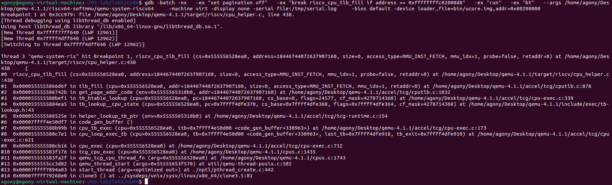
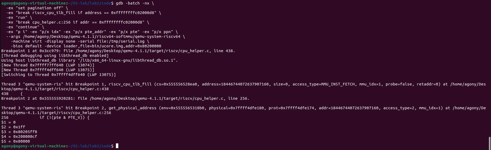
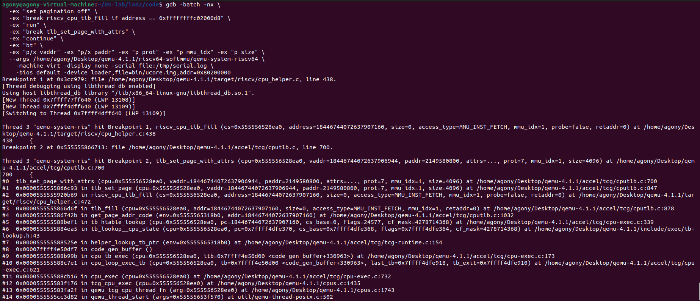
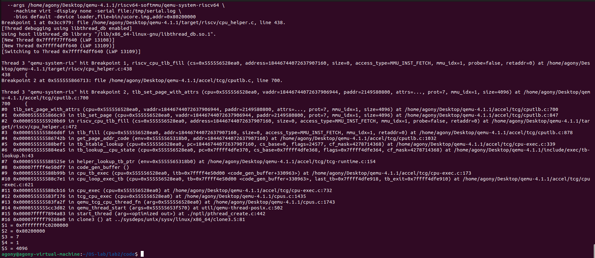
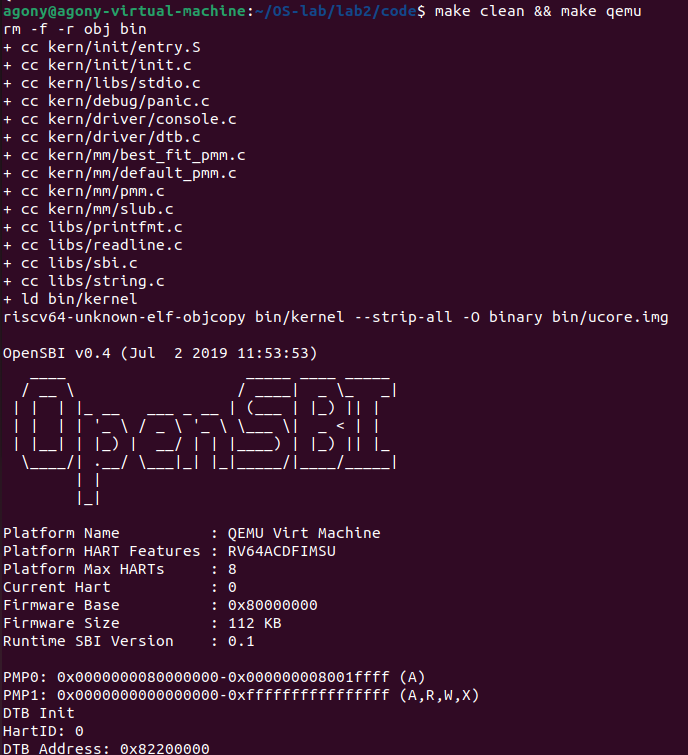
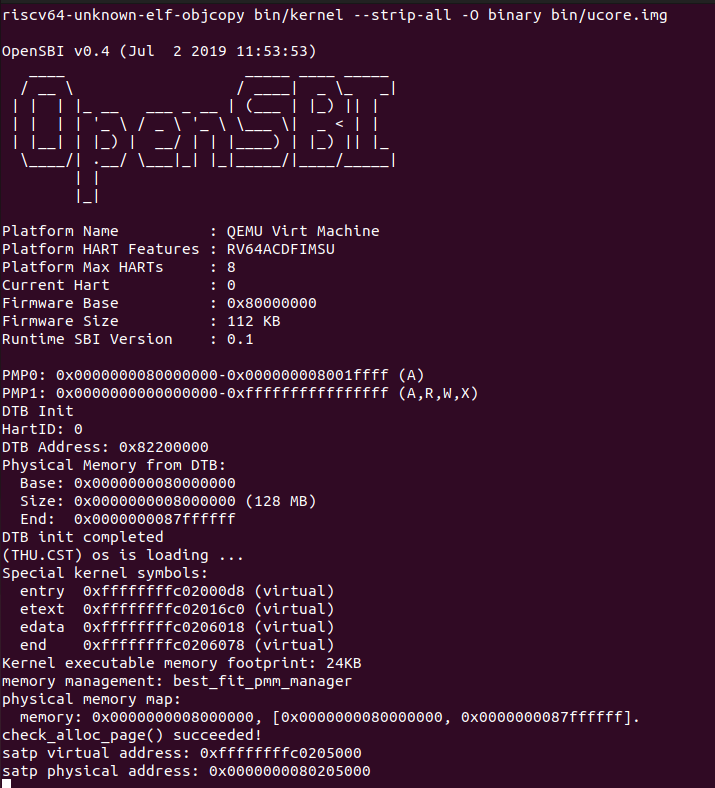
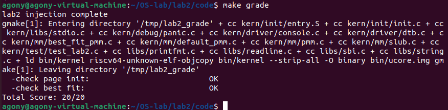
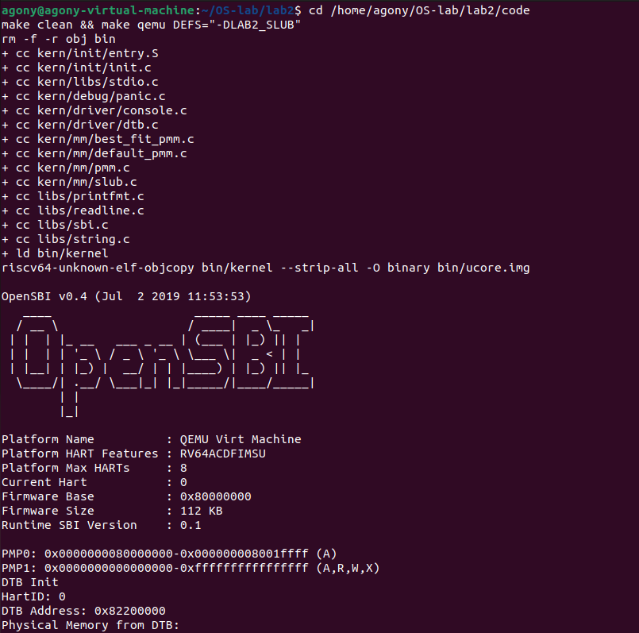
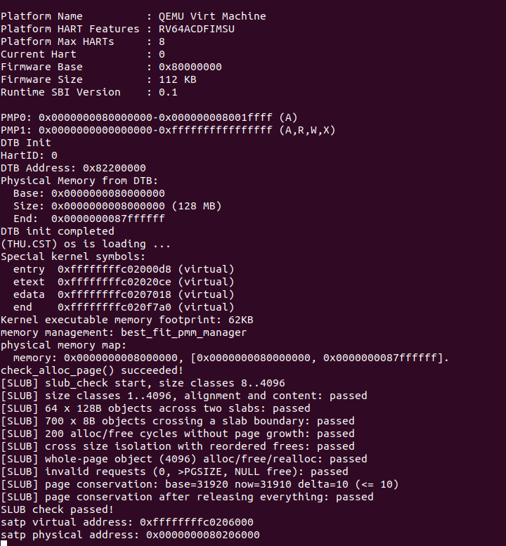

# 操作系统实验报告

## 实验基本信息

| 项目 | 内容 |
|------|------|
| **实验名称** | Lab2：物理内存和页表 |
| **小组成员** | [学号-姓名]、[学号-姓名]、[学号-姓名] |
| **完成日期** | 2026-10-21 |

### 小组分工

| 成员 | 负责的练习/模块 |
|------|----------------|
| [学号-姓名]（A） | `page_init`；First-Fit 理解；Best-Fit；Challenge 硬件内存范围；GDB 分支任务丙（TLB 差异）；集成与报告 |
| [学号-姓名]（B） | Buddy System；GDB 分支任务甲（调用路径与页表遍历）；总结·对操作系统的理解 |
| [学号-姓名]（C） | **Challenge SLUB（任意大小内存分配）**；**GDB 分支任务乙（TLB 查找代码）**；总结·AI 协作经验 |

---

## 一、实验目的

（由成员 A 撰写）

---

## 二、实验环境

| 成员 | AI 编程工具 | 底层模型 | 备注 |
|------|------------|---------|------|
| [学号-姓名]（A） | | | |
| [学号-姓名]（B） | | | |
| [学号-姓名]（C） | | | |

---

## 三、实验整体逻辑分析

### 3.1 本章节的逻辑主线

（由成员 A 撰写）

### 3.2 功能的逐步实现

（由成员 A 撰写）

---

## 四、实验内容与实现

### 功能模块：物理内存初始化 `page_init()`

（由成员 A 撰写）

---

### 练习：理解 First-Fit 连续物理内存分配算法

（由成员 A 撰写）

---

### 功能模块：Best-Fit 连续物理内存分配

（由成员 A 撰写）

---

### 功能模块：Buddy System（伙伴系统）

（由成员 B 撰写）

---

### 练习：GDB 调试 QEMU

#### 甲部分：调用路径与页表遍历（成员 B）

（由成员 B 撰写）

---

#### 乙部分：TLB 查找代码（成员 C）

**负责人：** [学号-姓名]（C）

##### 1. 结论先行

QEMU 4.1.1 里的"TLB"是**软件 TLB**（softmmu 的 `CPUTLBEntry` 表），不是硬件单元：

- **命中**时没有任何 C 函数被调用——TLB 比较被 TCG **编译进宿主机指令**里，由生成的代码内联完成；
- **未命中**时才回到 C：`tlb_fill()` → `riscv_cpu_tlb_fill()` → `get_physical_address()`（页表遍历），翻译成功后由 `tlb_set_page()` 把新映射**回填**进 TLB 表项。

##### 2. 关键代码定位（qemu-4.1.1 源码树）

| 环节 | 文件 / 函数（行号） | 作用 |
|---|---|---|
| 取指查 TLB | `accel/tcg/cputlb.c:1032` `get_page_addr_code()` | 取指时由虚拟地址求宿主机地址，查软件 TLB |
| TLB miss 入口 | `accel/tcg/cputlb.c:868` `tlb_fill()`；`:878` 调用 `cc->tlb_fill(...)` | 通用 miss 处理，转到架构回调 |
| RISC-V 回调 | `target/riscv/cpu_helper.c:435` `riscv_cpu_tlb_fill()` | 真正做地址翻译 |
| 页表遍历 | `target/riscv/cpu_helper.c:155` `get_physical_address()`；循环 237–262 行 | `ldq_phys` 读 PTE、判 `PTE_V` |
| TLB 回填 | `target/riscv/cpu_helper.c:472` `tlb_set_page()` → `accel/tcg/cputlb.c:843/697` `tlb_set_page_with_attrs()` | 写入 TLB 表项 |
| TLB 命中判定（C 描述） | `accel/tcg/cputlb.c:383` `tlb_hit_page_anyprot()`；`:386-388` | 对表项 `addr_read/addr_write/addr_code` 做页比较 |
| 命中路径的代码生成 | `tcg/i386/tcg-target.inc.c:2101` `tcg_out_qemu_ld()` | 在 x86 宿主机上生成内联 TLB 比较+访存代码 |

##### 3. 实测一：TLB 未命中 → 回落到页表遍历

断点（条件断点，避免每次翻译都停）：

```
(gdb) break riscv_cpu_tlb_fill if address == 0xffffffffc02000d8
```

`0xffffffffc02000d8` 是 `kern_init` 的虚拟地址（`obj/kernel.sym`）。命中后的调用栈：

```
#0  riscv_cpu_tlb_fill (address=0xffffffffc02000d8, access_type=MMU_INST_FETCH, mmu_idx=1)
        target/riscv/cpu_helper.c:438
#1  tlb_fill (addr=0xffffffffc02000d8, access_type=MMU_INST_FETCH, mmu_idx=1)
        accel/tcg/cputlb.c:878
#2  get_page_addr_code (addr=0xffffffffc02000d8)
        accel/tcg/cputlb.c:1032
#3  tb_htable_lookup (pc=0xffffffffc02000d8, ...)
        accel/tcg/cpu-exec.c:339
#4  tb_lookup__cpu_state (...)
        include/exec/tb-lookup.h:43
#5  helper_lookup_tb_ptr (...)
        accel/tcg/tcg-runtime.c:154
#6  code_gen_buffer ()
#7  cpu_tb_exec (...)
        accel/tcg/cpu-exec.c:173
```

解读：取指时先查**翻译块缓存（TB）**，没有对应 TB 就调用 `get_page_addr_code()` 获取宿主机地址；这一步要查软件 TLB，未命中于是进入 `tlb_fill()`，再由 `cc->tlb_fill` 分发到 RISC-V 的 `riscv_cpu_tlb_fill()`。



##### 4. 实测二：页表遍历（Sv39，只走了一级）

在 `get_physical_address()` 的 PTE 读取之后（`cpu_helper.c:256`）设条件断点：

```
(gdb) break cpu_helper.c:256 if addr == 0xffffffffc02000d8
```

命中后的局部变量：

| 变量 | 值 | 含义 |
|---|---|---|
| `i` | `0` | 页表遍历层级（第 0 级） |
| `idx` | `0x1ff` | `VPN[2]`（虚拟地址 38:30 位）= 511 |
| `pte_addr` | `0x80205ff8` | `boot_page_table_sv39`（`0x80205000`）+ 511×8 |
| `pte` | `0x200000cf` | PPN=`0x80000`，`V\|R\|W\|X\|A\|D=1`，是叶子 PTE |
| `ppn` | `0x80000` | 物理页帧号 |

物理地址 = `0x80000 << 12 + 0x2000d8 = 0x802000d8`，与 `kern_init` 的物理地址一致。

**为什么只走一级**：`entry.S` 的启动页表 `boot_page_table_sv39` 只填了最后一个表项（`.zero 8*511` + 一个 gigapage 表项），把 `0xffffffffc0000000` 起的 1GB 映射到 `0x80000000`，属于**一级 gigapage**，所以第 0 级就命中叶子并直接返回 `TRANSLATE_SUCCESS`，不存在走三级的情况。



##### 5. 实测三：TLB 回填

```
(gdb) break tlb_set_page_with_attrs
```

命中结果：

```
#0  tlb_set_page_with_attrs (vaddr=0xffffffffc0200000, paddr=0x80200000,
                             prot=7, mmu_idx=1, size=4096)
        accel/tcg/cputlb.c:700
#1  tlb_set_page (vaddr=0xffffffffc0200000, paddr=0x80200000, prot=7, mmu_idx=1, size=4096)
        accel/tcg/cputlb.c:847
#2  riscv_cpu_tlb_fill (address=0xffffffffc02000d8, ...)
        target/riscv/cpu_helper.c:472
#3  tlb_fill (...)
        accel/tcg/cputlb.c:878
#4  get_page_addr_code (...)
        accel/tcg/cputlb.c:1032
```

解读：

- `vaddr = 0xffffffffc0200000`：页对齐后的虚拟地址（`kern_init` 所在页基址）；
- `paddr = 0x80200000`：对应物理页基址；
- `prot = 7`：`PAGE_READ|PAGE_WRITE|PAGE_EXEC` 全开；
- `mmu_idx = 1`：S 模式（内核态）地址空间；
- `size = 4096`：TLB 表项粒度是一页——**即使 PTE 是 1GB 大页，QEMU 的 TLB 表项仍按 4KB 页记录**。





##### 6. TLB 命中路径

回填之后，同一页的再次访问不会进入任何 C 函数：命中判断由 `tcg/i386/tcg-target.inc.c:2101` 的 `tcg_out_qemu_ld()/tcg_out_qemu_st()` 在生成宿主机代码时内联展开，直接比较 `CPUTLBEntry.addr_read/addr_write/addr_code`，命中则直接访存。

`accel/tcg/cputlb.c:383` 的 `tlb_hit_page_anyprot()` 是这段内联比较逻辑的 C 等价描述：

```c
static inline bool tlb_hit_page_anyprot(CPUTLBEntry *tlb_entry,
                                        target_ulong page)
{
    return tlb_hit_page(tlb_entry->addr_read, page) ||
           tlb_hit_page(tlb_addr_write(tlb_entry), page) ||
           tlb_hit_page(tlb_entry->addr_code, page);
}
```

因此"QEMU 查找 TLB 的 C 代码"要分两部分理解：**表项结构与比较判定**在 `cputlb.c`，**真正的查找动作**被编译进了 TCG 生成的宿主机指令流。

##### 7. 调试中值得记录的细节

1. **1GB 大页导致只走一级**：启动页表用 gigapage，`get_physical_address()` 第 0 级就返回，所以"三级页表遍历"在这个地址上只看得到一次循环。
2. **断在函数入口取不到局部变量**：在 `riscv_cpu_tlb_fill` 入口（438 行）打印 `env->sptbr` 得到的是垃圾值（`0x5f646165725f7563`），因为函数体还没执行赋值；改为断在 `cpu_helper.c:256`（PTE 已读出）后才能拿到 `idx/pte/ppn`。
3. **取指与数据访存都走 `tlb_fill`**：取指路径是 `get_page_addr_code()` 进来的，数据访存取指路径由 `tlb_fill()` 的其他调用点进入，最终都会落到 `riscv_cpu_tlb_fill()`。
4. **TLB 表项粒度是 4KB**：`tlb_set_page_with_attrs(..., size=4096)`，与 PTE 的 1GB 大页无关。

##### 8. 复现命令

```bash
# 1) 生成 bin/ucore.img
cd /home/agony/OS-lab/lab2
make -j$(nproc)

# 2) 断在 TLB miss + 页表遍历
gdb -batch -nx \
  -ex "set pagination off" \
  -ex "break riscv_cpu_tlb_fill if address == 0xffffffffc02000d8" \
  -ex "run" \
  -ex "bt" \
  -ex "break cpu_helper.c:256 if addr == 0xffffffffc02000d8" \
  -ex "continue" \
  -ex "p i" -ex "p/x idx" -ex "p/x pte_addr" -ex "p/x pte" -ex "p/x ppn" \
  --args /home/agony/Desktop/qemu-4.1.1/riscv64-softmmu/qemu-system-riscv64 \
    -machine virt -display none -serial file:/tmp/serial.log \
    -bios default -device loader,file=bin/ucore.img,addr=0x80200000

# 3) 断在 TLB 回填
gdb -batch -nx \
  -ex "set pagination off" \
  -ex "break riscv_cpu_tlb_fill if address == 0xffffffffc02000d8" \
  -ex "run" \
  -ex "break tlb_set_page_with_attrs" \
  -ex "continue" \
  -ex "bt" \
  -ex "p/x vaddr" -ex "p/x paddr" -ex "p prot" -ex "p mmu_idx" \
  --args /home/agony/Desktop/qemu-4.1.1/riscv64-softmmu/qemu-system-riscv64 \
    -machine virt -display none -serial file:/tmp/serial.log \
    -bios default -device loader,file=bin/ucore.img,addr=0x80200000
```

三终端方式（指导书流程）：终端 1 `make debug`，终端 2 `sudo gdb` + `attach <PID>` + 上述断点，终端 3 `make gdb` 后 `b kern_init` 再 `continue`。


---

#### 丙部分：QEMU 软件 TLB 与真实 CPU TLB 的区别（成员 A）

（由成员 A 撰写）

---

### Challenge：获取硬件可用物理内存范围

（由成员 A 撰写）

---

### Challenge：任意大小的内存单元 SLUB 分配算法

**负责人：** [学号-姓名]（C）

#### 模块功能描述

| 文件 | 内容 |
|---|---|
| `kern/mm/slub.h` | 对外接口声明 |
| `kern/mm/slub.c` | 两层简化 SLUB 实现 + 自检 `slub_check()` |

```c
void  slub_init(void);            // 初始化 10 个大小类缓存
void  slub_check(void);           // 自检，由 pmm_init() 在 LAB2_SLUB 下调用
void *slub_alloc(size_t size);    // 任意大小分配，失败返回 NULL
void  slub_free(void *ptr);       // 释放，非法指针只告警不破坏结构
```

接入方式：A 已在 `kern/mm/pmm.c` 的 `pmm_init()` 中写好

```c
#ifdef LAB2_SLUB
    slub_init();
    slub_check();
#endif
```

因此本模块不需要修改 `pmm.c`，也不依赖具体页分配器（只调用 `alloc_pages/free_pages`）。


#### 1. 设计说明：为什么"固定大小类"就是"任意大小分配"

##### 1.1 SLUB 的两层架构决定了对象大小必须固定

第一层是页级分配（`alloc_pages/free_pages`），一次给整页；第二层在页内按**固定步长**把页切成等长对象，用空闲对象链表（freelist）串起来。只有步长固定，才能：

- 用"页内偏移 = 对象下标 × 步长"直接算出任意对象地址，不需要额外元数据；
- 用空闲对象自己的前 8 字节存 freepointer，零额外开销；
- 分配和释放都是 O(1)（弹出/压入链表），这正是 SLUB"低开销"的本质。

如果改成"每块按请求字节数精确切分"，就必须给每个对象加头部记录长度、需要扫描找空闲块，SLUB 的全部优点都不复存在——那是通用堆分配器，不是 SLUB。

##### 1.2 "任意大小"由大小类向上取整来服务

这是 Linux 内核 `mm/slub.c` 的实际做法：`kmem_cache` 的 `object_size` 固定，`kmalloc()` 这个"任意大小"接口把请求向上取整到最近的 kmalloc 缓存（8、16、32、…、8k）。我们照搬这套：

| 请求大小 | 大小类 | 步长 | 每页对象数 |
|---|---|---|---|
| 1 ~ 8 | 8 | 8 | 512 |
| 9 ~ 16 | 16 | 16 | 256 |
| 17 ~ 32 | 32 | 32 | 128 |
| 33 ~ 64 | 64 | 64 | 64 |
| 65 ~ 128 | 128 | 128 | 32 |
| 129 ~ 256 | 256 | 256 | 16 |
| 257 ~ 512 | 512 | 512 | 8 |
| 513 ~ 1024 | 1024 | 1024 | 4 |
| 1025 ~ 2048 | 2048 | 2048 | 2 |
| 2049 ~ 4096 | 4096 | 4096 | 1 |

因此从调用者角度看，`slub_alloc(size)` 对 1~4096 的**任意** `size` 都可用，只是内部按大小类近似。代价是内部碎片（例如请求 100 字节实际占 128 字节），换来 O(1) 分配/释放与复用。

##### 1.3 为什么上限是 4096，以及"简化"的边界

指导书对本任务的要求是"**可简化实现，能够体现其主体思想即可**"。本实现把缓存限制在一页以内：`size > PGSIZE` 返回 `NULL`。这样做的好处是实现简单、可完全验证；代价是不支持超过一页的对象（Linux 的 kmalloc 会继续用 order-1/2/3 的多页 slab 支持 8K/16K/32K，属于可选扩展方向）。在"两层架构 + 固定对象大小 + freelist 复用"这个主体思想上，本实现是完整且自洽的。

##### 1.4 与 Linux SLUB 的对应关系

| Linux SLUB 机制 | 本实现的简化版 |
|---|---|
| `struct kmem_cache`（每大小一个缓存） | `struct slub_cache`：步长、每页对象数、current、partial 链表 |
| `struct slab`（页的元数据） | `struct slub_slab`：freelist、inuse、objects、所属桶 |
| `calculate_sizes()`（算布局） | 步长 = 大小类，对象数 = `PGSIZE / 步长` |
| `new_slab()`（伙伴系统取页） | `alloc_pages(1)` 取一页并串 freelist |
| `___slab_alloc` 快/慢路径 | 当前 slab → partial 链表 → 新建 slab 三级 |
| `__slab_free` / `free_slab` | 压回 freelist；非当前 slab 且空则整页归还 |
| kmalloc 固定大小缓存 | 10 个 2 的幂大小类 |
| 砍掉：锁、per-cpu sheaf、NUMA、RCU、redzone/poison 等 | 单线程实验不需要 |


**最终提示词：** 见 [`prompt.md`](./prompt.md) 第 1、2 节（实现与测试两份提示词）。

#### 实现迭代过程

#### 4.1 `Page.property` 与页分配器的复用冲突（关键）

问题：SLUB 需要"由任意对象指针反查所属 slab"。内核没有 `KADDR`（`pmm.h` 里被注释掉了），只能通过 `pa2page(pa)` 拿页描述符。而 `struct Page` 里唯一可自由使用的整型字段是 `property`。

风险：`property` 同时被页分配器当作空闲块大小使用——`alloc_pages` 返回后它可能残留旧值，`free_pages` 又要求 `PG_property` 位必须为 0。

解决：
1. `slab_build()` 里在取到页后立即写 `page->property = slab 下标 + 1`，并 `ClearPageProperty(page)`；
2. 归还页面前**先** `page->flags = 0; page->property = 0;`，再 `free_page()`；
3. `slub_free()` 里做三重校验（页描述符一致、页基址一致、桶号有效），防止陈旧的 `property` 恰好指向一个已被回收复用的 slab。

#### 4.2 空 slab 的回收时机

初版设计里还保留了"当前 slab 变空时也尝试回收"的分支，实现后发现该分支不可达：`cache->current` 只会在"已满（freelist 为空）"时才被替换，而变空的 slab 一定还是 current，下次分配会直接复用。删掉死代码后逻辑更清晰：**非当前 slab 变空就整页归还，当前 slab 永远保留作缓存**。

#### 4.3 4096 桶（一页一个对象）的边界

`4096` 桶的 `objects == 1`，此时 freelist 只有 1 个节点。初版测试没有区分"分配失败"和"对象已被占满"两种情况，容易在跨 slab 测试里误判。最终用"每页对象数 = `PGSIZE / stride`"统一处理，并单独加了整页对象的分配/释放/再分配测试。

#### 4.4 页数守恒的预期值

`slub_check()` 结束时 `delta = 基线 − 当前` 必须等于**用到的桶数**（每个缓存保留 1 页 current 作缓存）。第一版测试只断言"页数不变"，但跨桶测试会合法地多占页，导致误报。改为"`delta ≤ 桶数` 且打印具体值"后既严格又不误伤。


---

#### 测试覆盖与有效性说明

| # | 测试 | 覆盖的核心行为 / 边界情况 | 为什么能有效检验 |
|---|---|---|---|
| 1 | 全大小类 1~4096 | 桶切换点（7→8、8→8、9→16）、非 2 的幂、4096 上界、8 字节对齐、整块读写 | 边界值取在桶切换处，能抓向上取整错误；每个对象写满 `size` 字节再读回，能抓越界或对象重叠 |
| 2 | 64×128B 同时存活 | 多对象并存、跨 2 个 slab | 超过单页 32 个对象，必然触发新 slab，检验 slab 间独立 |
| 3 | 700×8B 跨 slab | freelist 跨页衔接、对象不重叠 | 每个对象写 64 位唯一值，链表断链或对象重叠都会破坏内容 |
| 4 | 200 轮分配/释放 | 对象复用、空 slab 回收、页数不增长 | 页数必须严格相等，能抓"每轮新建 slab"或"释放不还页" |
| 5 | 交叉大小乱序释放 | 桶间隔离、乱序 free 不破坏存活对象 | 先释放中间对象再校验幸存者，能抓跨桶指针混淆 |
| 6 | 4096 整页对象 | 上界单对象页、页对齐、释放后复用 | 校验 4096 对齐与整页读写，能抓 4096 桶步长/对象数错误 |
| 7 | 非法输入 | `size=0`、`>PGSIZE`、`free(NULL)` | 检验参数校验与防御路径，保证不破坏状态 |
| 8 | 页数守恒 | 全部释放后页数回到基线 + 缓存页 | 全局泄漏不变量：`delta` 恰好等于用到的桶数（10），多泄漏一页即失败 |

有效性小结：测试同时从**内容维度**（逐字节模式校验，抓重叠/链表破坏）、**数量维度**（对象数/页数守恒，抓泄漏）、**边界维度**（桶切换点、单页上限、非法输入）三个方向覆盖；任何一类错误都会触发 `panic` 并打印是哪项测试失败，便于定位。


---

#### 运行输出

```
memory management: best_fit_pmm_manager
check_alloc_page() succeeded!
[SLUB] slub_check start, size classes 8..4096
[SLUB] size classes 1..4096, alignment and content: passed
[SLUB] 64 x 128B objects across two slabs: passed
[SLUB] 700 x 8B objects crossing a slab boundary: passed
[SLUB] 200 alloc/free cycles without page growth: passed
[SLUB] cross size isolation with reordered frees: passed
[SLUB] whole-page object (4096) alloc/free/realloc: passed
[SLUB] invalid requests (0, >PGSIZE, NULL free): passed
[SLUB] page conservation: base=31920 now=31910 delta=10 (<= 10)
[SLUB] page conservation after releasing everything: passed
SLUB check passed!
```

默认构建（不定义 `LAB2_SLUB`）下模块只编译不运行，`make grade` 仍为 20/20。

---

## 五、测试与验证

**测试截图：**

默认构建（`make qemu`，Best-Fit 管理器 + `check_alloc_page() succeeded!`）：





`make grade`（`check page init`、`check best fit` 均 OK，20/20）：



SLUB 自检（`make qemu DEFS="-DLAB2_SLUB"`，8 项测试全部通过、`SLUB check passed!`）：





---

## 六、实验总结与收获

### 对操作系统的理解

（由成员 B 撰写）

### AI 协作开发的经验

1. **提示词要“给上下文、给约束、给验收标准”。** 课程四段式（`[PROMPT]` / `[RELY]` / `[GUARANTEE]` / `[SPECIFICATION]`）最有效的是 `[RELY]`：把工程里真实的宏、结构体和可用函数贴进去，AI 才不会凭记忆编出 `PAGE_SIZE`、`malloc` 之类不存在的符号。我遇到的大多数编译错误都来自 `[RELY]` 抄错或漏写。
2. **先让 AI 生成最小可编译版本，再用测试驱动迭代。** SLUB 模块第一版只包含分配/释放主路径，跑通后再让 AI 补测试函数；测试反过来暴露了 `Page.property` 与页分配器复用冲突、整页对象边界等问题。
3. **AI 生成的代码必须人工审查“不变量”。** 例如归还页面前必须清 `flags`/`property`，否则 Best-Fit 的 `free_pages` 断言会失败；这类问题编译完全通过，只有真正跑内核才暴露。
4. **调试时把 AI 当“地图”而不是“答案”。** 用 AI 定位 QEMU 的 TLB 代码（`cputlb.c`、`riscv_cpu_tlb_fill`）比自己翻几万行源码快得多，但最终结论必须用自己的断点和调用栈验证——例如“1GB 大页只走一级页表”就是我断点确认后才写进报告的。
5. **记录迭代过程比记录结论更有价值。** 每次失败的提示词、报错和修正方式都保存下来，既方便回滚，也让报告里的“迭代过程”有真实素材。
