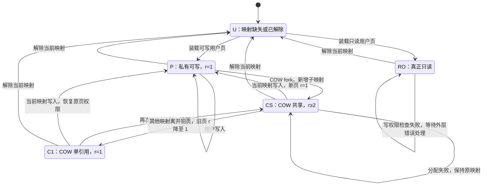

# Lab5 COW 写时复制机制设计报告

**负责人：** 2411033-季艾佳  
**实现范围：** COW 页面标记、fork 页共享接口、写异常处理、内核写入用户内存、引用计数与资源回收。  
**测试材料：** 本报告预留测试结果、实验现象和结论栏，供后续验收填写。

## 一、设计目标与实现主线

本次实验在 RISC-V ucore 的普通进程复制流程上增加 **Copy on Write，写时复制**。父进程执行 fork 时，内核先让父子进程的用户页表指向相同的物理页。父子进程继续读取原有数据；某个进程开始写入共享页面时，处理器产生写页异常，内核再为写入方准备私有页面。

这一安排把数据复制从 fork 阶段推迟到写入阶段。设父进程有 N 个有效用户数据页，每页占用 4096 字节。普通复制在 fork 阶段需要分配 N 个数据页，并复制 N × 4096 字节。COW 在这一阶段增加共享映射的引用；后续多引用页面的写异常才引入数据页分配和整页复制。**页表页仍由父子进程分别持有，因此需要分别统计数据页开销与页表开销。**

本次实验按以下顺序组织实现：

1. 在页表中记录页面原有的写权限，为写异常提供判断依据。
2. 在 fork 的页复制接口中建立共享映射，同时收回父子映射的写权限。
3. 在用户写异常中检查访问权限，完成页面复制或单引用权限恢复。
4. 在内核向用户地址写入时复用 COW 处理，覆盖退出码写回等路径。
5. 在解除映射时维护引用计数，并按层回收空页表。

前两个阶段建立共享关系，第三、第四阶段维护写入隔离，第五阶段结束页面的共享生命周期。后文沿这条路径解释数据结构、代码与测试设计。

## 二、地址、权限与引用计数

### 2.1 虚拟地址与物理页

用户程序通过虚拟地址访问数据。内核在页表中记录虚拟页对应的物理页，处理器据此完成地址转换。**两个进程可以使用相同的虚拟地址，并通过各自的页表访问不同的物理页。**

COW 利用这一层间接关系：fork 初期，父子进程在地址 V 处指向同一物理页 A；子进程写入后，内核将子进程在 V 处的映射改为物理页 B。父进程继续访问 A，子进程随后访问 B，两者的虚拟地址保持原值。

本次实现面向 **4 KiB 用户页**。`PGSIZE` 为 4096，`ROUNDDOWN(addr, PGSIZE)` 取得页起始地址，`PGOFF(addr)` 取得页内偏移。Sv39 使用三级页表，每级包含 512 个表项。一个末级页表覆盖 512 × 4096 字节，即 **2 MiB**；`copy_range()` 据此跳过末级页表缺失的地址区间。

### 2.2 页表项中的权限与 COW 标记

本次实验使用以下标志表达映射状态：

| 标志 | 含义 | 本次实现中的用途 |
|---|---|---|
| `PTE_V` | 页表项有效 | 确定当前虚拟页具有有效映射 |
| `PTE_U` | 用户态访问权限 | 限定 COW 的用户页面范围 |
| `PTE_R` | 读权限 | 检查数据页的读取与复制条件 |
| `PTE_W` | 写权限 | 控制用户写入能否由处理器执行 |
| `PTE_X` | 执行权限 | 复制映射时保留程序段的执行属性 |
| `PTE_A` | 访问记录 | 内核访问页面时维护访问状态 |
| `PTE_D` | 修改记录 | 内核写入页面时维护修改状态 |
| `PTE_COW` | 原本可写、当前因 COW 处于只读状态 | 判断写异常是否符合写时复制条件 |

在 [mmu.h](../code/kern/mm/mmu.h) 中，本次实验选择软件保留区中的第 8 位：

```c
#define PTE_COW 0x100
```

对于原本可写的用户页，fork 的共享路径清除 `PTE_W`，并设置 `PTE_COW`。处理器根据 `PTE_W` 触发写页异常；内核根据 `PTE_COW` 识别原有的写权限。

**真正只读的页面保留 `PTE_W=0、PTE_COW=0`。** 例如只读代码页即使与子进程共享，也保持这一组合。内核只有在 VMA 允许写入、PTE 具有 COW 标记且映射满足其他检查时，才恢复写权限。

### 2.3 VMA 与 PTE 分别记录两层权限

`vma_struct` 描述一段用户虚拟地址区域，`VM_WRITE` 表达这段区域在程序语义上的写权限。PTE 描述当前物理映射，`PTE_W` 表达处理器此刻可以执行的写访问。

COW 页面通常具有以下组合：

```text
VMA：VM_WRITE = 1
PTE：PTE_W = 0，PTE_COW = 1
```

本次实验保留 VMA 的写权限，只在 PTE 中暂时收回硬件写权限。用户写入后，内核先通过 `user_mem_check()` 检查 VMA，再通过页表标志检查 COW 状态。这两层检查共同决定后续的权限恢复。

### 2.4 `page_ref` 与 `mm_count` 的计数对象

**`page_ref(page)` 记录物理页的映射引用，`mm_count(mm)` 记录共享整个地址空间的进程数量。** 两者对应不同的资源。

普通 COW fork 为子进程建立独立的 `mm_struct` 和用户页表，再通过两个 PTE 引用同一数据页。此时该数据页的 `page_ref` 从 1 增加到 2。`CLONE_VM` 路径让线程共享整个 `mm_struct`，通过 `mm_count` 记录地址空间使用者。

内核还通过线性映射访问物理页。`page2kva()` 返回这种访问地址；本次实验的数据页计数按照 `page_insert()` 建立的映射维护。

| 操作 | 数据页引用变化 | 原因 |
|---|---|---|
| 子进程新增一条共享映射 | `r → r+1` | 新增 PTE 引用同一物理页 |
| 一个进程解除共享映射 | `r → r-1` | 删除该进程的 PTE 引用 |
| 多引用 COW 页完成复制 | 旧页 `r → r-1`，新页 `0 → 1` | 写入方从旧页切换到新页 |
| 单引用 COW 页恢复写权限 | `1 → 1` | 原物理页和映射数量保持原值 |
| 最后一条映射解除 | `1 → 0` | 内核将物理页归还分配器 |

## 三、代码组成与接口约定

| 文件 | 实现内容 | 在整条路径中的位置 |
|---|---|---|
| [mmu.h](../code/kern/mm/mmu.h) | `PTE_COW` | 记录页面原有写权限 |
| [pmm.c](../code/kern/mm/pmm.c) | `copy_range()` | 建立普通复制或 COW 共享映射 |
| [vmm.c](../code/kern/mm/vmm.c) | `do_cow_fault()` | 处理合法 COW 写入 |
| [trap.c](../code/kern/trap/trap.c) | `exception_handler()` 的写页异常分支 | 接收用户写异常并重试原指令 |
| [vmm.c](../code/kern/mm/vmm.c) | `copy_to_user()` | 为内核向用户空间写入准备目标页面 |
| [pmm.c](../code/kern/mm/pmm.c) | `page_remove_pte()`、`page_table_empty()`、`exit_range()` | 回收数据页引用和空页表 |
| [vmm.c](../code/kern/mm/vmm.c) | `exit_mmap()` | 清理整个用户地址范围 |
| [pmm.c](../code/kern/mm/pmm.c)、[pmm.h](../code/kern/mm/pmm.h) | `tlb_invalidate()`、`flush_tlb()` | 使处理器使用更新后的页表 |
| [vmm.h](../code/kern/mm/vmm.h)、[pmm.h](../code/kern/mm/pmm.h) | 声明与接口注释 | 明确调用条件、返回值和清理责任 |

`copy_range(to, from, start, end, share)` 要求源区间按页对齐、位于用户地址范围内，且目标区间空闲。`share=true` 表示建立 COW 共享映射，`share=false` 表示建立私有数据副本。函数以 0 表示成功，以负错误码表示参数或内存分配错误。调用方负责清理失败过程中已经构建的子地址空间。

`do_cow_fault(mm, addr)` 要求调用方传入目标地址空间与写入地址。函数以 0 表示目标页面已具备写权限，以 `-E_INVAL` 表示访问条件与 COW 规则冲突，以 `-E_NO_MEM` 表示页面分配失败。

`copy_to_user(mm, dst, src, len)` 将有效内核缓冲区的数据写入目标地址空间，返回布尔结果。`exit_mmap(mm)` 要求 `mm_count(mm)==0`，负责用户映射和下级页表；调用方随后通过进程管理接口释放根页表与 `mm_struct`。

## 四、逐阶段实现说明

### 4.1 fork：通过 `copy_range()` 建立共享映射

内核在复制用户地址空间时，逐页读取源 PTE。源地址对应的末级页表缺失时，内核前进到下一个 2 MiB 边界；源 PTE 缺失时，内核前进一页。这样，地址空间中的空洞保留为空洞，子进程获得与父进程对应的有效映射。

对于存在的用户页，内核检查 `PTE_U`、叶子访问权限和目标表项。通过这些检查后，内核从源 PTE 的低 10 位提取权限，进入共享或复制分支。

共享分支的核心代码为：

```c
if (perm & (PTE_W | PTE_COW)) {
    perm = (perm & ~PTE_W) | PTE_COW;
}
ret = page_insert(to, page, start, perm);
if (ret == 0 && *src != pte_create(page2ppn(page), perm)) {
    *src = pte_create(page2ppn(page), perm);
    tlb_invalidate(from, start);
}
```

内核先给子进程插入映射，再更新父进程权限。`page_insert()` 增加数据页引用计数，因此该调用承担新增引用的工作。**父子两份映射都要收回写权限，才能使双方的首次写入进入 COW 处理。** 父进程的 TLB 可能仍保存 fork 前的可写权限，内核在更新父 PTE 后刷新对应地址。

对于已经带有 `PTE_COW` 的源页，内核保留标记并新增共享引用。这个分支覆盖子进程再次 fork 的情形。对于真正只读的源页，内核保留只读属性，共享时只增加引用计数。

普通复制分支分配新页，复制 4096 字节，再为子进程建立映射。若源页原本带有 COW 标记，内核为新副本恢复 `PTE_W`、清除 `PTE_COW`。子进程已经持有独立的数据副本，可以使用原有的写权限。

内存分配失败可能发生在区间中部。此时，前面若干页已形成共享关系，后面的页仍保持原状态。函数返回错误码，调用方回收已构建的子地址空间。回收后，父进程的某些页面可能只剩一个引用且仍带有 COW 标记；后续单引用写异常会恢复这些页面的写权限。

### 4.2 用户写入：通过异常入口保留执行位置

用户程序向只读的 COW 映射写入时，处理器产生 `CAUSE_STORE_PAGE_FAULT`。中断帧中的 `tval` 保存故障地址，`epc` 保存触发异常的指令地址。

内核在 `exception_handler()` 中增加以下入口：

```c
case CAUSE_STORE_PAGE_FAULT:
    if (!trap_in_kernel(tf) && current != NULL && current->mm != NULL &&
        do_cow_fault(current->mm, tf->tval) == 0) {
        return;
    }
    break;
```

**COW 处理成功后保留 `epc`，让处理器再次执行原来的写指令。** 内核在异常处理中准备映射，处理器在异常返回后完成用户要求的数据写入。

系统调用的 `ecall` 在进入内核时已经完成请求提交，返回地址需要增加 4；COW 写指令在异常发生时尚待完成，因此沿用原指令地址。这一区别决定了两条异常路径的返回位置。

对于权限检查失败或内存分配失败的用户写异常，控制流进入现有的用户异常退出分支。内核态向用户空间写数据则使用后文的 `copy_to_user()` 入口。

### 4.3 写时复制：通过 `do_cow_fault()` 检查资格

内核先检查 `mm` 与根页表，再调用：

```c
user_mem_check(mm, addr, 1, 1)
```

最后一个参数 1 表示检查写权限。该检查覆盖用户地址范围、VMA 写属性与栈保护区域。随后，内核按页对齐地址，并通过 `get_pte(..., 0)` 取得已有映射。

页表层面的条件为：

```c
const pte_t required = PTE_V | PTE_U | PTE_R | PTE_COW;
if (ptep == NULL || (*ptep & required) != required || (*ptep & PTE_W)) {
    goto out;
}
```

内核要求页面同时具有有效、用户可访问、可读和 COW 属性，且当前写权限处于收回状态。这些条件把合法的延迟写入与真正只读页面、地址空洞和其他访问错误区分开来。

通过检查后，内核准备新的权限组合：

```c
perm = (perm | PTE_W | PTE_A | PTE_D) & ~PTE_COW;
```

其中 `PTE_W` 恢复写权限，`PTE_COW` 结束当前映射的延迟复制状态。`PTE_A` 与 `PTE_D` 记录本次写访问的访问、修改属性。原有的执行权限等标志继续保留。

### 4.4 多引用页面：分配副本并切换映射

当 `page_ref(old_page)>1` 时，其他映射仍依赖旧页内容。内核分配新物理页，并复制整个页面：

```c
memcpy(page2kva(new_page), page2kva(old_page), PGSIZE);
ret = page_insert(mm->pgdir, new_page, va, perm);
```

`page2kva()` 提供物理页的内核访问地址，`memcpy()` 复制页面中的原有数据。随后，`page_insert()` 将写入方的 PTE 改为新页，并同时完成两个计数动作：新页引用从 0 增至 1，旧页引用减少 1。

例如，父子最初共享 A，`ref(A)=2`。子进程写入时，内核创建 B，建立子进程对 B 的映射。更新后，`ref(A)=1`、`ref(B)=1`。父进程继续读取 A，子进程重试写指令并修改 B。**数据隔离来自父子映射指向不同物理页这一变化。**

若页面分配失败，函数返回 `-E_NO_MEM`；若插入映射失败，内核释放此次分配的新页。调用方根据返回值进入错误处理路径。

### 4.5 单引用页面：恢复原页的写权限

当 `page_ref(old_page)==1` 时，当前映射已经独占该数据页。内核更新原 PTE 的权限并刷新 TLB，保留原物理页号。

```c
*ptep = pte_create(page2ppn(old_page), perm);
tlb_invalidate(mm->pgdir, va);
```

这种状态通常出现在另一进程退出、另一映射完成 COW 复制，或失败的 fork 清理了子映射之后。引用计数先降至 1，剩余 PTE 继续保留 COW 标记；内核在下一次写入时完成权限恢复。

这条路径将一次写异常的额外数据页分配数保持为 0，复制字节数也为 0。**单引用恢复省去的是数据页分配和整页复制，写异常与 TLB 刷新仍属于本次处理过程。**

### 4.6 内核写入：通过 `copy_to_user()` 处理跨页 COW

`wait()` 的退出码写回需要内核修改用户变量。内核若通过物理页的线性映射写入共享页，就会同时改变其他映射看到的内容；若通过尚处于只读状态的用户地址写入，则会进入内核态写异常。

本次实验将这类写入集中到 `copy_to_user()`，并划分为两个阶段。

**第一阶段准备全部目标页面。** 内核先检查整个目标地址范围，再逐页查找 PTE。遇到 COW 页时，内核调用 `do_cow_fault()`，随后确认目标 PTE 同时具有 `PTE_V|PTE_U|PTE_R|PTE_W`，且已结束 COW 状态。

这一阶段覆盖跨页访问中的每一个目标页。若第二页分配失败，函数返回失败；已经完成准备的第一页可以保留私有副本，用户数据仍保持进入函数时的内容。**本次设计保证的是准备失败时的目标数据完整性，页面共享关系可以在准备期间发生变化。**

**第二阶段按页复制数据。** 内核取得目标物理页的线性地址，加上页内偏移，再计算本轮复制长度：

```c
size_t count = PGSIZE - PGOFF(addr);
if (count > end - addr) {
    count = end - addr;
}
```

例如从第一页末尾 4 字节处开始写入 12 字节，内核先写第一页的 4 字节，再写第二页的 8 字节。每轮复制前，内核维护目标 PTE 的 `PTE_A` 和 `PTE_D`。

内核通过目标 `mm` 的 PTE 定位物理页，因此还可以向当前处理器尚未激活的目标地址空间写入。权限检查和 COW 处理先于线性映射写入执行，从而维持用户映射的隔离语义。

长度为 0 时，函数返回成功。`mm==NULL` 时，函数沿用现有的内核地址范围检查与内核缓冲区复制约定。源地址 `src` 由调用方提供有效的内核缓冲区。

### 4.7 数据页回收：先撤销映射，再减少引用

用户进程退出、执行 exec 或撤销映射时，内核需要结束对应的物理页引用。本次实验在 `page_remove_pte()` 中采用以下顺序：

```c
*ptep = 0;
tlb_invalidate(pgdir, la);
if (page_ref_dec(page) == 0) {
    free_page(page);
}
```

内核先清除 PTE，再刷新对应地址的 TLB，随后减少引用。引用数降至 0 时，分配器接收该物理页。这一顺序使地址翻译的撤销先于物理页复用。

对于父子共享的页面，某一进程退出后，引用数由 2 降至 1，剩余进程继续持有原数据页。最后一个持有者退出后，引用数从 1 降至 0，内核归还物理页。`unmap_range()` 复用这一函数，按用户区间解除映射。

### 4.8 页表回收：检查整张表与兄弟表项

数据页通过 COW 共享，用户页表页则由各地址空间分别持有。内核在解除数据映射后，按照末级页表、中间页表的顺序回收这些管理结构。

本次实验增加 `page_table_empty()`，检查表内 512 个原始表项是否都为 0。`exit_range()` 先回收空的末级页表，再检查中间页表的全部表项。

这一检查范围决定了回收的安全性。例如，地址 V 与 V+2 MiB 位于不同末级页表，却可能共用同一中间页表。内核清理 V 所在范围后，中间页表仍保存指向 V+2 MiB 映射的表项。**上级页表的释放条件是整张表为空，局部区间清理完成只说明其中一部分映射已经结束。**

本次代码修正了原实现按局部范围推断中间页表生命周期的方式。内核清空父表项后执行全局地址翻译刷新，再减少页表页引用并释放页面。`exit_range()` 对叶子映射与下级页表指针进行区分，本次用户数据回收沿用 4 KiB 映射约定。

### 4.9 地址空间回收：覆盖部分构建的用户映射

`exit_mmap()` 在地址空间使用者计数归零后，先检查根页表，再执行：

```c
unmap_range(pgdir, USERBASE, USERTOP);
exit_range(pgdir, USERBASE, USERTOP);
```

第一步释放用户数据映射的引用，第二步回收下级空页表。本次实验扫描整个合法用户地址窗口，使清理过程覆盖 fork、exec 中已经分配页表或建立映射、VMA 登记尚待完成的中间状态。

根页表和内核映射继续交由外层进程管理路径处理。`put_pgdir()` 负责根页表页，`mm_destroy()` 负责 VMA 与 `mm_struct`。外层在回收当前地址空间的根页表前，需要切换到可继续执行的页表。

### 4.10 TLB 刷新与单核临界区

处理器在 TLB 中缓存地址翻译与权限。内核修改 PTE 后，需要刷新对应缓存，使后续访问采用新的物理页号或权限。

| 修改类型 | 本次采用的刷新方式 | 原因 |
|---|---|---|
| 单个叶子映射的权限或物理页号变化 | `tlb_invalidate()`，执行带虚拟地址的 `sfence.vma` | 更新对应页面的翻译与权限 |
| 撤销下级页表指针 | `flush_tlb()`，执行全局 `sfence.vma` | 覆盖下级页表指针变化涉及的地址翻译缓存 |

两处内联汇编都带有 `memory` clobber。它约束编译器对内存访问的重排，使页表写入与刷新操作按所需顺序生成。

本次实验面向当前的单 hart 运行方式，通过 `local_intr_save()` 与 `local_intr_restore()` 保护页表、引用计数和复制操作。保存中断状态后，嵌套调用继续沿用外层的关闭状态；最外层退出时恢复进入前的状态。多 hart 扩展需要增加共享页同步与跨 hart 的 TLB 刷新协议。

## 五、COW 状态转换模型

### 5.1 状态观察对象

本次实验以 **某个进程在某个虚拟页上的映射** 为状态观察对象。状态由 PTE 标志与对应物理页的引用数共同决定。内核通过引用数区间把页面分成共享与独占两类，因此可以用有限个状态描述具体执行路径。

精确引用数作为转换条件和输出记录。一个进程的映射发生变化时，其他映射对应的引用数分类也可能改变。例如，子进程复制旧页后，父进程的 PTE 标志保持原值，但旧页引用从 2 降至 1，父映射从 COW 共享态转入 COW 单引用态。

| 状态 | 名称 | 关键条件 | 写入处理 |
|---|---|---|---|
| U | 地址空洞或映射已解除 | 当前虚拟地址缺少有效用户映射 | 进入访问错误处理 |
| P | 私有可写态 | `W=1、COW=0、r=1` | 处理器执行写入 |
| CS | COW 共享态 | `W=0、COW=1、r≥2` | 分配副本并切换写入方映射 |
| C1 | COW 单引用态 | `W=0、COW=1、r=1` | 恢复原页写权限 |
| RO | 真正只读态 | `W=0、COW=0、r≥1` | 沿权限错误路径处理 |

本表描述普通 fork 的用户数据页。本次实验将 `CLONE_VM` 的整个地址空间共享语义与 `mm_count` 维护列入进程模块的集成约定。

### 5.2 映射状态图



图中从 CS 到 P 的箭头描述写入方取得新页。从 CS 到 C1 的箭头描述旧页的剩余持有者。两条箭头可以由同一次复制事件引起，分别对应不同进程的观察视角。

### 5.3 转换条件与计数输出

| 事件 | 初始状态 | 条件 | 当前映射的目标状态 | 物理页与引用输出 |
|---|---|---|---|---|
| 首次 COW fork | P | 子映射建立成功 | 父子都进入 CS | 共同指向旧页，旧页 `1→2` |
| 从 COW 页继续 fork | CS 或 C1 | 子映射建立成功 | 源映射与子映射进入 CS | 旧页 `r→r+1` |
| 多引用写入 | CS | 新页分配及插入成功 | 写入方进入 P | 旧页 `r→r-1`，新页 `0→1` |
| 单引用写入 | C1 | 权限检查通过 | 当前映射进入 P | 原页号保持原值，引用 `1→1` |
| 真正只读页共享 | RO | 子映射建立成功 | 父子保持 RO | 旧页 `r→r+1` |
| 真正只读页写入 | RO | 写权限检查失败 | RO，随后由外层处理进程状态 | 页面内容和权限保持原值 |
| COW 分配失败 | CS | 分配器返回空指针 | 当前映射保持 CS | 原 PTE 与数据页引用保持原值 |
| 当前共享映射解除 | CS | 引用数大于 1 | 当前映射进入 U | 旧页 `r→r-1`，剩余映射继续持有数据 |
| 最后一个映射解除 | P、C1 或单引用 RO | 引用数等于 1 | 当前映射进入 U | 旧页 `1→0`，分配器接收物理页 |
| 普通私有复制 | P、CS 或 C1 | `share=false` | 子映射进入 P | 子进程取得新页，源页引用保持原值 |
| 只读页的普通复制 | RO | `share=false` | 源映射与子映射保持 RO | 子进程取得独立只读副本，源页引用保持原值 |

`copy_to_user()` 复用 CS→P 与 C1→P 两条写入转换。它在准备阶段为目标区间中的各页分别完成状态转换，然后进入数据复制阶段。

### 5.4 物理页生命周期

映射状态之外，物理页还具有独立的分配生命周期。本次实验用以下规则衔接两个层次：

```text
分配器提供物理页，ref=0
    → page_insert 建立首条映射，ref=1
    → fork 新增共享映射，ref≥2
    → 复制或解除映射逐次减少 ref
    → 最后一次解除映射使 ref=0
    → free_page 将物理页归还分配器
```

单引用 COW 页仍占用有效物理页；`COW=1` 表达延迟恢复写权限的映射状态。物理页释放以引用数归零为条件。

### 5.5 父子双方写入的过程示例

本次实验以初始字节值 0x5A 的页面 A 说明转换。以下数值描述设计路径，实际运行记录放入测试章节。

| 阶段 | 父进程映射 | 子进程映射 | 页面引用 |
|---|---|---|---|
| fork 前 | A，可写，P | 子进程尚待创建 | `ref(A)=1` |
| fork 后 | A，只读，CS | A，只读，CS | `ref(A)=2` |
| 子进程写入前的 COW 处理完成 | A，只读，C1 | B，可写，P | `ref(A)=1、ref(B)=1` |
| 子进程重试写指令 | A，内容保持原值 | B，目标字节改为 0xA5 | 两页引用各为 1 |
| 父进程随后写入 | A，恢复可写，P | B，继续保持私有可写 | A 的物理页号保持原值 |
| 子进程解除映射 | A，继续有效 | U | `ref(B)=0`，B 归还分配器 |
| 父进程解除映射 | U | U | `ref(A)=0`，A 归还分配器 |

本例中，子进程的写入引入一次整页复制，父进程后续写入采用单引用恢复。状态表同时描述权限变化、物理页归属与回收时机。

## 六、测试设计与观察指标

### 6.1 分层验证安排

本次实验将验证分为目标文件编译、主机隔离检查和 QEMU 用户态测试三层。三层分别观察类型与接口、内存管理状态变化、实际进程与处理器行为。

现有 [test_cow_host.py](../code/tools/test_cow_host.py) 提供主机隔离检查。脚本读取项目中的函数定义和头文件，组合成临时 C 程序，交由宿主 GCC 编译，并启用 UndefinedBehaviorSanitizer 检查运行期间的未定义行为。脚本为分配器、CSR 和 TLB 操作提供模拟实现。

**隔离用例记录 PTE、物理页内容、引用计数和资源回收；QEMU 用例记录真实 fork、异常返回与进程生命周期。** 两组材料分别填写对应的结果栏。

### 6.2 测试装置与指标含义

脚本准备四个测试地址空间。`setup()` 分配根页表并登记用户 VMA，`map()` 建立测试数据映射，`entry()` 读取 PTE。`destroy()` 调用实际 `exit_mmap()` 后释放测试根页表，`finish()` 核对剩余空闲页数与中断状态。

模拟分配器提供 128 个物理页，每页 4096 字节。测试将新建数据页填充为 0x5A，并在写入时使用 0xA5 或 0x37，便于区分原值与修改值。`budget` 指定后续允许的成功分配次数，用于构造确定的内存不足位置。

| 指标 | 测量对象 | 记录方式与解释 |
|---|---|---|
| PTE 中的物理页号 | 父子当前访问的数据页 | 相同页号表示共享；写入方换用新页号表示完成分离 |
| `PTE_W` 与 `PTE_COW` | 当前映射的写入状态 | `0/1` 对应 COW，只读页采用 `0/0`，私有可写页采用 `1/0` |
| `page_ref()` | 同一数据页的映射引用数 | 与新增、替换和解除映射的次数对应 |
| `allocations` 的前后差值 | 测试期间成功的页面分配次数 | 统计包含页表页；测试单引用恢复时先准备页表，再比较差值 |
| 字节比较与 `memcmp()` | 物理页内容和目标区间边界 | 核对初始复制、父子隔离与跨页写入长度 |
| `nr_free_pages()` | 模拟分配器的空闲页数量 | 完整清理后与 128 页初始容量比较，检查资源归还 |
| `tlbs`、`full_fences` | 模拟刷新接口调用 | 记录刷新分支的调用，真实地址翻译行为在 QEMU 中观察 |
| `test_sstatus` | 进入与退出临界区的中断状态 | 核对开启状态和关闭状态下的保存、恢复行为 |
| `checks` | 测试断言累计次数 | 含测试装置、资源清理与功能断言，作为覆盖执行记录 |

### 6.3 H01：fork 共享、只读属性与地址空洞

**设计步骤。** 本次实验建立一个可写用户页、一个只读可执行页，以及一个地址空洞，再调用 `copy_range(..., true)` 复制这段区间。

**验收标准。** 父子可写页指向同一物理页，双方 PTE 满足 `W=0、COW=1`，数据页引用增至 2。只读页引用增至 2，双方保留 `W=0、COW=0` 和执行属性。地址空洞继续保持缺少映射的状态。

**原因分析。** 本例同时区分物理页共享与写权限恢复资格。共享关系通过页号和引用数体现，原有写权限通过 COW 标记体现。空洞检查进一步约束复制范围，避免将用户地址窗口中的空白区域扩展成有效页面。

**测试结果：**

**实验现象：**

**结论：**

### 6.4 H02：写异常复制与单引用恢复

**设计步骤。** 父子共享一个填充为 0x5A 的可写页。测试构造用户写页异常中断帧，将 `tval` 设为页内地址，记录 `epc` 与 `a0`，调用实际 `exception_handler()`。随后修改子页字节，再调用父页的 COW 处理。

**验收标准。** 子页换用新物理页，复制后的初始内容与旧页一致，父页字节维持 0x5A。异常处理后 `epc` 和 `a0` 保持原值。父页成为单引用后恢复写权限，其物理页号与分配次数保持原值。

**原因分析。** 子页的页号变化证明内核为写入方创建了数据副本；父页内容检查约束共享隔离。`epc` 检查对应原写指令的重试语义，`a0` 检查对应普通异常处理对寄存器现场的保持。父页的零分配差值则对应单引用恢复分支。

**测试结果：**

**实验现象：**

**结论：**

### 6.5 H03：多次 fork 的引用关系

**设计步骤。** 测试从第一个地址空间共享到第二个，再从第二个共享到第三个。随后依次处理第二、第一、第三个地址空间的写入。

**验收标准。** 三份映射初始共享同一页，引用数为 3。前两次写入分别创建私有页，旧页引用按 3→2→1 变化。最后一个持有者通过权限恢复继续使用旧页，并保留原执行属性。

**原因分析。** 已带有 COW 标记的页面继续 fork 时，源 PTE 的 `PTE_W` 已经清除。`copy_range()` 同时检查 `PTE_W|PTE_COW`，使这种源页继续进入共享路径。多次写入与引用递减构成对该分支的连续检查。

**测试结果：**

**实验现象：**

**结论：**

### 6.6 H04：普通复制与 COW 复制的衔接

**设计步骤。** 测试先通过 `share=false` 复制可写页，再建立 COW 共享映射，并从该 COW 页执行一次普通复制。

**验收标准。** 普通复制得到独立的物理页，子页满足 `W=1、COW=0`。从 COW 页复制得到的新页也具备这一权限组合，源页继续保留共享关系与原引用数。

**原因分析。** 普通复制已经提供独立的数据副本，因此子页可以恢复原有写权限。这个用例约束两种复制方式之间的转换，使普通基线与 COW 扩展复用同一接口。

**测试结果：**

**实验现象：**

**结论：**

### 6.7 H05：分配失败与区间中途失败

**设计步骤。** 本次实验通过 `budget=0` 构造子页表分配失败和 COW 新数据页分配失败。另一组用例在相邻的两个 2 MiB 区间各放置一个数据页，并通过分配预算使子地址空间在建立第二个末级页表时失败。

**验收标准。** 初次建立子映射前失败时，父 PTE 与引用数保持原值。COW 新页分配失败时，原共享 PTE 与数据内容保持原值。区间中途失败时，首个数据页已经形成 COW 共享关系，第二个数据页保留可写原映射；清理子映射后，首个父页进入单引用恢复路径。

**原因分析。** 内核按页推进复制，因此失败点之前和之后具有不同的资源状态。跨 2 MiB 边界可以使第二次页表分配发生在一个确定的位置。验收分别核对已建立共享页、尚待处理页面和部分页表的清理责任。

**测试结果：**

**实验现象：**

**结论：**

### 6.8 H06：权限、地址与目标映射检查

**设计步骤。** 测试分别传入真正只读页、只读 VMA、栈保护页、缺少用户权限的 PTE、地址空洞、零地址、发生回绕的地址、空地址空间，以及已经存在映射的复制目标区间。

**验收标准。** COW 处理对访问条件冲突返回 `-E_INVAL`，保留原有页内容和权限。`copy_range()` 对已占用目标保留原映射；对合法范围中的空洞按地址区间继续推进。

**原因分析。** VMA、PTE、地址范围和目标占用分别约束不同层次。将它们拆成独立输入，可以定位错误属于区域权限、硬件映射还是复制接口使用方式。后续 QEMU 用例再记录用户权限错误对应的进程退出行为。

**测试结果：**

**实验现象：**

**结论：**

### 6.9 H07：内核跨页写入与目标地址空间选择

**设计步骤。** 父子共享两个相邻页。测试让当前进程关联父地址空间，通过 `copy_to_user()` 向子地址空间第一页末尾 4 字节处写入 12 字节的 0x37 数据。

**验收标准。** 子地址空间的两个目标页分别取得私有副本。第一页最后 4 字节、第二页最前 8 字节按输入变化，邻接字节保持 0x5A。父页内容保持原值，目标 PTE 具有访问与修改属性。

**原因分析。** 两页写入检查了每页的 COW 准备与复制长度。当前地址空间与目标地址空间的区分则约束 `copy_to_user()` 的寻址方式：内核必须通过目标 `mm` 找到物理页，再利用线性映射完成写入。

**测试结果：**

**实验现象：**

**结论：**

### 6.10 H08：跨页写入准备阶段的失败

**设计步骤。** 测试沿用两页共享布局，将分配预算设为 1，使第一页 COW 准备成功、第二页 COW 准备失败，再调用跨页的 `copy_to_user()`。

**验收标准。** 函数返回失败。第一页可以保留新私有页，第二页继续指向共享旧页，两页目标数据都维持原值。后续完整清理归还测试所分配的页面。

**原因分析。** 第一阶段只调整映射，第二阶段才复制用户数据，因此准备失败的位置先于第一次数据写入。该设计将写入完整性与映射回滚分开处理，既保留数据内容，也保持引用计数与实际映射一致。

**测试结果：**

**实验现象：**

**结论：**

### 6.11 H09：局部回收与兄弟页表保护

**设计步骤。** 测试在 V 和 V+2 MiB 处各建立一页，使两页位于同一中间页表的不同末级页表中。随后解除并清理 V 所在区域，再检查另一页；最后清理第二个区域。

**验收标准。** 第一次清理释放首个空末级页表，保留仍有有效子项的中间页表与第二个数据页。第二次清理后，内核回收剩余的空末级页表和中间页表。

**原因分析。** 这个布局将局部区间清理与整张上级页表的生命周期分离。通过比较第一次清理前后的中间表项与第二页映射，可以检查 `page_table_empty(pd0)` 是否覆盖全部兄弟表项。

**测试结果：**

**实验现象：**

**结论：**

### 6.12 H10：部分构建的地址空间清理

**设计步骤。** 一组用例只成功分配中间页表，随后让末级页表分配失败；另一组先建立数据映射，再将测试 VMA 链表置为空。两组均调用实际的 `exit_mmap()`。

**验收标准。** 内核回收用户范围内的残留映射和空页表。清理完成后，测试根页表中的用户项归零，预设的内核表项保持原值，最终空闲页数恢复到初始容量。

**原因分析。** fork 和 exec 的分配过程具有多个中间状态，页表或映射的建立可能早于对应 VMA 的最终登记。完整用户窗口扫描直接依据现有页表回收资源，使清理覆盖这些构建阶段。

**测试结果：**

**实验现象：**

**结论：**

### 6.13 H11：父子清理顺序与中断状态

**设计步骤。** 本次实验分别安排子地址空间先清理和父地址空间先清理，再让剩余持有者写入页面。测试还分别从中断开启、关闭状态进入回收和复制函数。

**验收标准。** 首个地址空间清理后，数据页引用降至 1，剩余映射继续有效。最后一个持有者写入时采用单引用恢复；完整清理后，空闲页数恢复初值。函数退出时的中断状态与进入时相同。

**原因分析。** COW 的页面生命周期取决于剩余引用，进程的父子身份与退出顺序只决定引用减少的先后。中断状态检查约束嵌套临界区，确保内层函数沿用外层状态。

**测试结果：**

**实验现象：**

**结论：**

### 6.14 QEMU 用户态用例设计

本次实验在 A、B 的进程路径接齐后，将下列用例加入用户程序测试。现有主机隔离脚本中的多个 `mm_struct` 对应内存管理测试对象；下表通过实际进程、用户写指令和系统调用观察同样的状态转换。

| 编号 | 用例设计 | 核对内容 | 原因与判定依据 |
|---|---|---|---|
| Q01 | 子进程写全局变量，父进程等待后读取原值 | 子值变化，父值保持初值 | 写入方取得私有数据页，父映射继续持有旧页 |
| Q02 | 父进程写全局变量，子进程让出 CPU 后读取原值 | 父值变化，子值保持初值 | 父映射在 fork 时同样进入 COW 只读状态 |
| Q03 | 父子先后向同页写入不同值 | 双方各自读回目标值 | 首次写入分离映射，剩余单引用映射恢复权限 |
| Q04 | 一个进程多次 fork，再分别修改数据 | 各进程读回各自数据 | 已带 COW 标记的页面继续共享并维护引用 |
| Q05 | 父进程通过 `waitpid()` 接收退出码，存储变量位于 COW 页 | 退出码正确，其他进程的对应数据保持原值 | `do_wait()` 经 `copy_to_user()` 准备并写入目标页 |
| Q06 | 用户写入真正只读程序页，父进程继续运行并回收子进程 | 权限错误对应子进程终止，父进程继续执行 | 页表与 VMA 的权限检查控制写入资格 |
| Q07 | 在两页对齐缓冲区中逐字节写入，跨越页边界 | 两页数据与边界相邻字节符合输入 | 通过对齐的字节访问观察两页 COW，区分写页异常与访存对齐条件 |
| Q08 | 交替安排父先退出、子先退出与子进程 exec | 剩余进程数据有效，旧地址空间资源完成回收 | COW 引用随实际映射解除，exec 结束旧映射生命周期 |
| Q09 | 循环创建并等待子进程，记录前后空闲页数 | 用户数据页、用户页表和进程资源归还 | 多轮运行累积检查引用与生命周期配合 |
| Q10 | COW 扩展后运行基础评分 | 基础用户程序评分及公共检查 | 将扩展路径与加载、调度、系统调用及回收共同验收 |

### 6.15 运行命令与结果记录

在 `lab5/code` 目录下，目标文件编译与隔离检查采用：

```bash
make obj/kern/mm/pmm.o obj/kern/mm/vmm.o obj/kern/trap/trap.o 'DEFS+=-Werror'
python3 tools/test_cow_host.py
```

整机集成阶段采用：

```bash
make qemu
make grade
```

用户态专项用例随对应程序加入构建后，采用项目的 `build-<程序名>` 目标及适用的运行入口执行。

| 记录项 | 实际记录 |
|---|---|
| 测试日期与代码版本 | |
| 目标文件编译结果 | |
| 隔离检查输出与断言数量 | |
| Q01～Q10 运行结果 | |
| 基础评分结果 | |
| 关键 PTE、引用计数与空闲页记录 | |
| 日志与截图路径 | |
| 实验现象及原因分析 | |
| 最终验收结论 | |

## 七、进程模块的集成约定

本次实验当前将 COW 实现集中在内存管理与写异常入口。接入进程生命周期时，各路径沿用以下约定。

| 集成位置 | 接入方式 | 对应资源语义 |
|---|---|---|
| `copy_mm()` 普通用户 fork | 创建独立 `mm` 与用户页表，交由 `dup_mmap()` 复制区域 | 父子分别持有地址空间管理结构 |
| `dup_mmap()` | 完成 VMA 复制后调用 `copy_range(..., true)` | 用户数据页按 COW 方式共享 |
| `copy_mm()` 的 `CLONE_VM` 分支 | 共享整个 `mm`，维护 `mm_count` | 地址空间生命周期按使用者数量管理 |
| `do_wait()` 退出码写回 | 从内核临时变量通过 `copy_to_user()` 写入目标用户地址 | 内核写入沿用用户页的 COW 规则 |
| `do_exit()`、`do_execve()` | 在旧 `mm` 使用者归零后清理旧映射，再释放根页表与管理结构 | 页面引用结束后再归还物理页 |
| fork、exec 的失败分支 | 对部分构建的 `mm` 调用对应清理接口 | 已分配页表与已插入映射都有清理归属 |

`do_wait()` 应在退出码写回成功后完成对应的回收提交。这样，写回准备期间的分配失败仍可由调用方接收错误并处理等待关系。

本次工作区的普通用户地址空间复制、退出和程序替换路径仍处于集成阶段。本报告按现有 COW 函数说明设计与接口，实际进程结果填写在测试记录中。完整 Challenge 材料还包括 Dirty COW 资料研究、模拟条件评估、适用场景的错误与修复对照，以及对应证据；这些内容在专项工作完成后补充。

## 附录：当前实现代码

以下代码按本次工作区提取。正文说明各阶段的操作顺序与原因，附录保存对应函数的完整实现，便于对照代码复核。

### A.1 标记与接口声明

```c
#define PTE_COW 0x100

int do_cow_fault(struct mm_struct *mm, uintptr_t addr);
int copy_range(pde_t *to, pde_t *from, uintptr_t start, uintptr_t end, bool share);
bool copy_to_user(struct mm_struct *mm, void *dst, const void *src, size_t len);
```

### A.2 copy_range：共享与普通复制

```c
int copy_range(pde_t *to, pde_t *from, uintptr_t start, uintptr_t end, bool share)
{
    assert(start % PGSIZE == 0 && end % PGSIZE == 0);
    assert(USER_ACCESS(start, end));
    if (to == NULL || from == NULL || to == from) {
        return -E_INVAL;
    }

    while (start < end) {
        /* Single-hart critical section; no process is scheduled here. */
        bool intr_flag;
        local_intr_save(intr_flag);
        int ret = 0;

        pte_t *src = get_pte(from, start, 0);
        if (src == NULL) {
            /* No lowest-level page table: skip this 2 MiB interval. */
            local_intr_restore(intr_flag);
            start = ROUNDDOWN(start + PTSIZE, PTSIZE);
            continue;
        }
        if (!(*src & PTE_V)) {
            local_intr_restore(intr_flag);
            start += PGSIZE;
            continue;
        }

        uint32_t perm = (uint32_t)(*src & 0x3FF);
        /* This interface copies 4 KiB user leaf mappings only. */
        if (!(perm & PTE_U) || !(perm & (PTE_R | PTE_X)) ||
            ((perm & PTE_W) && !(perm & PTE_R))) {
            ret = -E_INVAL;
            goto page_out;
        }

        pte_t *dst = get_pte(to, start, 1);
        if (dst == NULL) {
            ret = -E_NO_MEM;
            goto page_out;
        }
        if (*dst != 0) {
            ret = -E_INVAL;
            goto page_out;
        }

        struct Page *page = pte2page(*src);
        if (share) {
            /* Repeated fork must preserve an existing COW marker. Truly
             * read-only pages are shared without ever gaining that marker.
             */
            if (perm & (PTE_W | PTE_COW)) {
                perm = (perm & ~PTE_W) | PTE_COW;
            }
            /* Publish the child mapping before restricting the parent.
             * Failure leaves this parent PTE unchanged. page_insert itself
             * increments the shared page's reference count exactly once.
             */
            ret = page_insert(to, page, start, perm);
            if (ret == 0 && *src != pte_create(page2ppn(page), perm)) {
                *src = pte_create(page2ppn(page), perm);
                tlb_invalidate(from, start);
            }
        }
        else {
            /* An eager copy of a COW page is privately writable again. */
            if (perm & PTE_COW) {
                perm = (perm | PTE_W) & ~PTE_COW;
            }
            struct Page *new_page = alloc_page();
            if (new_page == NULL) {
                ret = -E_NO_MEM;
                goto page_out;
            }
            memcpy(page2kva(new_page), page2kva(page), PGSIZE);
            ret = page_insert(to, new_page, start, perm);
            if (ret != 0) {
                free_page(new_page);
            }
        }

page_out:
        local_intr_restore(intr_flag);
        if (ret != 0) {
            /* The caller owns partial-child cleanup. Remaining parent COW
             * mappings stay valid, including the single-reference case.
             */
            return ret;
        }
        start += PGSIZE;
    }
    return 0;
}
```

### A.3 do_cow_fault：写入资格与副本管理

```c
int do_cow_fault(struct mm_struct *mm, uintptr_t addr)
{
    if (mm == NULL || mm->pgdir == NULL) {
        return -E_INVAL;
    }

    /* This lab runs on one hart. Protect PTE/refcount changes from interrupts;
     * SMP would additionally require shared-page locking and TLB shootdowns.
     */
    bool intr_flag;
    local_intr_save(intr_flag);
    int ret = -E_INVAL;

    /* Also rejects invalid addresses, read-only VMAs and the stack guard. */
    if (!user_mem_check(mm, addr, 1, 1)) {
        goto out;
    }

    uintptr_t va = ROUNDDOWN(addr, PGSIZE);
    pte_t *ptep = get_pte(mm->pgdir, va, 0);
    const pte_t required = PTE_V | PTE_U | PTE_R | PTE_COW;
    if (ptep == NULL || (*ptep & required) != required || (*ptep & PTE_W)) {
        goto out;
    }

    struct Page *old_page = pte2page(*ptep);
    if (page_ref(old_page) < 1) {
        goto out;
    }

    uint32_t perm = (uint32_t)(*ptep & 0x3FF);
    perm = (perm | PTE_W | PTE_A | PTE_D) & ~PTE_COW;

    if (page_ref(old_page) == 1) {
        /* Nobody else sees this page: permission restoration is sufficient. */
        *ptep = pte_create(page2ppn(old_page), perm);
        tlb_invalidate(mm->pgdir, va);
        ret = 0;
        goto out;
    }

    struct Page *new_page = alloc_page();
    if (new_page == NULL) {
        ret = -E_NO_MEM;
        goto out;
    }

    memcpy(page2kva(new_page), page2kva(old_page), PGSIZE);
    /* page_insert acquires the new reference and drops the old one. */
    ret = page_insert(mm->pgdir, new_page, va, perm);
    if (ret != 0) {
        free_page(new_page);
    }

out:
    local_intr_restore(intr_flag);
    return ret;
}
```

### A.4 copy_to_user：逐页准备与数据写入

```c
bool copy_to_user(struct mm_struct *mm, void *dst, const void *src, size_t len)
{
    if (len == 0) {
        return 1;
    }

    /* Preserve the existing trusted-kernel-address case. */
    if (mm == NULL) {
        if (!user_mem_check(NULL, (uintptr_t)dst, len, 1)) {
            return 0;
        }
        memcpy(dst, src, len);
        return 1;
    }
    if (mm->pgdir == NULL) {
        return 0;
    }

    /* COW Challenge 2411033: the current lab uses one hart. Keep the PTEs
     * stable from validation through the physical-alias writes below.
     */
    bool intr_flag;
    local_intr_save(intr_flag);
    bool ret = 0;
    uintptr_t addr = (uintptr_t)dst;
    if (!user_mem_check(mm, addr, len, 1)) {
        goto out;
    }

    uintptr_t end = addr + len;
    const pte_t required = PTE_V | PTE_U | PTE_R | PTE_W;

    /* Prepare every destination page before copying any bytes. Failure may
     * leave some pages private, but leaves the destination contents intact.
     */
    for (uintptr_t cur = addr; cur < end;
         cur = ROUNDDOWN(cur, PGSIZE) + PGSIZE) {
        pte_t *ptep = get_pte(mm->pgdir, cur, 0);
        if (ptep == NULL) {
            goto out;
        }
        if ((*ptep & PTE_COW) && do_cow_fault(mm, cur) != 0) {
            goto out;
        }
        if ((*ptep & required) != required || (*ptep & PTE_COW)) {
            goto out;
        }
    }

    const char *from = src;
    while (addr < end) {
        pte_t *ptep = get_pte(mm->pgdir, addr, 0);
        size_t count = PGSIZE - PGOFF(addr);
        if (count > end - addr) {
            count = end - addr;
        }

        /* Physical aliases also work when mm is not the active address
         * space. The permission/COW checks above must precede these writes.
         */
        char *to = (char *)page2kva(pte2page(*ptep)) + PGOFF(addr);
        if ((*ptep & (PTE_A | PTE_D)) != (PTE_A | PTE_D)) {
            *ptep |= PTE_A | PTE_D;
            tlb_invalidate(mm->pgdir, addr);
        }
        memcpy(to, from, count);
        from += count;
        addr += count;
    }
    ret = 1;

out:
    local_intr_restore(intr_flag);
    return ret;
}
```

### A.5 page_remove_pte：映射引用回收

```c
static inline void page_remove_pte(pde_t *pgdir, uintptr_t la, pte_t *ptep)
{
    bool intr_flag;
    local_intr_save(intr_flag);
    if (*ptep & PTE_V)
    {
        struct Page *page = pte2page(*ptep);
        assert(page_ref(page) > 0);
        /* Revoke this mapping before its last reference can be reused. */
        *ptep = 0;
        tlb_invalidate(pgdir, la);
        if (page_ref_dec(page) == 0)
        {
            free_page(page);
        }
    }
    local_intr_restore(intr_flag);
}
```

### A.6 page_table_empty 与 exit_range：下级页表回收

```c
static bool page_table_empty(pte_t *table)
{
    for (size_t i = 0; i < NPTEENTRY; i++) {
        if (table[i] != 0) {
            return 0;
        }
    }
    return 1;
}

void exit_range(pde_t *pgdir, uintptr_t start, uintptr_t end)
{
    assert(start % PGSIZE == 0 && end % PGSIZE == 0);
    assert(USER_ACCESS(start, end));
    assert(pgdir != NULL);

    bool intr_flag;
    local_intr_save(intr_flag);
    const pte_t leaf = PTE_R | PTE_W | PTE_X;

    for (uintptr_t d1 = ROUNDDOWN(start, PDSIZE); d1 < end; d1 += PDSIZE) {
        pde_t *pdep1 = &pgdir[PDX1(d1)];
        if (!(*pdep1 & PTE_V) || (*pdep1 & leaf)) {
            continue;
        }

        struct Page *pd_page = pde2page(*pdep1);
        pde_t *pd0 = page2kva(pd_page);
        uintptr_t begin = start > d1 ? start : d1;
        uintptr_t limit = end < d1 + PDSIZE ? end : d1 + PDSIZE;

        for (uintptr_t d0 = ROUNDDOWN(begin, PTSIZE); d0 < limit; d0 += PTSIZE) {
            pde_t *pdep0 = &pd0[PDX0(d0)];
            if (!(*pdep0 & PTE_V) || (*pdep0 & leaf)) {
                continue;
            }
            struct Page *pt_page = pde2page(*pdep0);
            if (page_table_empty(page2kva(pt_page))) {
                assert(page_ref(pt_page) == 1);
                *pdep0 = 0;
                /* Non-leaf changes require a full translation-cache fence
                 * before the old page-table memory can be reused.
                 */
                flush_tlb();
                page_ref_dec(pt_page);
                free_page(pt_page);
            }
        }

        /* Check ALL sibling entries, including those outside [start, end).
         * The old local-range test could free a directory with live siblings.
         */
        if (page_table_empty(pd0)) {
            assert(page_ref(pd_page) == 1);
            *pdep1 = 0;
            flush_tlb();
            page_ref_dec(pd_page);
            free_page(pd_page);
        }
    }
    local_intr_restore(intr_flag);
}
```

### A.7 exit_mmap：用户地址窗口清理

```c
void exit_mmap(struct mm_struct *mm)
{
    assert(mm != NULL && mm_count(mm) == 0);
    pde_t *pgdir = mm->pgdir;
    if (pgdir == NULL) {
        return;
    }

    /* COW Challenge 2411033: release mappings before private page tables.
     * Scan the entire user window so partially built mappings/page tables
     * from a failed fork or exec are not dependent on VMA insertion order.
     * Kernel mappings and the root page itself are owned by other paths.
     */
    unmap_range(pgdir, USERBASE, USERTOP);
    exit_range(pgdir, USERBASE, USERTOP);
}
```

### A.8 地址翻译刷新

```c
void tlb_invalidate(pde_t *pgdir, uintptr_t la)
{
    asm volatile("sfence.vma %0" : : "r"(la) : "memory");
}

static inline void flush_tlb()
{
    asm volatile("sfence.vma" ::: "memory");
}
```
