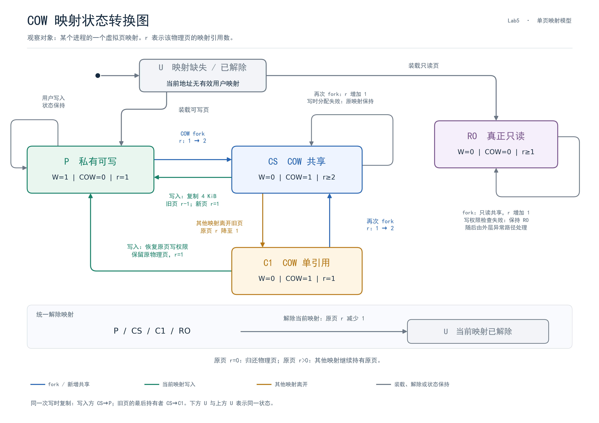
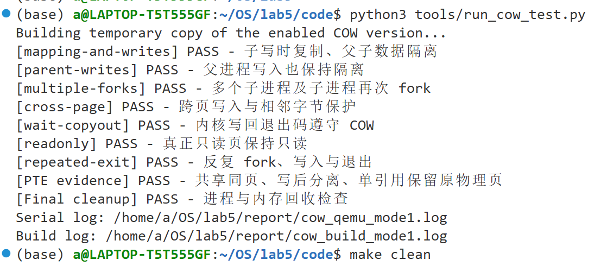
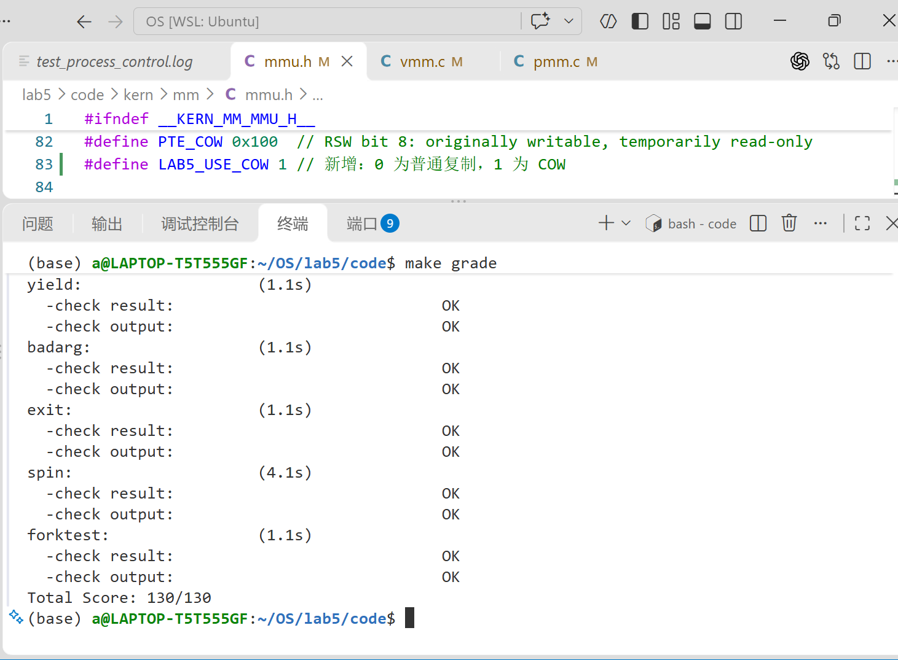

# Lab5 COW 写时复制机制设计报告

**负责人：** 2411033-季艾佳  
**实现范围：** COW 页面标记、fork 页共享接口、写异常处理、内核写入用户内存、引用计数与资源回收。  

## 一、设计目标与实现主线

本次实验在 RISC-V ucore 的普通进程复制流程上增加 **Copy on Write，写时复制**。父进程执行 fork 时，内核先让父子进程的用户页表指向相同的物理页。父子进程继续读取原有数据；某个进程开始写入共享页面时，处理器产生写页异常，内核再为写入方准备私有页面。

这一安排把数据复制从 fork 阶段推迟到写入阶段。设父进程有 N 个有效用户数据页，每页占用 4096 字节。普通复制在 fork 阶段需要分配 N 个数据页，并复制 N × 4096 字节。COW 在这一阶段增加共享映射的引用；后续多引用页面的写异常才引入数据页分配和整页复制。**页表页仍由父子进程分别持有，因此需要分别统计数据页开销与页表开销。**

本次实验按以下顺序组织实现：

1. 在页表中记录页面原有的写权限，为写异常提供判断依据。
2. 在 fork 的页复制接口中建立共享映射，同时收回父子映射的写权限。
3. 在用户写异常中检查访问权限，完成页面复制或单引用权限恢复。
4. 在内核向用户地址写入时复用 COW 处理，覆盖退出码写回等路径。
5. 在解除映射时维护引用计数，并按层回收空页表。

前两个阶段建立共享关系，第三、第四阶段维护写入隔离，第五阶段结束页面的共享生命周期。后文沿这条路径解释数据结构、代码与测试设计。

## 二、地址、权限与引用计数

### 2.1 虚拟地址与物理页

用户程序通过虚拟地址访问数据。内核在页表中记录虚拟页对应的物理页，处理器据此完成地址转换。**两个进程可以使用相同的虚拟地址，并通过各自的页表访问不同的物理页。**

COW 利用这一层间接关系：fork 初期，父子进程在地址 V 处指向同一物理页 A；子进程写入后，内核将子进程在 V 处的映射改为物理页 B。父进程继续访问 A，子进程随后访问 B，两者的虚拟地址保持原值。

本次实现面向 **4 KiB 用户页**。`PGSIZE` 为 4096，`ROUNDDOWN(addr, PGSIZE)` 取得页起始地址，`PGOFF(addr)` 取得页内偏移。Sv39 使用三级页表，每级包含 512 个表项。一个末级页表覆盖 512 × 4096 字节，即 **2 MiB**；`copy_range()` 据此跳过末级页表缺失的地址区间。

### 2.2 页表项中的权限与 COW 标记

本次实验使用以下标志表达映射状态：

| 标志 | 含义 | 本次实现中的用途 |
|---|---|---|
| `PTE_V` | 页表项有效 | 确定当前虚拟页具有有效映射 |
| `PTE_U` | 用户态访问权限 | 限定 COW 的用户页面范围 |
| `PTE_R` | 读权限 | 检查数据页的读取与复制条件 |
| `PTE_W` | 写权限 | 控制用户写入能否由处理器执行 |
| `PTE_X` | 执行权限 | 复制映射时保留程序段的执行属性 |
| `PTE_A` | 访问记录 | 内核访问页面时维护访问状态 |
| `PTE_D` | 修改记录 | 内核写入页面时维护修改状态 |
| `PTE_COW` | 原本可写、当前因 COW 处于只读状态 | 判断写异常是否符合写时复制条件 |

在 [mmu.h](../code/kern/mm/mmu.h) 中，本次实验选择软件保留区中的第 8 位：

```c
#define PTE_COW 0x100
```

本次测试将 `LAB5_USE_COW` 设为 1。`dup_mmap()` 通过 `bool share = LAB5_USE_COW` 选择共享分支，使实际用户 fork 进入 COW 路径。

对于原本可写的用户页，fork 的共享路径清除 `PTE_W`，并设置 `PTE_COW`。处理器根据 `PTE_W` 触发写页异常；内核根据 `PTE_COW` 识别原有的写权限。

**真正只读的页面保留 `PTE_W=0、PTE_COW=0`。** 例如只读代码页即使与子进程共享，也保持这一组合。内核只有在 VMA 允许写入、PTE 具有 COW 标记且映射满足其他检查时，才恢复写权限。

### 2.3 VMA 与 PTE 分别记录两层权限

`vma_struct` 描述一段用户虚拟地址区域，`VM_WRITE` 表达这段区域在程序语义上的写权限。PTE 描述当前物理映射，`PTE_W` 表达处理器此刻可以执行的写访问。

COW 页面通常具有以下组合：

```text
VMA：VM_WRITE = 1
PTE：PTE_W = 0，PTE_COW = 1
```

本次实验保留 VMA 的写权限，只在 PTE 中暂时收回硬件写权限。用户写入后，内核先通过 `user_mem_check()` 检查 VMA，再通过页表标志检查 COW 状态。这两层检查共同决定后续的权限恢复。

### 2.4 `page_ref` 与 `mm_count` 的计数对象

**`page_ref(page)` 记录物理页的映射引用，`mm_count(mm)` 记录共享整个地址空间的进程数量。** 两者对应不同的资源。

普通 COW fork 为子进程建立独立的 `mm_struct` 和用户页表，再通过两个 PTE 引用同一数据页。此时该数据页的 `page_ref` 从 1 增加到 2。`CLONE_VM` 路径让线程共享整个 `mm_struct`，通过 `mm_count` 记录地址空间使用者。

内核还通过线性映射访问物理页。`page2kva()` 返回这种访问地址；本次实验的数据页计数按照 `page_insert()` 建立的映射维护。

| 操作 | 数据页引用变化 | 原因 |
|---|---|---|
| 子进程新增一条共享映射 | `r → r+1` | 新增 PTE 引用同一物理页 |
| 一个进程解除共享映射 | `r → r-1` | 删除该进程的 PTE 引用 |
| 多引用 COW 页完成复制 | 旧页 `r → r-1`，新页 `0 → 1` | 写入方从旧页切换到新页 |
| 单引用 COW 页恢复写权限 | `1 → 1` | 原物理页和映射数量保持原值 |
| 最后一条映射解除 | `1 → 0` | 内核将物理页归还分配器 |

## 三、代码组成与接口约定

| 文件 | 实现内容 | 在整条路径中的位置 |
|---|---|---|
| [mmu.h](../code/kern/mm/mmu.h) | `PTE_COW` | 记录页面原有写权限 |
| [pmm.c](../code/kern/mm/pmm.c) | `copy_range()` | 建立普通复制或 COW 共享映射 |
| [vmm.c](../code/kern/mm/vmm.c) | `do_cow_fault()` | 处理合法 COW 写入 |
| [trap.c](../code/kern/trap/trap.c) | `exception_handler()` 的写页异常分支 | 接收用户写异常并重试原指令 |
| [vmm.c](../code/kern/mm/vmm.c) | `copy_to_user()` | 为内核向用户空间写入准备目标页面 |
| [pmm.c](../code/kern/mm/pmm.c) | `page_remove_pte()`、`page_table_empty()`、`exit_range()` | 回收数据页引用和空页表 |
| [vmm.c](../code/kern/mm/vmm.c) | `exit_mmap()` | 清理整个用户地址范围 |
| [pmm.c](../code/kern/mm/pmm.c)、[pmm.h](../code/kern/mm/pmm.h) | `tlb_invalidate()`、`flush_tlb()` | 使处理器使用更新后的页表 |
| [vmm.h](../code/kern/mm/vmm.h)、[pmm.h](../code/kern/mm/pmm.h) | 声明与接口注释 | 明确调用条件、返回值和清理责任 |

`copy_range(to, from, start, end, share)` 要求源区间按页对齐、位于用户地址范围内，且目标区间空闲。`share=true` 表示建立 COW 共享映射，`share=false` 表示建立私有数据副本。函数以 0 表示成功，以负错误码表示参数或内存分配错误。调用方负责清理失败过程中已经构建的子地址空间。

`do_cow_fault(mm, addr)` 要求调用方传入目标地址空间与写入地址。函数以 0 表示目标页面已具备写权限，以 `-E_INVAL` 表示访问条件与 COW 规则冲突，以 `-E_NO_MEM` 表示页面分配失败。

`copy_to_user(mm, dst, src, len)` 将有效内核缓冲区的数据写入目标地址空间，返回布尔结果。`exit_mmap(mm)` 要求 `mm_count(mm)==0`，负责用户映射和下级页表；调用方随后通过进程管理接口释放根页表与 `mm_struct`。

## 四、逐阶段实现说明

### 4.1 fork：通过 `copy_range()` 建立共享映射

内核在复制用户地址空间时，逐页读取源 PTE。源地址对应的末级页表缺失时，内核前进到下一个 2 MiB 边界；源 PTE 缺失时，内核前进一页。这样，地址空间中的空洞保留为空洞，子进程获得与父进程对应的有效映射。

对于存在的用户页，内核检查 `PTE_U`、叶子访问权限和目标表项。通过这些检查后，内核从源 PTE 的低 10 位提取权限，进入共享或复制分支。

共享分支的核心代码为：

```c
if (perm & (PTE_W | PTE_COW)) {
    perm = (perm & ~PTE_W) | PTE_COW;
}
ret = page_insert(to, page, start, perm);
if (ret == 0 && *src != pte_create(page2ppn(page), perm)) {
    *src = pte_create(page2ppn(page), perm);
    tlb_invalidate(from, start);
}
```

内核先给子进程插入映射，再更新父进程权限。`page_insert()` 增加数据页引用计数，因此该调用承担新增引用的工作。**父子两份映射都要收回写权限，才能使双方的首次写入进入 COW 处理。** 父进程的 TLB 可能仍保存 fork 前的可写权限，内核在更新父 PTE 后刷新对应地址。

对于已经带有 `PTE_COW` 的源页，内核保留标记并新增共享引用。这个分支覆盖子进程再次 fork 的情形。对于真正只读的源页，内核保留只读属性，共享时只增加引用计数。

普通复制分支分配新页，复制 4096 字节，再为子进程建立映射。若源页原本带有 COW 标记，内核为新副本恢复 `PTE_W`、清除 `PTE_COW`。子进程已经持有独立的数据副本，可以使用原有的写权限。

内存分配失败可能发生在区间中部。此时，前面若干页已形成共享关系，后面的页仍保持原状态。函数返回错误码，调用方回收已构建的子地址空间。回收后，父进程的某些页面可能只剩一个引用且仍带有 COW 标记；后续单引用写异常会恢复这些页面的写权限。

### 4.2 用户写入：通过异常入口保留执行位置

用户程序向只读的 COW 映射写入时，处理器产生 `CAUSE_STORE_PAGE_FAULT`。中断帧中的 `tval` 保存故障地址，`epc` 保存触发异常的指令地址。

内核在 `exception_handler()` 中增加以下入口：

```c
case CAUSE_STORE_PAGE_FAULT:
    if (!trap_in_kernel(tf) && current != NULL && current->mm != NULL &&
        do_cow_fault(current->mm, tf->tval) == 0) {
        return;
    }
    break;
```

**COW 处理成功后保留 `epc`，让处理器再次执行原来的写指令。** 内核在异常处理中准备映射，处理器在异常返回后完成用户要求的数据写入。

系统调用的 `ecall` 在进入内核时已经完成请求提交，返回地址需要增加 4；COW 写指令在异常发生时尚待完成，因此沿用原指令地址。这一区别决定了两条异常路径的返回位置。

对于权限检查失败或内存分配失败的用户写异常，控制流进入现有的用户异常退出分支。内核态向用户空间写数据则使用后文的 `copy_to_user()` 入口。

### 4.3 写时复制：通过 `do_cow_fault()` 检查资格

内核先检查 `mm` 与根页表，再调用：

```c
user_mem_check(mm, addr, 1, 1)
```

最后一个参数 1 表示检查写权限。该检查覆盖用户地址范围、VMA 写属性与栈保护区域。随后，内核按页对齐地址，并通过 `get_pte(..., 0)` 取得已有映射。

页表层面的条件为：

```c
const pte_t required = PTE_V | PTE_U | PTE_R | PTE_COW;
if (ptep == NULL || (*ptep & required) != required || (*ptep & PTE_W)) {
    goto out;
}
```

内核要求页面同时具有有效、用户可访问、可读和 COW 属性，且当前写权限处于收回状态。这些条件把合法的延迟写入与真正只读页面、地址空洞和其他访问错误区分开来。

通过检查后，内核准备新的权限组合：

```c
perm = (perm | PTE_W | PTE_A | PTE_D) & ~PTE_COW;
```

其中 `PTE_W` 恢复写权限，`PTE_COW` 结束当前映射的延迟复制状态。`PTE_A` 与 `PTE_D` 记录本次写访问的访问、修改属性。原有的执行权限等标志继续保留。

### 4.4 多引用页面：分配副本并切换映射

当 `page_ref(old_page)>1` 时，其他映射仍依赖旧页内容。内核分配新物理页，并复制整个页面：

```c
memcpy(page2kva(new_page), page2kva(old_page), PGSIZE);
ret = page_insert(mm->pgdir, new_page, va, perm);
```

`page2kva()` 提供物理页的内核访问地址，`memcpy()` 复制页面中的原有数据。随后，`page_insert()` 将写入方的 PTE 改为新页，并同时完成两个计数动作：新页引用从 0 增至 1，旧页引用减少 1。

例如，父子最初共享 A，`ref(A)=2`。子进程写入时，内核创建 B，建立子进程对 B 的映射。更新后，`ref(A)=1`、`ref(B)=1`。父进程继续读取 A，子进程重试写指令并修改 B。**数据隔离来自父子映射指向不同物理页这一变化。**

若页面分配失败，函数返回 `-E_NO_MEM`；若插入映射失败，内核释放此次分配的新页。调用方根据返回值进入错误处理路径。

### 4.5 单引用页面：恢复原页的写权限

当 `page_ref(old_page)==1` 时，当前映射已经独占该数据页。内核更新原 PTE 的权限并刷新 TLB，保留原物理页号。

```c
*ptep = pte_create(page2ppn(old_page), perm);
tlb_invalidate(mm->pgdir, va);
```

这种状态通常出现在另一进程退出、另一映射完成 COW 复制，或失败的 fork 清理了子映射之后。引用计数先降至 1，剩余 PTE 继续保留 COW 标记；内核在下一次写入时完成权限恢复。

这条路径将一次写异常的额外数据页分配数保持为 0，复制字节数也为 0。**单引用恢复省去的是数据页分配和整页复制，写异常与 TLB 刷新仍属于本次处理过程。**

### 4.6 内核写入：通过 `copy_to_user()` 处理跨页 COW

`wait()` 的退出码写回需要内核修改用户变量。内核若通过物理页的线性映射写入共享页，就会同时改变其他映射看到的内容；若通过尚处于只读状态的用户地址写入，则会进入内核态写异常。

本次实验将这类写入集中到 `copy_to_user()`，并划分为两个阶段。

**第一阶段准备全部目标页面。** 内核先检查整个目标地址范围，再逐页查找 PTE。遇到 COW 页时，内核调用 `do_cow_fault()`，随后确认目标 PTE 同时具有 `PTE_V|PTE_U|PTE_R|PTE_W`，且已结束 COW 状态。

这一阶段覆盖跨页访问中的每一个目标页。若第二页分配失败，函数返回失败；已经完成准备的第一页可以保留私有副本，用户数据仍保持进入函数时的内容。**本次设计保证的是准备失败时的目标数据完整性，页面共享关系可以在准备期间发生变化。**

**第二阶段按页复制数据。** 内核取得目标物理页的线性地址，加上页内偏移，再计算本轮复制长度：

```c
size_t count = PGSIZE - PGOFF(addr);
if (count > end - addr) {
    count = end - addr;
}
```

例如从第一页末尾 4 字节处开始写入 12 字节，内核先写第一页的 4 字节，再写第二页的 8 字节。每轮复制前，内核维护目标 PTE 的 `PTE_A` 和 `PTE_D`。

内核通过目标 `mm` 的 PTE 定位物理页，因此还可以向当前处理器尚未激活的目标地址空间写入。权限检查和 COW 处理先于线性映射写入执行，从而维持用户映射的隔离语义。

长度为 0 时，函数返回成功。`mm==NULL` 时，函数沿用现有的内核地址范围检查与内核缓冲区复制约定。源地址 `src` 由调用方提供有效的内核缓冲区。

### 4.7 数据页回收：先撤销映射，再减少引用

用户进程退出、执行 exec 或撤销映射时，内核需要结束对应的物理页引用。本次实验在 `page_remove_pte()` 中采用以下顺序：

```c
*ptep = 0;
tlb_invalidate(pgdir, la);
if (page_ref_dec(page) == 0) {
    free_page(page);
}
```

内核先清除 PTE，再刷新对应地址的 TLB，随后减少引用。引用数降至 0 时，分配器接收该物理页。这一顺序使地址翻译的撤销先于物理页复用。

对于父子共享的页面，某一进程退出后，引用数由 2 降至 1，剩余进程继续持有原数据页。最后一个持有者退出后，引用数从 1 降至 0，内核归还物理页。`unmap_range()` 复用这一函数，按用户区间解除映射。

### 4.8 页表回收：检查整张表与兄弟表项

数据页通过 COW 共享，用户页表页则由各地址空间分别持有。内核在解除数据映射后，按照末级页表、中间页表的顺序回收这些管理结构。

本次实验增加 `page_table_empty()`，检查表内 512 个原始表项是否都为 0。`exit_range()` 先回收空的末级页表，再检查中间页表的全部表项。

这一检查范围决定了回收的安全性。例如，地址 V 与 V+2 MiB 位于不同末级页表，却可能共用同一中间页表。内核清理 V 所在范围后，中间页表仍保存指向 V+2 MiB 映射的表项。**上级页表的释放条件是整张表为空，局部区间清理完成只说明其中一部分映射已经结束。**

本次代码修正了原实现按局部范围推断中间页表生命周期的方式。内核清空父表项后执行全局地址翻译刷新，再减少页表页引用并释放页面。`exit_range()` 对叶子映射与下级页表指针进行区分，本次用户数据回收沿用 4 KiB 映射约定。

### 4.9 地址空间回收：覆盖部分构建的用户映射

`exit_mmap()` 在地址空间使用者计数归零后，先检查根页表，再执行：

```c
unmap_range(pgdir, USERBASE, USERTOP);
exit_range(pgdir, USERBASE, USERTOP);
```

第一步释放用户数据映射的引用，第二步回收下级空页表。本次实验扫描整个合法用户地址窗口，使清理过程覆盖 fork、exec 中已经分配页表或建立映射、VMA 登记尚待完成的中间状态。

根页表和内核映射继续交由外层进程管理路径处理。`put_pgdir()` 负责根页表页，`mm_destroy()` 负责 VMA 与 `mm_struct`。外层在回收当前地址空间的根页表前，需要切换到可继续执行的页表。

### 4.10 TLB 刷新与单核临界区

处理器在 TLB 中缓存地址翻译与权限。内核修改 PTE 后，需要刷新对应缓存，使后续访问采用新的物理页号或权限。

| 修改类型 | 本次采用的刷新方式 | 原因 |
|---|---|---|
| 单个叶子映射的权限或物理页号变化 | `tlb_invalidate()`，执行带虚拟地址的 `sfence.vma` | 更新对应页面的翻译与权限 |
| 撤销下级页表指针 | `flush_tlb()`，执行全局 `sfence.vma` | 覆盖下级页表指针变化涉及的地址翻译缓存 |

两处内联汇编都带有 `memory` clobber。它约束编译器对内存访问的重排，使页表写入与刷新操作按所需顺序生成。

本次实验面向当前的单 hart 运行方式，通过 `local_intr_save()` 与 `local_intr_restore()` 保护页表、引用计数和复制操作。保存中断状态后，嵌套调用继续沿用外层的关闭状态；最外层退出时恢复进入前的状态。多 hart 扩展需要增加共享页同步与跨 hart 的 TLB 刷新协议。

## 五、COW 状态转换模型

### 5.1 状态观察对象

本次实验以 **某个进程在某个虚拟页上的映射** 为状态观察对象。状态由 PTE 标志与对应物理页的引用数共同决定。内核通过引用数区间把页面分成共享与独占两类，因此可以用有限个状态描述具体执行路径。

精确引用数作为转换条件和输出记录。一个进程的映射发生变化时，其他映射对应的引用数分类也可能改变。例如，子进程复制旧页后，父进程的 PTE 标志保持原值，但旧页引用从 2 降至 1，父映射从 COW 共享态转入 COW 单引用态。

| 状态 | 名称 | 关键条件 | 写入处理 |
|---|---|---|---|
| U | 地址空洞或映射已解除 | 当前虚拟地址缺少有效用户映射 | 进入访问错误处理 |
| P | 私有可写态 | `W=1、COW=0、r=1` | 处理器执行写入 |
| CS | COW 共享态 | `W=0、COW=1、r≥2` | 分配副本并切换写入方映射 |
| C1 | COW 单引用态 | `W=0、COW=1、r=1` | 恢复原页写权限 |
| RO | 真正只读态 | `W=0、COW=0、r≥1` | 沿权限错误路径处理 |

本表描述普通 fork 的用户数据页。本次实验将 `CLONE_VM` 的整个地址空间共享语义与 `mm_count` 维护列入进程模块的集成约定。

### 5.2 映射状态图



图中以蓝色表示 fork 新增共享，以绿色表示当前映射写入，以橙色表示其他映射离开旧页。底部集中绘制四种有效状态解除映射后进入 U 的转换；上方与下方的 U 表示同一状态。

图中从 CS 到 P 的箭头描述写入方取得新页。从 CS 到 C1 的箭头描述旧页的剩余持有者。两条箭头可以由同一次复制事件引起，分别对应不同进程的观察视角。

### 5.3 转换条件与计数输出

| 事件 | 初始状态 | 条件 | 当前映射的目标状态 | 物理页与引用输出 |
|---|---|---|---|---|
| 首次 COW fork | P | 子映射建立成功 | 父子都进入 CS | 共同指向旧页，旧页 `1→2` |
| 从 COW 页继续 fork | CS 或 C1 | 子映射建立成功 | 源映射与子映射进入 CS | 旧页 `r→r+1` |
| 多引用写入 | CS | 新页分配及插入成功 | 写入方进入 P | 旧页 `r→r-1`，新页 `0→1` |
| 单引用写入 | C1 | 权限检查通过 | 当前映射进入 P | 原页号保持原值，引用 `1→1` |
| 真正只读页共享 | RO | 子映射建立成功 | 父子保持 RO | 旧页 `r→r+1` |
| 真正只读页写入 | RO | 写权限检查失败 | RO，随后由外层处理进程状态 | 页面内容和权限保持原值 |
| COW 分配失败 | CS | 分配器返回空指针 | 当前映射保持 CS | 原 PTE 与数据页引用保持原值 |
| 当前共享映射解除 | CS | 引用数大于 1 | 当前映射进入 U | 旧页 `r→r-1`，剩余映射继续持有数据 |
| 最后一个映射解除 | P、C1 或单引用 RO | 引用数等于 1 | 当前映射进入 U | 旧页 `1→0`，分配器接收物理页 |
| 普通私有复制 | P、CS 或 C1 | `share=false` | 子映射进入 P | 子进程取得新页，源页引用保持原值 |
| 只读页的普通复制 | RO | `share=false` | 源映射与子映射保持 RO | 子进程取得独立只读副本，源页引用保持原值 |

`copy_to_user()` 复用 CS→P 与 C1→P 两条写入转换。它在准备阶段为目标区间中的各页分别完成状态转换，然后进入数据复制阶段。

### 5.4 物理页生命周期

映射状态之外，物理页还具有独立的分配生命周期。本次实验用以下规则衔接两个层次：

```text
分配器提供物理页，ref=0
    → page_insert 建立首条映射，ref=1
    → fork 新增共享映射，ref≥2
    → 复制或解除映射逐次减少 ref
    → 最后一次解除映射使 ref=0
    → free_page 将物理页归还分配器
```

单引用 COW 页仍占用有效物理页；`COW=1` 表达延迟恢复写权限的映射状态。物理页释放以引用数归零为条件。

### 5.5 父子双方写入的过程示例

本次实验以初始字节值 0x5A 的页面 A 说明转换。以下数值描述设计路径，实际运行记录放入测试章节。

| 阶段 | 父进程映射 | 子进程映射 | 页面引用 |
|---|---|---|---|
| fork 前 | A，可写，P | 子进程尚待创建 | `ref(A)=1` |
| fork 后 | A，只读，CS | A，只读，CS | `ref(A)=2` |
| 子进程写入前的 COW 处理完成 | A，只读，C1 | B，可写，P | `ref(A)=1、ref(B)=1` |
| 子进程重试写指令 | A，内容保持原值 | B，目标字节改为 0xA5 | 两页引用各为 1 |
| 父进程随后写入 | A，恢复可写，P | B，继续保持私有可写 | A 的物理页号保持原值 |
| 子进程解除映射 | A，继续有效 | U | `ref(B)=0`，B 归还分配器 |
| 父进程解除映射 | U | U | `ref(A)=0`，A 归还分配器 |

本例中，子进程的写入引入一次整页复制，父进程后续写入采用单引用恢复。状态表同时描述权限变化、物理页归属与回收时机。

## 六、COW 专项测试与基础回归验证

### 6.1 测试目标与执行方式

本次实验在 `LAB5_USE_COW=1` 的配置下完成两项验证：先运行 COW 专项用户程序，再运行 Lab5 基础评分。**专项测试观察共享、写入和回收过程中的页面变化；基础评分检查 COW 与原有进程管理功能的配合。**

两项测试采用以下命令，在 `lab5/code` 目录执行：

```bash
python3 tools/run_cow_test.py
make grade
```

专项测试由两个文件配合完成。[cowtest.c](../code/user/cowtest.c) 在 ucore 用户态执行 fork、写内存、wait 和 kill，并通过断言检查数据与退出码。[run_cow_test.py](../code/tools/run_cow_test.py) 检查 COW 开关，在临时副本中构建 `cowtest`，启动 QEMU，再核对用户断言、页表快照和最终回收检查。

内核通过原有 `print_pgdir()` 系统调用输出页表信息。脚本从中提取探针页的物理地址及 `PTE_W`、`PTE_COW`，将核对结果汇总为终端中的 `PASS`。因此，专项测试既检查程序读回的数据，也检查数据隔离对应的页表变化。

### 6.2 专项测试结果与观察指标

本次运行完成七组用户态检查，脚本还给出页表证据与最终回收两项检查结果。图 1 汇总了这九项结果。



**图 1：七组用户态测试、页表状态检查和最终进程及内存回收检查均为 PASS。**

| 输出项目 | 实际检查内容 | 对应的 COW 设计要求 |
|---|---|---|
| `mapping-and-writes` | 子进程写入后保留各自数据，父进程随后完成写入 | 写入方取得私有数据，剩余持有者恢复写权限 |
| `parent-writes` | 父进程修改数据，子进程继续读回初值 | 父映射和子映射同样遵守写时复制 |
| `multiple-forks` | 多个子进程及孙进程修改各自数据 | 继续 fork 时保留 COW 共享语义 |
| `cross-page` | 在页边界两侧写入，并检查相邻字节 | 对两个目标页分别完成 COW 处理 |
| `wait-copyout` | 内核写回退出码，观察进程继续读回原值 | 内核写用户空间时维护 COW 隔离 |
| `readonly` | 子进程尝试修改真正只读页，父进程取得对应退出码 | COW 权限恢复保留原有的访问权限约束 |
| `repeated-exit` | 连续进行 16 轮 fork、写入与等待 | 多轮复制及退出过程维护有效的页面引用 |
| `PTE evidence` | 比较四次快照的物理页号和权限位 | 建立共享、写后分离和单引用恢复的页表证据 |
| `Final cleanup` | 核对进程树、内核堆和物理页收尾断言 | 用户进程结束后归还对应资源 |

本次测试使用的指标与含义如下：

| 指标 | 观察方式 | 判定依据 |
|---|---|---|
| **物理页起始地址 PA** | 比较同一虚拟页在不同快照中的映射 | 原页号相同对应共享或原页复用，写入方取得新页号对应分离 |
| **写权限与 COW 标记** | 对 PTE 分别按 `0x004`、`0x100` 取位 | `W=0、COW=1` 为延迟写入状态；`W=1、COW=0` 为私有可写状态 |
| **字节与整数值** | 用户程序执行读取断言 | 按测试输入核对修改值、原值与边界字节 |
| **退出码** | 父进程通过 `waitpid()` 接收 | 核对正常退出、内核写回及权限错误处理 |
| **资源收尾状态** | 内核执行 `init_main()` 中的断言 | 核对进程关系、堆分配及物理页归还情况 |
| **基础评分** | 执行 `make grade` | 核对 13 个基础用户程序的功能与公共检查 |

### 6.3 子进程写入、父进程恢复与页表证据

**测试目的。** COW 的关键在于 fork 阶段共享数据页，在写入阶段建立私有数据。父子各自读回正确值还需要配合物理页号与权限位，才能完整描述这一过程。本次实验选择一个独占 4 KiB 且按页对齐的 `probe` 数组，避免其他全局变量的写入提前改变探针页状态。

**测试过程。** 父进程先将 `probe[7]` 设为 `0x5A`，再执行 fork。子进程记录 `child-before` 快照，将该字节改为 `0xA5`，记录 `child-after` 快照后以 `0x11` 退出。父进程通过 `waitpid()` 核对退出码，再确认自身读回值仍为 `0x5A`。随后，父进程记录 `parent-before` 快照，将该字节改为 `0xB2`，最后记录 `parent-after` 快照。

**测试结果与实验现象。** 图 1 中 `mapping-and-writes` 与 `PTE evidence` 均为 `PASS`。本次运行的探针虚拟地址为 `0x805000`，四次快照的关键数据如下。表中的字节值对应用户程序通过的读取断言。

| 快照 | 记录时机 | 物理页起始地址 PA | `PTE_W` | `PTE_COW` | `probe[7]` |
|---|---|---|---|---|---|
| `child-before` | 子进程首次写入前 | `0x804CA000` | 0 | 1 | `0x5A` |
| `child-after` | 子进程写入后 | `0x805D6000` | 1 | 0 | `0xA5` |
| `parent-before` | 父进程等待子进程退出后，自身首次写入前 | `0x804CA000` | 0 | 1 | `0x5A` |
| `parent-after` | 父进程写入后 | `0x804CA000` | 1 | 0 | `0xB2` |

**原因分析。** 子进程写入前处于 COW 只读状态，原页地址与父进程保留的地址同为 `0x804CA000`。子进程的写指令触发页异常后，内核复制原页，将子 PTE 改为 `0x805D6000`，恢复写权限并清除 COW 标记。子进程随后重试原指令，将新页中的目标字节改为 `0xA5`；父进程继续访问原页，因此读回 `0x5A`。

父进程记录 `parent-before` 时，子进程已经结束，父进程成为原探针页的最后持有者。该页仍保留 COW 标记。父进程后续写入触发单引用处理分支，内核在原页上恢复写权限，故 `parent-after` 的物理地址继续保持 `0x804CA000`。

**本次结果对应两条状态转换：子映射通过 CS→P 完成复制，父映射通过 C1→P 恢复原页写权限。** 四次快照同时解释了数据分离、权限变化与原页复用。

### 6.4 父进程写入的隔离检查

**测试目的。** fork 后父子双方都持有共享数据。测试需要覆盖父进程先写入的路径，检查 `copy_range()` 对父映射的写权限调整。

**测试过程。** 父进程将探针字节设为 `0x22` 后 fork。父进程把自己的字节改为 `0x77`；子进程在 8 轮 `yield()` 之间检查该字节，每次都要求读回 `0x22`。父进程等待子进程结束后检查自身值为 `0x77`。

**测试结果与实验现象。** 图 1 中 `parent-writes` 为 `PASS`，父进程读回 `0x77`，子进程各次读取均满足初值断言。

**原因分析。** 内核在 fork 的共享阶段同时清除父子 PTE 的 `PTE_W`。父进程写入时，处理器同样进入 COW 异常路径；内核为父进程准备可写页面，子进程继续访问原有内容。`yield()` 使父子交替运行，让子进程在多个调度点检查自己的数据。

**父进程写入后，子进程仍持有原值，父子双方的写入隔离通过检查。**

### 6.5 多个子进程与再次 fork

**测试目的。** 页面共享关系会随着继续 fork 而扩展。源页面此时可能已经满足 `W=0、COW=1`，测试需要覆盖这种页面继续参与进程复制的情形。

**测试过程。** 父进程以 `0x22` 为探针初值，依次创建 4 个子进程。第 i 个子进程写入 `0x30+i`，在 3 轮 `yield()` 中核对自己的值，再以 i 为退出码结束。父进程逐个等待并检查退出码，随后检查自己的探针仍为 `0x22`。

接着，父进程创建一个子进程，该子进程继续创建孙进程。孙进程把探针改为 `0x99` 后退出，子进程和父进程在各自等待结束后都检查 `0x22`。

**测试结果与实验现象。** 图 1 中 `multiple-forks` 为 `PASS`。4 个子进程完成各自的写入与退出码检查，孙进程写入后，上两级进程继续读回原值。

**原因分析。** `copy_range()` 将原有写权限与已有 COW 标记一起作为共享分支的判断条件。源页已经处于 COW 状态时，内核继续建立共享映射并增加引用。后续写入只替换写入方的 PTE，其他持有者继续依赖原页。多级 fork 把这一过程从父子两份映射扩展到多个映射，检验了持续共享与逐次分离的配合。

**多个子进程及孙进程各自完成写入，原有持有者继续读回初值，多级共享关系通过隔离检查。**

### 6.6 跨页写入与边界字节检查

**测试目的。** COW 以页为复制单位，跨页写入需要处理两个目标页。测试还需要检查写入区间的相邻字节，以确认修改范围与用户请求一致。

**测试过程。** 父进程将按页对齐的两页缓冲区填充为 `0x5A`，再执行 fork。子进程从第一页末尾 4 字节处开始，逐字节写入 12 个 `0x37`，即覆盖第一页最后 4 字节和第二页最前 8 字节。子进程核对这 12 个字节，并检查区间前后相邻字节仍为 `0x5A`。父进程在等待结束后检查对应区域仍保持原值。

**测试结果与实验现象。** 图 1 中 `cross-page` 为 `PASS`。子进程的目标区间满足写入断言，区间外两个相邻字节以及父进程对应区域保持初值。

**原因分析。** 逐字节访问使本例通过字节存储跨越页边界。第一页与第二页各自具有独立的 PTE，子进程首次修改对应页面时，内核分别处理其 COW 状态。写入仍由返回用户态后的原指令完成，因此字节修改范围由用户循环的边界确定。

**两个目标页完成各自的数据分离，12 字节写入区间及其相邻字节符合测试输入。**

### 6.7 内核写回退出码的 COW 检查

**测试目的。** 内核通过 wait 写回退出码时，也会修改用户页面。该路径需要在写入前处理共享映射，维护与用户写指令相同的数据隔离语义。

**测试过程。** 父进程在独占一页的 `wait_page` 中写入 `0x12345678`，随后创建观察进程。观察进程持续检查这个值，并通过 `yield()` 让出 CPU。父进程再创建工作进程，工作进程以 `0x3344` 退出。

父进程将 `wait_page` 的起始地址传给 `waitpid()` 接收退出码。写回后，父进程检查 `0x3344`，再进行 8 轮 `yield()`，让观察进程继续检查原值，最后终止并回收观察进程。

**测试结果与实验现象。** 图 1 中 `wait-copyout` 为 `PASS`。父进程收到 `0x3344`，观察进程继续保持初值断言，随后按父进程发出的 kill 请求结束并完成回收。

**原因分析。** 工作进程退出后，观察进程仍持有退出码所在的旧数据页。内核执行 `do_wait()` 时，经 `copy_to_user()` 检查父进程的目标页并处理 COW，再向父进程的私有页写入退出码。观察进程继续读取旧页，因此保留 `0x12345678`。让观察进程持续存活，保证了这次写回发生时旧数据页仍有其他持有者。

**父进程取得正确退出码，观察进程保留原值，内核写回路径通过共享页面隔离检查。**

### 6.8 真正只读页面的权限保护

**测试目的。** COW 页面与程序只读页都可能满足 `PTE_W=0`。测试需要核对内核依据原有写权限和 COW 标记处理写入，保留程序段的只读属性。

**测试过程。** 本次实验将 `readonly_page` 放入只读区域，并让子进程尝试把其中一个字节改为 `0xA5`。父进程通过 `waitpid()` 取得子进程退出码，并要求其等于 `-E_KILLED`。

**测试结果与实验现象。** 图 1 中 `readonly` 为 `PASS`。四次页表快照中，该只读页的虚拟地址为 `0x802000`，PTE 均保持 `W=0、COW=0`。子进程写入时产生编号为 `0xF` 的写页异常，故障地址指向 `0x802000`；父进程取得 `-E_KILLED` 并继续运行后续用例。

**原因分析。** 内核给原本可写的共享页设置 `PTE_COW`，真正只读页继续保留原有权限。`do_cow_fault()` 先检查 VMA 写权限，再检查有效用户映射和 COW 标记；该次写入沿用户权限错误路径结束对应子进程。父进程通过等待接口取得退出状态，进程回收流程继续执行。

**子进程按权限错误退出，父进程继续执行，程序只读段在 COW 扩展后保持保护。**

### 6.9 反复退出与最终资源回收

**测试目的。** 写时复制会增加共享引用，并在写入时替换映射。测试需要把创建、修改和退出重复组合，检查共享页引用与私有副本的生命周期。

**测试过程。** 父进程连续进行 16 轮 fork。第 i 轮子进程将探针字节改为 i，再以 i 为退出码结束；父进程检查退出码和自身保留的 `0x22`。全部用户用例结束后，`init_main()` 等待并回收用户进程链，再执行进程与内存收尾断言。

**测试结果与实验现象。** 图 1 中 `repeated-exit` 和 `Final cleanup` 均为 `PASS`。16 轮子进程完成数据和退出码检查，最终执行到 `init check memory pass.` 对应的成功分支。

**原因分析。** 内核在 `page_remove_pte()` 中撤销映射并减少引用。一个持有者退出后，剩余持有者继续使用原页；最后一个引用结束时，内核归还该数据页。各进程持有的下级页表则在清空后逐层回收，父进程通过 `do_wait()` 回收子进程的内核栈和 PCB。

最终收尾检查包含三个层次：

| 检查层次 | 实际执行的检查 | 对应资源 |
|---|---|---|
| 进程关系 | 用户进程链结束后，进程数量为 2，检查 init 的子进程关系和进程链表 | PCB、父子关系与进程登记 |
| 内核堆 | `kallocated()` 与进入用户程序前的记录相等 | VMA、地址空间管理结构及其他堆分配 |
| 物理页 | 空闲页数量加上 SLOB 新增保留页后，与进入用户程序前的数量相等 | 用户数据页、用户页表、内核栈等物理页面 |

SLOB 使用 arena 页承载小块堆分配。内核在收尾时单独记录这部分保留页的增量，再比较物理页数量，使检查同时考虑分配器的保留策略与用户资源归还情况。

**本次结果表明，该轮 COW 用户进程链通过了现有的进程、堆分配和物理页收尾检查。**

### 6.10 启用 COW 后的基础功能回归

**测试目的。** COW 改造涉及 fork 页表、用户写异常、wait 写回和退出回收，这些路径同时服务于 Lab5 基础程序。本次实验在完成专项测试后执行 `make grade`，检查扩展与原有功能的配合。

**测试过程。** 本次实验保留 `LAB5_USE_COW=1`，运行基础评分脚本。脚本在临时副本中注入基础检查，依次构建并执行 13 个用户程序，每项同时核对程序行为和公共检查输出。

**测试结果与实验现象。** 图 2 显示 COW 开关为 1，评分终端的最终结果为 **`Total Score: 130/130`**。截图末段的 `yield`、`badarg`、`exit`、`spin` 和 `forktest` 均显示功能检查与公共输出检查为 `OK`。



**图 2：`LAB5_USE_COW=1` 时，Lab5 基础评分达到 130/130。**

13 个程序从以下几组行为覆盖本次扩展的关联路径：

| 程序组 | 程序 | 与 COW 的关联 |
|---|---|---|
| 用户异常与权限检查 | `badsegment`、`divzero`、`softint`、`faultread`、`faultreadkernel`、`testbss` | 合法 COW 写入与其他用户异常沿各自的处理路径执行，程序装载和数据初始化保持原有行为 |
| 用户态运行与页表查看 | `hello`、`pgdir` | 用户态进入、系统调用返回与页表访问继续工作 |
| 调度与进程控制 | `yield`、`badarg`、`exit`、`spin`、`forktest` | 检查主动让出、参数处理、复制、等待、终止以及批量回收的配合 |

**原因分析。** 专项程序集中检查共享页的状态变化，基础程序则把这些内存管理路径放回正常的用户程序生命周期。`exit` 和 `badarg` 经过 fork 与 wait，`spin` 覆盖调度、kill 和等待，`forktest` 反复创建并回收子进程。它们通过评分，说明这些既有场景在启用 COW 后仍满足评分脚本的功能要求。

**本次基础回归结果为 130/130，COW 专项检查与基础功能检查均完成。**

### 6.11 验证结论与状态转换的对应关系

| 本次验证内容 | 对应的设计机制 | 实际结果 |
|---|---|---|
| fork 后的页面共享 | 父子映射指向原物理页，并保持 COW 只读状态 | `PTE evidence` 通过 |
| 多引用页写入 | 写入方取得新页，完成 CS→P | 子写、父写与跨页用例通过 |
| 单引用页写入 | 保留原物理页，完成 C1→P | 父进程写入前后 PA 相同，权限转为可写 |
| 继续 fork | 为已有 COW 页新增共享映射 | 多子进程和孙进程用例通过 |
| 内核写入用户页 | `copy_to_user()` 准备私有目标页后写回 | `wait-copyout` 通过 |
| 真正只读页写入 | 保留只读属性，进入用户权限错误处理 | `readonly` 通过 |
| 页面与进程生命周期 | 解除映射、减少引用、回收空页表及进程资源 | 重复退出与最终回收检查通过 |
| 基础功能兼容 | 启用 COW 后执行原有用户程序 | 基础评分 130/130 |

本次实验通过两张截图记录专项检查和基础回归结果，并通过上述数据、页表状态与回收条件解释各项 `PASS` 的判定依据。**在本次覆盖的进程创建、写入、等待和退出场景中，COW 的共享、分离、权限保护与回收路径符合设计。**
