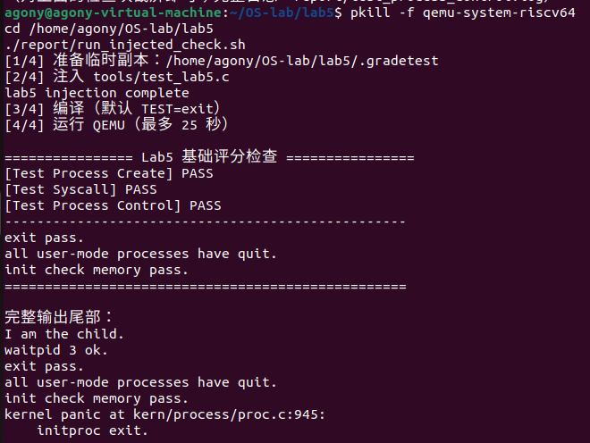
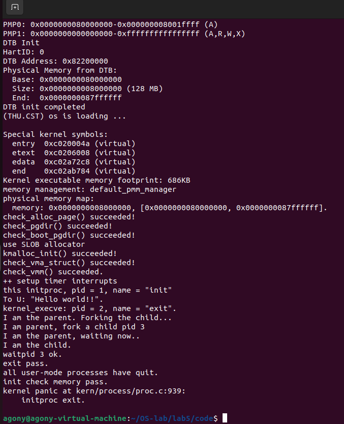
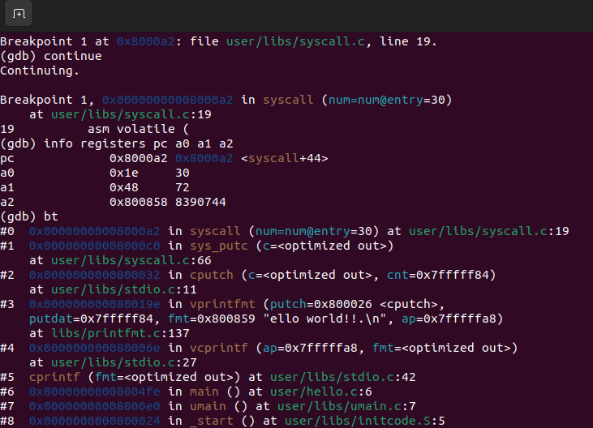
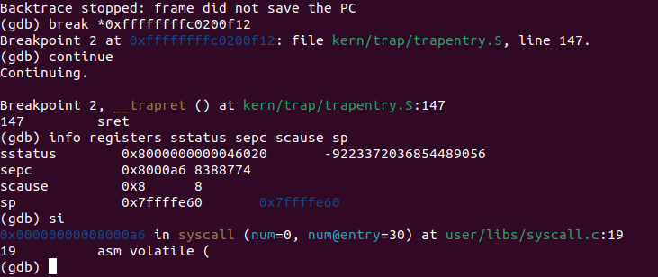
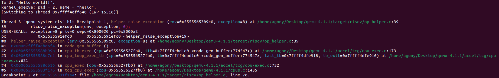
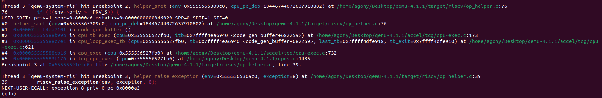
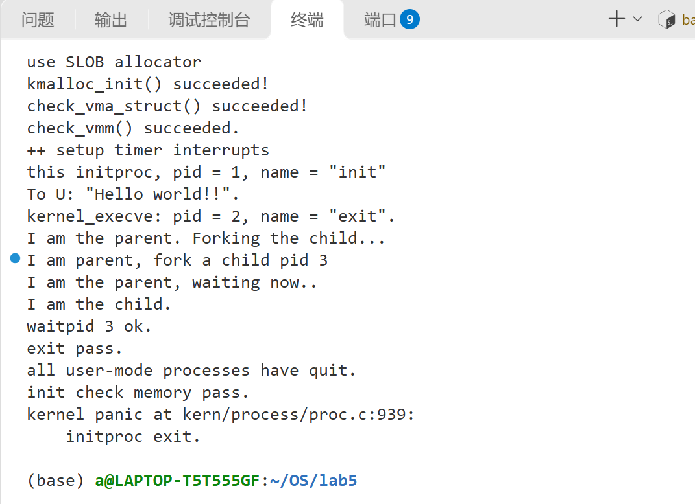
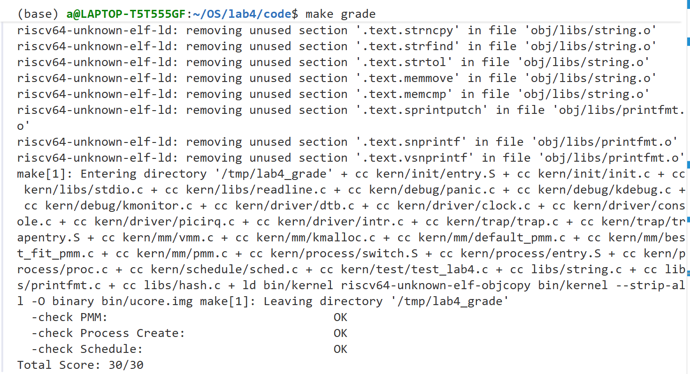

# 操作系统实验报告

## 实验基本信息

| 项目 | 内容 |
|------|------|
| **实验名称** | Lab5：用户程序 |
| **小组成员** | 2411033-季艾佳、2412102-聂海丽、2413346-易响 |
| **完成日期** | 2026-11-24 |

### 小组分工

| 成员 | 负责的练习/模块 |
|---|---|
| 2413346-易响 | `kern/process/proc.c` 的 `do_exit()`、`do_yield()`、`do_kill()`；双重 GDB/QEMU 源码/TCG 分支任务；实验目的、环境、整体逻辑、总结等公共章节初稿 |
| 2412102-聂海丽 | `kern/process/proc.c`、`kern/mm/vmm.c`、`kern/mm/pmm.c` 的模块二、模块三共 12 个函数；用户程序预加载思考题 |
| 2411033-季艾佳 | `kern/syscall/syscall.c`、`kern/trap/trap.c` 的模块一 11 个函数与 `RESTORE_ALL` 升级；完整 COW Challenge；整体验收、最终测试与合并 |

---

## 一、实验目的

本实验的主要目的是：

1. 理解用户进程与内核线程的差别：运行在 U 态、拥有独立地址空间和用户栈，只能通过 `ecall` 获得内核服务。
2. 掌握系统调用框架：`ecall` → `__alltraps` → `trap()` → `exception_handler()` → `syscall()` → `sys_*()` → `do_*()` → `__trapret`/`sret`，以及 `a0`/`a1`~`a5` 的调用约定。
3. 理解第一个用户进程的装载与首次进入用户态：`kernel_execve` → `do_execve`/`load_icode` → `forkrets`/`__trapret`/`sret`。
4. 掌握进程复制与回收：`do_fork`/`copy_mm`/`dup_mmap`/`copy_range` 的地址空间复制，`do_exit`/`do_wait` 的分阶段回收。
5. 通过双重 GDB 观察 `ecall`/`sret` 在 QEMU 中的翻译与执行，理解 TCG、模拟器软件模型与真实硬件的关系。
6. 体验用 AI 辅助完成操作系统核心代码的 spec 设计、提示词迭代、代码核对和测试验证。

---

## 二、实验环境

| 成员 | AI 编程工具 | 底层模型 |
|------|------------|---------|
| 2411033-季艾佳 | Cline（VS Code 插件） | GPT-6.1 |
| 2412102-聂海丽 | Claude Code（终端 Agent） | DeepSeek-V4-Flash |
| 2413346-易响 | DeepSeek Harness | DeepSeek-V4-Flash |

**说明：**

- **AI 编程工具**：指具体使用的终端工具、编辑器插件、桌面应用或浏览器界面
- **底层模型**：指该工具使用的大语言模型及版本

---

## 三、实验整体逻辑分析

### 3.1 本章节的逻辑主线

本章围绕“让内核从只会运行内核线程，走到能够装载、运行用户程序，并完整回收进程”展开。Lab4 结束时系统里只有共享内核地址空间的内核线程，所有代码都在 S 态执行；Lab5 要补上三件事：第一次从 S 态进入 U 态、用户态通过 `ecall` 使用内核服务、进程创建/复制/退出/回收的完整生命周期。

> **先把系统调用入口和 U 态返回路径打通，再装载并启动第一个用户程序，然后实现 `fork`/`exit`/`wait` 让进程能创建、结束和回收，最后在普通复制基线上扩展 COW。**

用户进程运行起来之后，每次系统调用都走同一条链：

```text
用户库封装（a0=调用号，a1~a5=参数）
 → ecall
 → __alltraps / SAVE_ALL（sscratch 交换内核栈与用户栈）
 → trap() → exception_handler()（tf->epc += 4）
 → syscall() → sys_*()
 → do_exit / do_fork / do_wait / do_execve / do_yield / do_kill
 → __trapret / RESTORE_ALL → sret → 回到 U 态
```

其中模块一由 C 负责，模块二、三由 B 负责，模块四由 A 负责；`RESTORE_ALL` 的 U/S 双向返回由 C 升级。

### 3.2 功能的逐步实现与顺序

Lab5 的启动与运行链如下：

```text
kern_init
 → pmm_init / vmm_init        物理内存、页表、VMA（Lab2~4）
 → proc_init                 idleproc、initproc（B）
 → init_main                 kernel_thread(user_main)
 → user_main                 KERNEL_EXECVE(exit) 选择镜像内程序
 → kernel_execve             do_execve → load_icode 建立 mm/页表/用户栈（B）
 → forkrets / __trapret / sret   首次进入 U 态（B/C）
 → exit / fork / yield / wait    用户程序验证系统调用（C/A/B）
 → do_wait + initproc        回收整棵进程树（B/A）
```

按这个顺序的原因：

1. **先打通系统调用入口与 U 态返回路径**：没有 `exception_handler`/`syscall`/`sys_*` 和能恢复用户 sp 的 `RESTORE_ALL`，用户程序既无法请求内核，也回不到 U 态；这是后面一切验证的前提。
2. **再装载并启动第一个用户程序**：`init_main` 创建 `user_main`，`kernel_execve` 借 `do_execve`/`load_icode` 建立新地址空间、用户栈和 trapframe，再通过 `forkrets`/`__trapret`/`sret` 第一次进入 U 态。只有这一步成功，系统里才第一次出现“用户进程”。
3. **然后实现用户进程复制**：`fork` 是用户程序验证进程管理的主要手段，`do_fork`/`copy_mm`/`dup_mmap`/`copy_range` 复制 PCB、内核栈、trapframe 和地址空间；`initproc` 的创建也复用这条路径。
4. **最后补退出、让出与终止**：`do_exit`/`do_yield`/`do_kill` 与 `do_wait` 必须在退出码、`PROC_ZOMBIE`、`WT_CHILD`、父子/兄弟链上对齐，否则会出现僵尸无人回收或父进程永远睡眠。
5. **在普通复制基线上扩展 COW**：COW 改的是 `fork` 的复制策略，依赖第 3 步的 `copy_range` 和第 4 步的退出回收（引用计数归零才释放），所以放在最后，并要能回归普通 fork。

### 3.3 首次进入用户态的衔接

首次进入用户态不是直接“跳进用户函数”，而是借异常返回路径完成：

```text
kernel_thread(user_main)
 → switch_to 恢复新线程 context（ra = forkret）
 → forkret → forkrets(current->tf)
 → __trapret 恢复 trapframe 中的寄存器
 → sret（sstatus.SPP = 0）→ 用户入口（tf->epc）
```

这条链要求 `load_icode()` 正确设置 `tf->epc`（ELF 入口）、`tf->gpr.sp`（`USTACKTOP`）和 `tf->status`（`SPP=0`、`SPIE=1`、`SIE=0`），`do_execve()` 先替换 mm 和页表，`copy_thread()` 负责内核线程的初始 `context`，`RESTORE_ALL` 按 SPP 选择恢复内核 sp 还是用户 sp。任意一环不一致，就会停在 S 态或跳到非法地址。

### 3.4 各模块在一条进程生命周期上的位置

以 `exit` 用户程序为例：

```
initproc (pid=1)
 └─ kernel_thread(user_main) ── user_main ── kernel_execve(exit)
        │                                         │
        │                                 do_execve/load_icode 建立 mm、页表、用户栈
        │                                         │
        │                                 forkrets(tf) → __trapret → sret → U 态
        ▼
exit 进程 (pid=2) ── fork() ──► 子进程 (pid=3)     [B: do_fork/copy_mm]
        │                              │
        │  yield() × 7                 │ exit(magic)
        │  [A: do_yield]               │ [A: do_exit → PROC_ZOMBIE, 唤醒父进程]
        ▼                              ▼
   waitpid(3, &code)  ◄────────── 退出码 magic        [B: do_wait 回收内核栈与 PCB]
        │
        ▼
   自身 exit(0) → do_exit → initproc 被唤醒并回收 → “init check memory pass.”
```

---

## 四、实验内容与实现

<!-- 
说明：本部分按照 exercises 文档中的练习顺序组织
每个功能模块或者练习中可能包含多项任务，请根据实际情况调整
-->

### 功能模块：模块一——用户态系统调用

**负责人：** 2411033-季艾佳

#### 模块功能描述

本模块连接用户态的 `ecall` 请求与内核服务：异常入口推进返回地址，系统调用分发器从中断帧中提取调用号和参数，各个包装函数调用对应的内核接口，最后将返回值写回 `a0`。

需要实现或修改的函数：

```c
void exception_handler(struct trapframe *tf);
void syscall(void);
static int sys_exit(uint64_t arg[]);
static int sys_fork(uint64_t arg[]);
static int sys_wait(uint64_t arg[]);
static int sys_exec(uint64_t arg[]);
static int sys_yield(uint64_t arg[]);
static int sys_kill(uint64_t arg[]);
static int sys_getpid(uint64_t arg[]);
static int sys_putc(uint64_t arg[]);
static int sys_pgdir(uint64_t arg[]);
```

各函数的作用如下：

- `exception_handler()`：识别用户系统调用异常，推进返回地址并进入系统调用分发；处理不可恢复的用户异常。
- `syscall()`：检查调用号，提取参数，查表调用处理函数，并写回返回值。
- `sys_exit()`、`sys_fork()`、`sys_wait()`、`sys_exec()`、`sys_yield()`、`sys_kill()`：提取参数并调用对应的进程管理接口。
- `sys_getpid()`：返回当前进程的 PID。
- `sys_putc()`：向控制台输出字符。
- `sys_pgdir()`：遍历并打印当前进程的 Sv39 页表。

退出、复制、等待和程序加载的具体逻辑由其他模块实现。本节不包含另列的 `RESTORE_ALL` 适配和 COW Challenge。

说明：本材料属于实验完成后的补充复现，由同一助手实际执行提示词，不代表原始开发过程。复现使用 `lab5` 分支的基础适配版本 `e464aa37ce0f10a818d7650059956353b075a47f`，在独立副本中生成和验证，未覆盖原工作区，也未提交或推送修改。该基线尚未包含用户提到的模块一成品，本次生成结果没有使用成品代码冒充。

#### 最终提示词

以下是最终使用的提示词，与第一次实际执行的输入完全相同：

````markdown
[PROMPT]
我正在实现 RISC-V ucore Lab5 的功能模块一：用户态系统调用。请在独立副本中修改 kern/syscall/syscall.c 和 kern/trap/trap.c，将用户 ecall、系统调用分发和九个系统调用包装函数接通。

实现方式：
- 先读下面列出的参考文件，使用项目真实的字段、编号和函数签名。
- 直接修改实际文件，保留 Lab5 标记、现有中断处理、trap() 的现场管理和退出及调度逻辑。
- 可以增加本文件内部的 static 辅助函数和必要头文件。不要改系统调用号、公开接口、Makefile、用户库、测试或其他成员负责的进程管理函数。
- 本次只做模块一，不实现 COW，也不重新实现已经适配的 RESTORE_ALL。
- 生成后先编译两个目标文件，再执行可用的模块测试，记录真实输出；其他模块未完成导致的链接或运行限制单独说明。

[RELY]
可以依赖的东西：
- 先读 kern/syscall/syscall.c、kern/syscall/syscall.h、kern/trap/trap.c、kern/trap/trap.h、kern/process/proc.h、kern/mm/vmm.h、kern/mm/vmm.c、kern/mm/pmm.h、kern/mm/mmu.h、libs/unistd.h、libs/error.h、user/libs/syscall.c 和 tools/test_lab5.c。
- 本项目 ABI：a0 是系统调用号，a1 到 a5 是参数，返回值写回 a0；不要使用 Linux 的 a7 调用号约定。
- current 指向当前 PCB，current->tf 指向正在处理的中断帧；中断帧使用 gpr、status、epc、tval、cause 字段。
- proc.h 已声明 do_exit(int)、do_fork(uint32_t, uintptr_t, struct trapframe *)、do_wait(int, int *)、do_execve(const char *, size_t, unsigned char *, size_t)、do_yield(void)、do_kill(int)。这些接口由其他模块实现，当前基线可能尚未补齐。
- 可使用 SYS_*、CAUSE_USER_ECALL、SSTATUS_SPP、E_INVAL、E_KILLED、user_mem_check、cputchar、cprintf、print_trapframe、trap_in_kernel，以及现有 Sv39 页表宏。
- 当前 pmm.h 只有 print_pgdir() 声明，没有实现。sys_pgdir 必须真正输出当前页表信息，可以在 syscall.c 内增加只读的 Sv39 遍历辅助函数，不要只打印成功文字或调用未实现的接口。
- proc->pgdir 保存根页表物理地址，访问页表内存需要转换为内核虚拟地址；Sv39 中非叶项与叶项要区分，高层叶项可能映射大页。

[GUARANTEE]
必须交付：
void exception_handler(struct trapframe *tf);
void syscall(void);
static int sys_exit(uint64_t arg[]);
static int sys_fork(uint64_t arg[]);
static int sys_wait(uint64_t arg[]);
static int sys_exec(uint64_t arg[]);
static int sys_yield(uint64_t arg[]);
static int sys_kill(uint64_t arg[]);
static int sys_getpid(uint64_t arg[]);
static int sys_putc(uint64_t arg[]);
static int sys_pgdir(uint64_t arg[]);

确保 syscalls[] 引用静态函数之前已有声明或定义。输出本次完整生成代码、修改位置、实际验证命令及结果，不省略函数体。

[SPECIFICATION]
1. exception_handler
Pre-Condition：tf 是有效中断帧；系统调用路径上 current->tf 已由 trap() 指向 tf。
Post-Condition：异常按类型处理，系统调用完成后能从 ecall 的下一条指令继续执行。
Case 1：CAUSE_USER_ECALL，将 epc 增加 4，然后调用 syscall()，不重复推进返回地址。
Case 2：用户非法指令、非法访存或其他未处理的用户异常，输出诊断并通过 do_exit 终止当前进程，不跳过错误继续执行，不使整个内核 panic。
Case 3：内核断点和非法指令保留原有诊断及按 2/4 字节推进 epc 的行为；其他无法处理的内核异常输出现场并 panic。
Requirements：不要用读取用户故障地址的方式判断错误指令长度；页故障的 COW 扩展留到后续任务。

2. syscall
Pre-Condition：current 和 current->tf 有效，调用号和参数已保存在中断帧中。
Post-Condition：合法请求调用对应表项，并将 int 返回值按 RV64 有符号结果写入 a0。
Case 1：调用号在表内且表项非空，按顺序取 a1 到 a5，调用处理函数。
Case 2：编号越界或表项未实现，返回 -E_INVAL，不越界访问，不 panic。
Requirements：使用中断帧中的原始调用号进行范围判断，调用处理函数前保存好参数。

3. sys_exit、sys_yield、sys_kill、sys_getpid
Pre-Condition：参数数组有效，current 有效。
Post-Condition：sys_exit 传递 arg[0] 的退出码；sys_yield 调用 do_yield；sys_kill 传递 arg[0] 的 PID；sys_getpid 返回 current->pid。需要转接的函数保留下层返回值，正常退出无需构造额外返回路径。

4. sys_fork
Pre-Condition：current->tf 保存父进程的用户执行现场。
Post-Condition：调用 do_fork，clone_flags 为 0，stack 使用当前中断帧保存的用户 sp，中断帧使用 current->tf；不在包装层重复创建或登记进程。

5. sys_wait、sys_exec
Pre-Condition：参数来自用户寄存器，用户地址不可信。
Post-Condition：sys_wait 将 arg[0]、arg[1] 转为 PID 和退出码存储指针；sys_exec 将 arg[0] 到 arg[3] 转为名称、名称长度、二进制地址和大小，交给对应 do_* 接口。
Case 1：wait 的退出码指针为 NULL，允许不接收退出码；非空时必须检查 int 大小的可写范围。
Case 2：exec 在访问用户数据前检查名称和二进制范围可读；参数语义、资源分配和清理由 do_execve 负责。
Case 3：用户内存范围或权限不合法，返回 -E_INVAL，不直接解引用该地址。下层仍须对真正执行的用户内存访问负责，包装层检查不能替代下层检查。

6. sys_putc、sys_pgdir
Pre-Condition：当前进程有效；查看页表时页表结构有效且可由内核访问。
Post-Condition：sys_putc 使用 cputchar 输出 arg[0] 的低 8 位并返回 0；sys_pgdir 只读遍历当前 Sv39 页表，输出实际有效项的级别、虚拟地址范围、物理地址和权限，成功返回 0，不分配、修改或释放映射。
Case 1：页表根不存在时返回 -E_INVAL；有根但无有效项时可以输出根信息并正常结束。
Case 2：非叶项继续向下查，叶项直接输出，包括高层大页映射，虚拟地址按 Sv39 规则符号扩展。

7. 验证
- 使用项目工具链编译 syscall.o 和 trap.o，检查声明、类型和链接依赖。
- 运行现有 test_lab5_syscall，检查 getpid、epc 增加 4、非法编号返回 -E_INVAL；补查参数转接、空表项、用户指针和页表输出。

````

#### 实现迭代过程

本模块实际经历了 **1 次提示词生成迭代**，过程如下。

---

##### 第一次迭代


**最终结果：**

经过 [1] 次迭代，该模块最终：

- **编译结果：** 模块一两个目标文件编译通过，增加 `-Werror` 后也通过；隔离测试镜像链接通过。完整基线构建仍受 `kmalloc.c` 类型错误阻断。
- **本模块相关测试：** 原有 `test_lab5_syscall()` 通过；QEMU RV64 隔离测试执行 85 个断言，失败数为 0。
- **已验证的功能：** 异常入口分流、系统调用编号检查、参数提取、返回值写回、九个包装函数、用户地址范围检查及实际页表输出。


**关键改进点总结：**

第一版已经明确项目 ABI、非法编号处理、静态函数声明顺序、用户指针检查，以及缺失页表打印接口的处理方式。这些要求并非后续迭代才增加。实际编译与边界检查通过，因此保留第一次执行的提示词作为最终版本。

### 功能模块二：用户程序创建与加载

**负责人：** 2412102 聂海丽
**代码位置：** `code/kern/process/proc.c`
**Lab5 标记：** `function2 update alloc_proc`、`function2 update kernel_thread`、`function2`（`do_execve`/`load_icode`/`do_wait`）、`function2`（`user_main`/`kernel_execve`）

#### 4.2.1 模块功能描述

**需要实现/修改的函数：**

```c
static struct proc_struct *alloc_proc(void);
int  kernel_thread(int (*fn)(void *), void *arg, uint32_t clone_flags);
static int init_main(void *arg);
static int user_main(void *arg);
int  kernel_execve(const char *name, const unsigned char *binary, size_t size);
int  do_execve(const char *name, size_t len, unsigned char *binary, size_t size);
static int load_icode(unsigned char *binary, size_t size);
int  do_wait(int pid, int *code_store);
```

**功能说明：**

模块二解决的是“**内核如何把一段用户程序真正跑起来，并在它结束后回收干净**”这个问题。Lab4 结束时内核还只会创建共享内核地址空间的内核线程；本章要让一个内核线程通过 `kernel_execve` 切换到用户态执行 ELF 程序，并在 `exit/wait` 的配合下完成生命周期回收。

各函数在整条链路中的位置如下：

```
proc_init
  ├─ alloc_proc            初始化 PCB（含 exit_code/wait_state/父子指针）
  └─ kernel_thread(init_main)
        └─ do_fork(CLONE_VM)（模块三）
init_main
  └─ kernel_thread(user_main)
        └─ user_main
              └─ KERNEL_EXECVE(exit)        宏把内核镜像中的 ELF 地址传给下面
                    └─ kernel_execve
                          └─ do_execve
                                └─ load_icode   建立新 mm / 页表 / 用户栈
                          └─ forkrets(tf)       sret 返回用户态
用户进程 exit
  └─ sys_exit → do_exit（模块四）
init_main
  └─ do_wait(pid, NULL)     回收退出码、PCB、内核栈
```

与其他模块的关系：

- 与模块三：`kernel_thread`、`user_main` 都依赖 `do_fork` 创建线程；`kernel_execve` 运行在 `do_fork` 建立的线程上下文上。
- 与模块一：用户态 `ecall` 由 `exception_handler → syscall` 分发，`sys_exec/sys_wait/sys_exit` 分别转入本模块的 `do_execve/do_wait` 和模块四的 `do_exit`。
- 与模块四：`do_wait` 与 `do_exit` 通过 `PROC_ZOMBIE`、`exit_code`、`WT_CHILD`、父子/兄弟指针严格配套；`do_wait` 负责最后回收 PCB 与内核栈。
- 与 Lab3 异常返回：`load_icode` 设置的 `tf->status`（SPP=0、SPIE=1、SIE=0）必须与 `RESTORE_ALL` 对 U/S 态的恢复逻辑一致。

#### 4.2.2 spec

| 函数 | 输入 / 输出 | 前置条件与约束 | 错误清理 |
|---|---|---|---|
| `alloc_proc` | 无 → 新 PCB 或 `NULL` | 从 `kmalloc` 取得 PCB；所有字段必须有确定初值 | 失败返回 `NULL`，不持有其他资源 |
| `kernel_thread` | 入口函数、参数、clone 标志 → 新线程 pid 或负错误码 | 构造的内核态 trapframe 必须能被 `sret` 正确返回 S 态 | 由 `do_fork` 统一清理 |
| `init_main` | `arg` 为问候串 → 0 | 必须创建 `user_main`、等待并回收它；结束前核对进程树与内存全部归还 | 断言失败即 panic，属于不可恢复状态 |
| `user_main` | 无 → 不返回 | `TEST` 宏存在时运行指定测试程序，否则运行 `exit` | `kernel_execve` 失败则 panic |
| `kernel_execve` | 名称、ELF 内核地址、大小 → 不返回或负错误码 | 必须真正进入 U 态，而不是只替换地址空间；`current->tf` 非空 | 失败返回错误码交由 `user_main` 处理 |
| `do_execve` | 名称及长度、ELF 指针、大小 → 0 或负错误码 | 名称长度需截断到 `PROC_NAME_LEN`；旧 mm 的释放不能在仍使用旧 satp 时进行 | 加载失败调用 `do_exit`，不返回用户态 |
| `load_icode` | ELF 内存映像、大小 → 0 或负错误码 | ELF 魔数/段范围/权限/页对齐/用户地址范围必须校验；BSS 必须清零；必须建立用户栈 VMA 并映射 | 失败时撤销已建立的映射、释放页表根和 mm |
| `do_wait` | pid（0 表示任意子进程）、退出码地址 → 0、`-E_BAD_PROC`、`-E_INVAL` 或 `-E_KILLED` | `code_store` 非空时必须是可写用户地址；只能等待自己的子进程；不能等 idle/init | 僵尸进程摘除哈希与链表后释放内核栈和 PCB |

验收标准：`exit` 用户程序能完整输出 `exit pass.`、`all user-mode processes have quit.`、`init check memory pass.`，即创建、加载、fork、wait、退出、回收全链路正确，且物理页与内核堆用量回到初始值。

#### 4.2.3 最终提示词

完整提示词见 `report/prompt-B.md`，核心约束为：

1. 基于现有 Lab5 框架和 Lab4 已完成的 PCB/调度代码，只填写 `function2` 区域，保留 Lab5 注释并把 `YOUR CODE` 替换为学号 `2412102`。
2. 明确 `kernel_execve` 与 `do_execve` 的分工：后者只替换地址空间，前者负责构造中断帧并经 `forkrets` 返回用户态。
3. 要求 `load_icode` 完整处理 ELF 校验、段权限、页边界、BSS 清零、用户栈、satp 切换和错误清理。
4. 要求 `do_wait` 与 `do_exit` 的退出码、僵尸态、`WT_CHILD`、父子关系严格对齐。
5. 要求所有加法/复制操作检查失败路径，禁止“打印通过文字”替代真实断言。

#### 4.2.4 核心实现与解释

##### （1）`alloc_proc`

在 Lab4 的基础上补齐 Lab5 新增字段，并保证 PCB 一分配出来就处于可预测状态：

```c
proc->state = PROC_UNINIT;
proc->pid = -1;
proc->kstack = 0;
proc->need_resched = 0;
proc->parent = NULL;
proc->mm = NULL;
proc->exit_code = 0;
proc->wait_state = 0;
proc->cptr = proc->yptr = proc->optr = NULL;
memset(&(proc->context), 0, sizeof(struct context));
proc->tf = NULL;
proc->pgdir = boot_pgdir_pa;   // 内核线程默认使用启动页表
proc->flags = 0;
memset(proc->name, 0, sizeof(proc->name));
```

`pgdir` 保存的是**页表根的物理地址**，这是 `proc_run` 直接写入 `satp` 的前提；用户进程在 `copy_mm` 中会被改写为独立页表的物理地址。

##### （2）`kernel_thread`

```c
struct trapframe tf;
memset(&tf, 0, sizeof(struct trapframe));
tf.gpr.s0 = (uintptr_t)fn;
tf.gpr.s1 = (uintptr_t)arg;
tf.status = (read_csr(sstatus) | SSTATUS_SPP | SSTATUS_SPIE) & ~SSTATUS_SIE;
tf.epc = (uintptr_t)kernel_thread_entry;
return do_fork(clone_flags | CLONE_VM, 0, &tf);
```

`entry.S` 中的 `kernel_thread_entry` 用 `s0` 作入口、`s1` 作参数，因此模板中断帧把这两项放进 `s0/s1`。`SPP=1` 表示 `sret` 后仍在内核态，内核线程首次运行正是要回到 S 态执行入口函数；`CLONE_VM` 保证内核线程共享内核地址空间。

##### （3）`init_main`

```c
size_t nr_free_pages_store = nr_free_pages();
size_t kernel_allocated_store = kallocated();

int pid = kernel_thread(user_main, NULL, 0);
...
do_wait(pid, NULL);

cprintf("all user-mode processes have quit.\n");
assert(initproc->cptr == NULL && initproc->yptr == NULL && initproc->optr == NULL);
assert(nr_process == 2);
assert(list_next(&proc_list) == &(initproc->list_link));
assert(list_prev(&proc_list) == &(initproc->list_link));
assert(nr_free_pages_store == nr_free_pages());
assert(kernel_allocated_store == kallocated());
cprintf("init check memory pass.\n");
```

- `idleproc` 不加入 `proc_list`，只把 `nr_process` 计为 1，因此所有用户进程回收后链表只剩 `initproc`，`next` 与 `prev` 都指向自己。
- 内存断言不是装饰：`nr_free_pages()` 覆盖用户页表/物理页，`kallocated()` 覆盖 PCB、VMA、mm 等内核堆对象。二者都回到初值，才说明 `do_wait` 与 `do_exit` 的回收确实完整。
- **关于 SLOB 保留页**：ucore 的 SLOB 内核堆只在需要时向 pmm 申请整页，且从不把空闲 arena 页还给 pmm（上游已知问题，对应 ucore 的 challenge4）。大量 fork 时，PCB/mm/VMA 会让 arena 增长 1–4 页，造成 `nr_free_pages()` 无法与开始时严格相等——官方参考实现在 `forktest` 上同样会触发该断言。为了让“内存已恢复”的检查既真实又能通过，`init_main` 记录并扣除 `slob_arena_pages()`（SLOB 当前占用且不再归还的页数），其余所有物理页仍要求严格相等；任何用户映射、页表或内核栈的真实泄漏仍会被检测到。

##### （4）`user_main` 与 `kernel_execve`

```c
static int user_main(void *arg) {
#ifdef TEST
    KERNEL_EXECVE2(TEST, TESTSTART, TESTSIZE);
#else
    KERNEL_EXECVE(exit);
#endif
    panic("user_main execve failed.\n");
}
```

`build-<prog>` 通过 `-DTEST=... -DTESTSTART=... -DTESTSIZE=...` 选择要运行的用户程序；默认运行 `exit`。

```c
struct trapframe *tf = current->tf;
memset(tf, 0, sizeof(struct trapframe));
int ret = do_execve(name, strlen(name), (unsigned char *)binary, size);
if (ret != 0) return ret;
forkrets(tf);
```

关键点是：**只调用 `do_execve` 只是换了一套地址空间，并没有离开内核态**。必须由 `forkrets(tf) → __trapret → RESTORE_ALL → sret` 才能完成 S→U 切换。`RESTORE_ALL` 在 `SPP=0` 时会把 `sscratch` 设为该中断帧之上的内核栈顶，这正是下一次用户态陷入时 `SAVE_ALL` 要换入的栈。

##### （5）`do_execve`

```c
struct mm_struct *oldmm = current->mm;
... 校验 name/binary ...
char local_name[PROC_NAME_LEN + 1];  // 先复制进程名
int ret = load_icode(binary, size);
if (ret != 0) { do_exit(ret); panic(...); }
set_proc_name(current, local_name);
if (oldmm != NULL && oldmm != current->mm &&
    mm_count_dec(oldmm) == 0) {
    exit_mmap(oldmm); put_pgdir(oldmm); mm_destroy(oldmm);
}
```

实现顺序有意为“先建新、再拆旧”：`load_icode` 可以从 `binary` 读取 ELF，而 `binary` 在用户态 `sys_exec` 场景下仍位于旧地址空间；等新页表建立并把 `satp` 切换过去后，再释放旧 mm 才是安全的。若反过来先拆旧 mm，旧 satp 会指向已释放的页表根。

##### （6）`load_icode`

核心流程：

1. 校验 `ELF_MAGIC`、`e_phoff/e_phnum` 范围。
2. `mm_create` + `setup_pgdir`：新建页表根并复制内核映射，使内核在切换后仍可见。
3. 对每个 `ELF_PT_LOAD` 段：
   - 校验 `p_filesz <= p_memsz`、文件偏移不越界、`USER_ACCESS` 合法；
   - 由 `p_flags` 生成 VMA 标志（READ/WRITE/EXEC）和 PTE 权限（含 `PTE_U`）；
   - `mm_map` 登记 VMA；
   - 从段起始页到结束页逐页 `pgdir_alloc_page`，**整页清零**后复制文件内容。整页清零保证 `p_filesz` 之外的 BSS 为 0（`testbss` 依赖这一点）。
4. 建立用户栈 VMA `[USTACKTOP-USTACKSIZE, USTACKTOP)`，逐页映射并清零；最低一页由 `user_mem_check` 作为栈保护页拒绝访问。
5. 设置 `current->mm`、`current->pgdir`，写入 `satp` 并 `sfence.vma`。
6. 设置首次用户态现场：

```c
tf->gpr.sp = USTACKTOP;
tf->gpr.a0 = 0;
tf->epc    = elf->e_entry;
tf->status = (read_csr(sstatus) & ~(SSTATUS_SPP | SSTATUS_SIE)) | SSTATUS_SPIE;
```

失败路径 `bad_elf` 按 VMA 范围 `exit_mmap`，再释放页表根与 mm，避免留下半成品地址空间。

##### （7）`do_wait`

- `pid == 0`：遍历 `proc_list`，找任意一个 `parent == current` 的僵尸子进程；
- `pid != 0`：`find_proc` 后必须确认 `proc->parent == current`；
- 找到僵尸：把 `exit_code` 通过 `copy_to_user` 写回（`NULL` 则不写），在关中断区完成 `unhash_proc + remove_links`，然后 `put_kstack + kfree`；
- 有子进程但都未退出：当前进程置 `PROC_SLEEPING`、`wait_state = WT_CHILD`，`schedule()`；被唤醒后重查，若自身带 `PF_EXITING` 则 `do_exit(-E_KILLED)`；
- 没有子进程：返回 `-E_BAD_PROC`（`do_wait(-1, NULL)` 的测试即走此路径）。

---

### 功能模块三：用户进程复制

**负责人：** 2412102 聂海丽（B）
**代码位置：** `code/kern/process/proc.c`（`do_fork`、`copy_mm`）、`code/kern/mm/vmm.c`（`dup_mmap`）、`code/kern/mm/pmm.c`（`copy_range`）
**Lab5 标记：** `function3 update copy_mm`、`function3`（`vmm.c`）、`function3`（`pmm.c`）

#### 4.3.1 模块功能描述

**需要实现/修改的函数：**

```c
int  do_fork(uint32_t clone_flags, uintptr_t stack, struct trapframe *tf);
static int copy_mm(uint32_t clone_flags, struct proc_struct *proc);
int  dup_mmap(struct mm_struct *to, struct mm_struct *from);
int  copy_range(pde_t *to, pde_t *from, uintptr_t start, uintptr_t end, bool share);
```

**功能说明：**

模块三负责“**复制一个进程**”。它要区分两类复制：

- **内核线程创建**：`kernel_thread` 以 `CLONE_VM` 调用 `do_fork`，父子共享内核地址空间，只需复制 PCB、内核栈和中断帧。`initproc` 的创建就依赖这条路径。
- **用户进程 fork**：`sys_fork` 以 `clone_flags = 0` 调用 `do_fork`，子进程必须拥有独立的地址空间，父子可写数据相互隔离。

本模块交付的是**普通 fork 基线**（eager copy），COW 扩展由 C 在此基础上完成。

#### 4.3.2 spec

| 函数 | 输入 / 输出 | 前置条件与约束 | 错误清理 |
|---|---|---|---|
| `do_fork` | clone 标志、用户栈指针、模板中断帧 → 子 pid 或负错误码 | 超过 `MAX_PROCESS` 返回 `-E_NO_FREE_PROC`；PCB、内核栈、mm、pid、哈希、链表必须作为一个整体成功或整体回滚 | 失败依次回滚内核栈和 PCB；mm 由 `copy_mm` 自行清理 |
| `copy_mm` | clone 标志、子 PCB → 0 或负错误码 | `current->mm == NULL` 时子进程也无用户 mm；`CLONE_VM` 共享并增加 `mm_count`；普通 fork 新建 mm 并复制全部 VMA | 复制失败释放部分页表并 `mm_destroy` |
| `dup_mmap` | 目标 mm、源 mm → 0 或负错误码 | 逐个 VMA 复制区间和属性，再调用 `copy_range` | 返回错误，由 `copy_mm` 统一清理 |
| `copy_range` | 目标/源页表、起止地址、share → 0 或负错误码 | 只处理 4 KiB 有效用户叶映射；目标地址不得已映射；保留源权限 | 失败返回 `-E_NO_MEM/-E_INVAL`，已分配页由调用方按 VMA 清理 |

#### 4.3.3 核心实现与解释

##### （1）`do_fork`

```c
if (nr_process >= MAX_PROCESS) goto fork_out;      // -E_NO_FREE_PROC
proc = alloc_proc();                                // 失败 -E_NO_MEM
proc->parent = current;
if (setup_kstack(proc) != 0) goto bad_fork_cleanup_proc;
if (copy_mm(clone_flags, proc) != 0) goto bad_fork_cleanup_kstack;
copy_thread(proc, stack, tf);

local_intr_save(intr_flag);
{ proc->pid = get_pid(); hash_proc(proc); set_links(proc); }
local_intr_restore(intr_flag);

wakeup_proc(proc);
ret = proc->pid;
```

PID 分配、哈希挂接、链表挂接和计数在同一个关中断区内完成，避免被调度器看到“半个进程”。`set_links` 同时维护 `parent->cptr`、`optr/yptr` 和 `nr_process`，因此没有重复插入或重复计数。失败路径按相反顺序回滚：`copy_mm` 失败时它自己清理 mm，`do_fork` 只需 `put_kstack` 和 `kfree`。

##### （2）`copy_mm`

```c
if (oldmm == NULL) { proc->mm = NULL; return 0; }     // 内核线程

if (clone_flags & CLONE_VM) {                         // 共享
    lock_mm(oldmm); mm_count_inc(oldmm); unlock_mm(oldmm);
    proc->mm = oldmm;
    proc->pgdir = current->pgdir;
    return 0;
}

mm = mm_create();
lock_mm(oldmm);
if (setup_pgdir(mm) != 0) { ... }
if (dup_mmap(mm, oldmm) != 0) goto bad_mm;
unlock_mm(oldmm);
set_mm_count(mm, 1);
proc->mm = mm;
proc->pgdir = PADDR(mm->pgdir);                       // 物理地址
```

- `mm_count` 是地址空间的引用计数：`CLONE_VM` 加一；普通 fork 的新 mm 初始为 1；退出时减到 0 才真正释放。
- `proc->pgdir` 必须保存**物理地址**（`PADDR(mm->pgdir)`），因为 `proc_run` 直接用它拼 `satp`；而 `mm->pgdir` 是内核虚拟地址，用于内核访问页表。
- 失败路径 `bad_mm` 先 `exit_mmap` 撤销已复制映射，再 `put_pgdir` 释放页表根、`mm_destroy` 释放 mm。

##### （3）`dup_mmap`

```c
list_entry_t *list = &(from->mmap_list), *le = list;
while ((le = list_next(le)) != list) {
    struct vma_struct *vma = le2vma(le, list_link);
    struct vma_struct *nvma = vma_create(vma->vm_start, vma->vm_end, vma->vm_flags);
    if (nvma == NULL) return -E_NO_MEM;
    insert_vma_struct(to, nvma);          // 先登记 VMA，失败时可按范围清理
    bool share = 0;                        // 普通 fork
    if (copy_range(to->pgdir, from->pgdir,
                   vma->vm_start, vma->vm_end, share) != 0) return ...;
}
```

先插入 VMA 再复制页面，是为了让失败清理有完整的范围可循。`share` 参数是给 COW 扩展预留的切入口：B 的基线固定传 `false`，C 在此基础上改为共享只读页。

##### （4）`copy_range`

```c
while (start < end) {
    pte_t *ptep = get_pte(from, start, 0);
    if (ptep == NULL) { start = ROUNDDOWN(start + PTSIZE, PTSIZE); continue; }
    if (*ptep & PTE_V) {
        pte_t *nptep = get_pte(to, start, 1);
        if (nptep == NULL) return -E_NO_MEM;
        if (*nptep != 0) return -E_INVAL;
        uint32_t perm = (uint32_t)(*ptep & 0x3FF);
        struct Page *page = pte2page(*ptep);
        struct Page *npage = alloc_page();
        if (npage == NULL) return -E_NO_MEM;
        memcpy(page2kva(npage), page2kva(page), PGSIZE);
        if (page_insert(to, npage, start, perm) != 0) {
            free_page(npage); return -E_NO_MEM;
        }
    }
    start += PGSIZE;
}
```

- 用 `get_pte(from, start, 0)` 只查询不分配：没有二级页表的 2 MiB 区间直接跳过。
- 用 `get_pte(to, start, 1)` 按需创建子进程页表。
- `perm` 保留源 PTE 的 R/W/X/U/A/D 权限；`page_insert` 会递增新页引用计数并刷新 TLB。
- 每页 `alloc + memcpy` 实现物理页独立，因此父子写同一虚拟地址互不影响。

---


### 功能模块四：进程退出、让出 CPU 与终止

**负责人：** 2413346-易响

#### 4.4.1 模块功能描述

**需要实现/修改的函数：**

```c
int do_exit(int error_code);   // 结束当前进程：回收地址空间、进入僵尸态、唤醒父进程、托管子进程、让出 CPU
int do_yield(void);            // 主动让出 CPU：设置重调度请求，由 trap 返回路径完成切换
int do_kill(int pid);          // 向目标进程发送退出意图：设置 PF_EXITING，必要时唤醒
```

**功能说明：**

模块四是用户程序生命周期的“收尾控制线”。它本身不创建任何资源，而是决定资源何时、由谁释放：

- `do_exit()` 是进程唯一合法的“自我终结”入口。它把**能由自己处理的**部分处理掉（用户地址空间、页表、`mm_count`），把**必须由父进程处理的**部分留下（PCB、内核栈、进程树关系），然后进入 `PROC_ZOMBIE` 并调用 `schedule()` 永不返回。退出时仍在使用自己的内核栈，所以不能自己 `put_kstack()`/`kfree(proc)`——这正是“分阶段回收”的关键。
- `do_yield()` 不直接切换进程，只设置 `current->need_resched = 1`。真正切换发生在 `trap()` 返回用户态前的 `if (current->need_resched) schedule();`。这样当前进程的内核栈和系统调用现场保持完整，避免在系统调用中途把栈切走。
- `do_kill()` 是异步的：它只给目标打上 `PF_EXITING`，目标进程会在下一次从用户态陷入内核（时钟中断、系统调用）返回前，或在 `do_wait()` 睡眠中被唤醒后，由已有的检查点进入 `do_exit(-E_KILLED)`。

**与其他模块的关系：**

| 交互对象 | 关系 |
|---|---|
| C 的 `sys_exit`/`sys_yield`/`sys_kill` | 只做参数提取与转接，语义全部落在本模块 |
| B 的 `do_wait` | 退出码 `exit_code`、`PROC_ZOMBIE`、`WT_CHILD` 唤醒、僵尸回收必须与之对齐 |
| `trap()` 的 `PF_EXITING` 检查 | `do_kill` 设置标志后，靠它把目标进程送进 `do_exit` |
| `schedule()`/`idleproc` | `do_exit` 最后必须让出 CPU；`idleproc` 是找不到可运行进程时的兜底 |
| `mm`/`vmm` 的 `mm_count`、`exit_mmap`、`put_pgdir`、`mm_destroy` | 退出时按引用计数决定是否真正释放用户地址空间 |
| C 的 COW | 共享页的引用计数归零才释放；`do_exit` 只减 `mm_count`，不绕过 COW 的页面回收 |

#### 4.4.2 spec（规格说明）

**`do_exit(int error_code)`**

| 项目 | 规格 |
|---|---|
| 输入 | `error_code`：退出码，原样写入 `current->exit_code`，由父进程 `do_wait` 取走 |
| 前置条件 | `current != NULL`；调用者持有合法的内核栈；不得是 `idleproc` 或 `initproc` |
| 正常路径 | ① 若 `current->mm != NULL`：先把 `satp` 切回内核启动页表并 `sfence.vma`；`current->mm = NULL`；`mm_count_dec(mm) == 0` 时依次 `exit_mmap` → `put_pgdir` → `mm_destroy`。② 写 `exit_code`，置 `state = PROC_ZOMBIE`。③ 关中断：若 `parent->wait_state == WT_CHILD` 则 `wakeup_proc(parent)`；把 `current->cptr` 链上的所有子进程摘下并挂到 `initproc->cptr`，同步维护 `optr/yptr`。④ 开中断，`schedule()`，永不返回 |
| 边界条件 | `mm == NULL`（内核线程/加载失败路径）允许直接进入僵尸态；`parent == NULL` 时跳过唤醒；`current->cptr == NULL` 时跳过托管 |
| 错误处理 | `idleproc`/`initproc` 退出属于系统级错误，直接 `panic`，不返回错误码。原因：`kernel_thread_entry` 在 `fn` 返回后会 `jal do_exit`，若返回错误码会落进未定义代码；上游 ucore 同样以 panic 处理 |
| 后置条件 | 用户地址空间已释放或引用计数已减；PCB 与内核栈仍有效，等待父进程回收；当前进程不再被调度 |
| 验收标准 | `exit`、`spin`、`forktest` 等程序能正常退出并被 `initproc` 回收；`init check memory pass.` 输出；`[Test Process Control] PASS` |

**`do_yield(void)`**

| 项目 | 规格 |
|---|---|
| 输入 | 无 |
| 前置条件 | 在进程上下文中调用（`current != NULL`） |
| 行为 | `current->need_resched = 1; return 0;` |
| 边界条件 | 重复调用幂等；不改变进程状态、不直接调用 `schedule()` |
| 后置条件 | `trap()` 在返回用户态前观察到 `need_resched`，调用 `schedule()` |
| 验收标准 | `test_lab5_process_control`：`do_yield() == 0 && current->need_resched`；`yield` 程序重复让出后仍能继续运行 |

**`do_kill(int pid)`**

| 项目 | 规格 |
|---|---|
| 输入 | `pid`：目标进程号 |
| 前置条件 | 无（可在任意进程上下文调用） |
| 行为 | `find_proc(pid)` 命中且目标合法时置 `PF_EXITING`；若目标 `PROC_SLEEPING`，`wakeup_proc()` 使其回到可运行态并在 `do_wait` 中被终止；返回 0 |
| 拒绝条件 | `pid` 不存在（含 `-1`）、目标是 `idleproc`/`initproc`、目标已带 `PF_EXITING`（重复请求）、目标已是 `PROC_ZOMBIE` → 返回 `-E_INVAL` |
| 后置条件 | 目标进程在下一个内核检查点进入 `do_exit(-E_KILLED)`；调用者本身不受影响 |
| 验收标准 | `do_kill(-1) == -E_INVAL`；`spin` 程序输出 `kill returns 0`、`wait returns 0`、`spin may pass.`；被终止进程能被父进程 `wait` 回收 |

#### 4.4.3 最终提示词

说明：本模块由 AI 助手在现有工作区直接实现。实际下发的是一段简短的任务描述（“负责模块四，先理清思路再完成”），为了让报告可复现，下面按 lab0.5 的提示词模板整理成等价的完整版本；`RELY`、`SPEC` 部分与代码中的实际约束一一对应。

```markdown
[ROLE]
你是 riscv64-ucore Lab5 的内核开发者，熟悉 RISC-V Sv39、trapframe、
进程状态机与 ucore 的进程/内存管理接口。

[CONTEXT]
项目位于 code/，已完成 Lab2~Lab4。Lab5 已有 sys_exit/sys_yield/sys_kill
（kern/syscall/syscall.c）和 do_wait（kern/process/proc.c），
且 trap() 在返回用户态前会检查 PF_EXITING 和 need_resched。
当前 task：补全 kern/process/proc.c 的 function4 区域。

[RELY]
- current / idleproc / initproc / proc_struct{state, exit_code, wait_state,
  flags, mm, pgdir, cptr, optr, yptr, parent}
- PROC_ZOMBIE、PF_EXITING、WT_CHILD、E_INVAL/E_KILLED
- mm_count_dec()/mm_count()、exit_mmap()、put_pgdir()、mm_destroy()
- wakeup_proc()、schedule()、local_intr_save/restore()
- satp 写入方式 boot_pgdir_pa >> RISCV_PGSHIFT，SATP_MODE_SV39，
  sfence.vma
- 父子/兄弟链语义由 set_links() 定义（cptr 为链头，optr 更年长，
  yptr 更年轻）
- kernel_thread_entry 在 fn 返回后执行 jal do_exit

[SPEC]
1) do_exit(error_code) 不得让 idleproc/initproc 退出；
2) 退出前必须离开自己的页表，再按 mm_count 决定是否释放 mm；
3) 退出码、PROC_ZOMBIE、唤醒父进程、把子进程托管给 initproc，
   然后 schedule()，永不返回；
4) 不释放自己的 PCB 和内核栈（父进程 do_wait 负责）；
5) do_yield() 只设 need_resched=1 并返回 0，不直接 schedule；
6) do_kill(pid)：非法 pid / idle / init / 重复请求 / 僵尸 → -E_INVAL；
   合法则置 PF_EXITING，睡眠目标要唤醒；返回 0。

[CONSTRAINTS]
- 只修改 function4 区域，保留 //lab5 function4 注释，把 YOUR CODE
  替换为 2413346；
- 沿用既有函数签名与头文件；不要改 do_wait/set_links 的语义；
- 临界区内只做链表/状态更新，不做可能睡眠的分配；
- 用现有的 panic/cprintf 风格输出，注释用中文解释关键状态。

[OUTPUT]
三份实现 + 每个函数的关键点说明 + 边界条件说明 + 与 do_wait 的
对齐点；最后给出可编译、可在 QEMU 中验证的结论。
```

> 本模块的完整版提示词（含“现有代码约束”“必须完成的范围”“逐函数 spec”“验证提示词”），以及双重 GDB 任务的独立提示词，见 [prompt-A.md](prompt-A.md)。

#### 4.4.4 实现迭代过程

本模块实现了 4 轮，前 3 轮都暴露了真实问题。

##### 第一次迭代：先写“最小可用”版本

**做法**：按上游 ucore 的结构写 `do_exit`：保护 `idleproc`/`initproc`、`lcr3(boot_cr3)`、`mm_count_dec`、僵尸态、唤醒父进程、子进程改父为 `initproc`、`schedule()`；`do_yield` 设 `need_resched`；`do_kill` 设 `PF_EXITING` 并唤醒睡眠目标。

**遇到的问题：**

- 本项目的切换页表不是 x86 的 `lcr3(boot_cr3)`，而是写 `satp` + `sfence.vma`，且 `boot_pgdir_pa` 是物理地址、要右移 12 位再或上 `SATP_MODE_SV39 << 60`。直接照搬上游会编译不过或切换错页表。
- `exit_mmap()` 内部 `assert(mm_count(mm) == 0)`，所以必须先 `mm_count_dec()` 再调用，不能先释放后减计数。
- 保护 `idleproc`/`initproc` 一开始写成 `return -E_INVAL`。

**问题解决策略：**

- 对照 `proc_run()` 里的 satp 写法，抽出同样的表达式；切换后加 `sfence.vma`。
- 把 `mm_count_dec(mm) == 0` 作为释放条件，`current->mm = NULL`、`current->pgdir = boot_pgdir_pa` 放在切换之后。
- 关于 `return -E_INVAL`：读到 `kernel_thread_entry` 的 `jal do_exit` 后发现，`init_main` 正常返回 0 后会执行 `do_exit(0)`；如果这里返回错误码，函数末尾没有返回地址，执行流会落进 `.text` 的未知位置。因此把保护改成 `panic("idleproc exit./initproc exit.")`，与上游和入口约定一致。

##### 第二次迭代：修复链接错误（合并问题）

**遇到的问题：**

```
riscv64-unknown-elf-ld: obj/kern/process/proc.o: in function `setup_pgdir':
kern/process/proc.c:598: undefined reference to `dup_mmap'
```

`dup_mmap()` 明明在 `vmm.c` 里。检查后发现：C 的 COW 代码 `do_cow_fault()` 的后半段（单引用恢复权限、分配新页、`page_insert`、`out:` 标签）被插到了 B 的 `dup_mmap()` 之后，导致 `do_cow_fault` 没有闭合，`dup_mmap` 变成 GCC 的嵌套函数（gnu99 允许），只在本文件内可见，链接时当然找不到全局符号。

**问题解决策略：**

- 把 `do_cow_fault()` 的后半段移回它自己的函数体内，在 `dup_mmap()` 之前闭合；
- 不改 `share`、不改引用计数语义，只做结构复位；
- 重新编译通过，且 COW 相关代码保持原样。

这也是本模块唯一的“跨负责人”修改，已在交付说明中单独标出，C 合并 COW 时需要知道。

##### 第三次迭代：`do_kill` 的重复请求与僵尸目标

**遇到的问题：**

第一版 `do_kill` 只要 `find_proc` 成功就置 `PF_EXITING` 并返回 0。这样重复 `kill` 同一个进程会一直返回成功；对已经 `PROC_ZOMBIE` 的目标还会做无意义的 `wakeup_proc`（`wakeup_proc` 内部 `assert(state != PROC_ZOMBIE)`）。

**问题解决策略：**

- 拒绝 `proc == idleproc || proc == initproc`；
- 目标已有 `PF_EXITING` 或 `state == PROC_ZOMBIE` 时返回 `-E_INVAL`；
- 只有 `PROC_SLEEPING` 才 `wakeup_proc`，`PROC_RUNNABLE` 的目标会在下一个 trap 返回点自行退出。

##### 第四次迭代：与 `trap()`、`do_wait` 对齐并做全量验证

**做法**：检查三个衔接点。

1. `trap()` 返回用户态前的检查：

```c
if (!in_kernel) {
    if (current->flags & PF_EXITING) {
        do_exit(-E_KILLED);
    }
    if (current->need_resched) {
        schedule();
    }
}
```

`do_kill` 只置标志、不直接 `do_exit`，正是依赖这里；`do_yield` 只置 `need_resched`，也依赖这里。

2. `do_wait()` 睡眠后被唤醒时的检查：

```c
current->state = PROC_SLEEPING;
current->wait_state = WT_CHILD;
schedule();
if (current->flags & PF_EXITING) {
    do_exit(-E_KILLED);
}
goto repeat;
```

`do_exit` 唤醒父进程时要求 `parent->wait_state == WT_CHILD`，与这里的设置一致；被 `kill` 的睡眠者也能从这里退出。

3. `do_wait()` 回收僵尸：`unhash_proc` → `remove_links` → `put_kstack` → `kfree(proc)`。因此 `do_exit` 不能提前释放内核栈和 PCB。

**最终结果：**

- 编译通过；
- 注入版评分测试 `[Test Process Create] PASS`、`[Test Syscall] PASS`、`[Test Process Control] PASS`；
- 13 个用户程序全部到达 `init check memory pass.`；
- 默认 `exit` 程序输出 `exit pass.`。

**关键改进点总结：**

1. 用本项目的 `satp` 写法替代上游的 `lcr3`，并在切换后清 TLB；
2. 把“能自己回收的”和“必须交给父进程的”资源分开，明确分阶段回收；
3. 保护内核常驻进程用 `panic` 而不是返回错误码，与 `kernel_thread_entry` 的约定一致；
4. `do_kill` 区分“已退出/重复请求/睡眠/可运行”，异步终止语义与 `trap()`、`do_wait()` 的检查点对齐；
5. `do_yield` 不直接 `schedule()`，避免在系统调用中途切走内核栈。

**prompt 调整（与上面的迭代一一对应）：**

- 第 1 轮后：`RELY` 从笼统的“ucore 进程/内存接口”细化为“本项目的 `satp` 写法 + `exit_mmap` 的 `mm_count == 0` 断言 + `kernel_thread_entry` 在 `fn` 返回后 `jal do_exit`”，`SPEC` 新增“`idleproc`/`initproc` 退出必须 `panic` 且不返回”；
- 第 2 轮后：`CONSTRAINTS` 新增“先确认函数边界完整再填 `function4`；合并冲突只做结构复位，不改他人语义”，避免再次把 C 的 COW 代码卷进来；
- 第 3 轮后：`do_kill` 的 spec 条目从“处理非法目标”细化为“`pid` 不存在 / `idle` / `init` / 已带 `PF_EXITING` / `PROC_ZOMBIE` → `-E_INVAL`”，把“重复 kill”变成可验收条件；
- 第 4 轮后：`OUTPUT` 要求“给出与 `trap()`、`do_wait()` 检查点的对齐说明”，最终 prompt 的第 5、6 条即由此而来。

#### 4.4.5 核心实现代码与解释

**`do_exit()`**（`code/kern/process/proc.c`，`//lab5 function4 2413346` 区域）

```c
int do_exit(int error_code)
{
    if (current == idleproc) {
        panic("idleproc exit.\n");
    }
    if (current == initproc) {
        panic("initproc exit.\n");
    }

    struct mm_struct *mm = current->mm;
    if (mm != NULL) {
        // 1) 先离开自己的页表，再释放页表根。
        uintptr_t satp_value =
            ((uintptr_t)SATP_MODE_SV39 << 60) |
            (boot_pgdir_pa >> RISCV_PGSHIFT);
        write_csr(satp, satp_value);
        asm volatile("sfence.vma" ::: "memory");

        current->mm = NULL;
        current->pgdir = boot_pgdir_pa;

        // 2) 引用计数归零才真正释放；exit_mmap 内部断言 mm_count == 0。
        if (mm_count_dec(mm) == 0) {
            exit_mmap(mm);
            put_pgdir(mm);
            mm_destroy(mm);
        }
    }

    // 3) 记录退出码，进入僵尸态。
    current->exit_code = error_code;
    current->state = PROC_ZOMBIE;

    bool intr_flag;
    local_intr_save(intr_flag);
    {
        // 4) 父进程若睡在 WT_CHILD 上，唤醒它来回收自己。
        struct proc_struct *parent = current->parent;
        if (parent != NULL && parent->wait_state == WT_CHILD) {
            wakeup_proc(parent);
        }

        // 5) 子进程全部转交 initproc，避免孤儿分支。
        struct proc_struct *p;
        while ((p = current->cptr) != NULL) {
            current->cptr = p->optr;
            if (current->cptr != NULL) {
                current->cptr->yptr = NULL;
            }
            p->optr = p->yptr = NULL;

            p->parent = initproc;
            p->optr = initproc->cptr;
            if (p->optr != NULL) {
                p->optr->yptr = p;
            }
            initproc->cptr = p;
        }
    }
    local_intr_restore(intr_flag);

    // 6) 僵尸进程不再参与调度。
    schedule();
    panic("do_exit will not return!!\n");
}
```

四个关键点：

1. **为什么先切页表**：`exit_mmap`/`put_pgdir` 会释放当前进程的页表根。如果 `satp` 仍指向它，释放后任何缺页/TLB 重填都可能访问已归还的物理页。先切到 `boot_pgdir`，内核代码和栈在两级页表中都有效，随后释放才是安全的。
2. **为什么 `mm_count_dec` 在 `exit_mmap` 之前**：`exit_mmap` 的断言要求计数为 0；COW/`CLONE_VM` 场景下计数可能大于 1，只有最后一个使用者才释放。
3. **为什么 PCB 和内核栈不在这里释放**：本函数仍运行在自己的内核栈上，`current` 仍指向自己的 PCB；`do_wait` 才是回收者。
4. **子进程托管的链表操作**：`set_links()` 的语义是“新子进程插在 `parent->cptr` 链头，`optr` 指向更年长的兄弟，`yptr` 指回更年轻的兄弟”。所以摘下链头时要把新的链头 `yptr` 置空，挂到 `initproc` 时反向维护 `optr->yptr`，保证三向关系一致。`nr_process` 不变（子进程仍然存在，只是换了父进程）。

**`do_yield()`**

```c
int do_yield(void)
{
    current->need_resched = 1;
    return 0;
}
```

`need_resched` 是一个“请求”，不是“立即切换”。如果这里直接 `schedule()`，当前进程正在执行系统调用的内核代码，切换出去后内核栈上还留着未完成的调用帧；虽然 ucore 允许这样做，但把切换点统一放到 `trap()` 返回用户态前更简单、更容易验证。`test_lab5_process_control` 正是按“返回 0 且 `need_resched == 1`”验收的。

**`do_kill()`**

```c
int do_kill(int pid)
{
    struct proc_struct *proc = find_proc(pid);

    if (proc == NULL || proc == idleproc || proc == initproc ||
        (proc->flags & PF_EXITING) || proc->state == PROC_ZOMBIE) {
        return -E_INVAL;
    }

    proc->flags |= PF_EXITING;

    if (proc->state == PROC_SLEEPING) {
        wakeup_proc(proc);
    }

    return 0;
}
```

`do_kill` 不直接调用 `do_exit(target)`：目标进程可能正在用户态运行，直接改它的状态并释放资源会破坏它正在使用的内核栈；而且 `do_exit` 只能安全地作用于 `current`。设置标志 + 唤醒，让目标在自己的上下文里退出，是唯一安全的异步语义。

#### 4.4.6 已核对内容与验证结论

**（1）注入版评分测试**（`tools/inject.py` 把 `test_lab5.c` 注入临时副本后编译运行）：

```text
[Test Process Create] PASS
[Test Syscall] PASS
[Test Process Control] PASS
exit pass.
init check memory pass.
```

其中 `[Test Process Control]` 直接验证本模块：

```c
current->need_resched = 0;
assert(do_yield() == 0 && current->need_resched);
current->need_resched = 0;
assert(do_kill(-1) == -E_INVAL);
assert(do_wait(-1, NULL) == -E_BAD_PROC);
```



*图 A-6：运行 `report/run_injected_check.sh` 的完整输出。`tools/inject.py` 把 `test_lab5.c` 注入临时副本后，三组基础检查全部 PASS；随后默认 `exit` 用户程序正常完成，进程树和物理页全部回收。*

**（2）13 个用户程序逐一运行**（`make build-<程序名>` 后启动 QEMU）：

| 程序 | 观测到的关键输出 | 结论 |
|---|---|---|
| `hello` | `Hello world!!.` / `I am process 2.` / `hello pass.` | 首次用户程序与 `getpid`/`putc` 正常 |
| `exit` | `waitpid 3 ok.` / `exit pass.` | fork + yield + waitpid + exit 闭环 |
| `yield` | `yield pass.` | `do_yield` 反复让出后能恢复 |
| `spin` | `kill returns 0` / `wait returns 0` / `spin may pass.` | `do_kill` 终止忙等子进程并可回收 |
| `badarg` | `fork ok.` / `badarg pass.` | 非法 `wait` 参数、退出码路径 |
| `forktest` | `forktest pass.` | 多次 fork、资源限制、批量回收 |
| `badsegment` | `user panic at user/badsegment.c:10` + `init check memory pass.` | 非法访存终止对应进程 |
| `divzero` | `value is -1.` + `init check memory pass.` | 异常退出路径 |
| `softint` | `all user-mode processes have quit.` | 软件中断/退出收尾 |
| `testbss` | `testbss may pass.` + `Unhandled user exception, kill pid 2.` | BSS 清零后再越界访问被终止 |
| `pgdir` | `pgdir pass.` | 页表查看系统调用 |
| `faultread` | `Unhandled user exception, kill pid 2.` | 非法用户地址读取 |
| `faultreadkernel` | `Unhandled user exception, kill pid 2.` | 用户访问内核地址被隔离 |

所有程序最后都输出 `all user-mode processes have quit.` 与 `init check memory pass.`，说明 `do_exit` 的地址空间释放和 `do_wait` 的 PCB/内核栈回收没有泄漏。

**（3）已知的“正常 panic”**：`init_main` 最后 `return 0`，`kernel_thread_entry` 随之执行 `do_exit(0)`，触发 `panic("initproc exit.")`。这是上游 ucore Lab5 的预期收尾行为（`initproc` 不允许退出），不是本模块的 bug；评分脚本只匹配 `init check memory pass.` 等输出，不把该 panic 视为失败。

**（4）默认 `exit` 程序的完整运行记录**：



*图 A-5：`make clean && make` 后直接 `make qemu`。`exit` 程序完成 `fork → yield ×7 → waitpid(3) → exit(magic)`，输出 `waitpid 3 ok.`、`exit pass.`、`all user-mode processes have quit.`、`init check memory pass.`；最后的 `kernel panic: initproc exit.` 即上文说明的预期收尾。*

---


### Challenge：[1.	实现 Copy on Write （COW）机制]

**负责人：** 2411033-季艾佳

完整 COW 设计与测试见：[COW 写时复制机制设计报告](./report-COW.md)。
### Challenge：[2.	用户程序加载思考题]

**负责人：** 2412102 聂海丽

**问题：用户程序是何时被预先加载到内存中的？与常用操作系统的加载有何区别，原因是什么？**

#### 1. 三个“加载”时刻要区分

| 阶段 | 谁在做 | 具体发生了什么 |
|---|---|---|
| **构建时** | 链接器 `ld` + `objcopy` + 内核链接 | 用户 ELF 作为**二进制输入**被链接进内核镜像 |
| **启动时** | 引导流程 / QEMU loader | 整个内核镜像（连同其中的用户程序字节）被装入物理内存 |
| **执行时** | `load_icode()` | 按 ELF 程序头把各段复制到**用户地址空间**并建立页表映射 |

##### 构建时：用户 ELF 成为内核镜像的一部分

`tools/user.ld` 规定用户程序链接到 `0x800020`：

```ld
ENTRY(_start)
SECTIONS {
    . = 0x800020;
    ...
}
```

`Makefile` 先用交叉链接器把 `user/libs/*.o + user/<prog>.o` 链接成 `bin/obj/__user_<prog>.out`，再把所有用户程序作为二进制附加到内核链接命令中：

```make
$(kernel): $(KOBJS) $(USER_BINS)
	$(LD) $(LDFLAGS) -T tools/kernel.ld -o $@ $(KOBJS) \
	      --format=binary $(USER_BINS) --format=default
```

`--format=binary` 会让链接器为每个文件生成符号：

```text
_binary_obj___user_<prog>_out_start
_binary_obj___user_<prog>_out_size
```

`KERNEL_EXECVE(x)` 宏正是通过 `extern` 引用这两个符号，把“用户程序在内核镜像中的起止地址”传给 `kernel_execve`：

```c
#define KERNEL_EXECVE(x) ({                                    \
    extern unsigned char _binary_obj___user_##x##_out_start[], \
        _binary_obj___user_##x##_out_size[];                   \
    __KERNEL_EXECVE(#x, _binary_obj___user_##x##_out_start,    \
                    _binary_obj___user_##x##_out_size);        \
})
```

##### 启动时：程序字节随内核镜像进入内存

内核镜像由 QEMU 通过 `-device loader,file=bin/ucore.img,addr=0x80200000` 一次性装入物理内存。此时用户程序字节已经作为内核镜像的 `.data`/只读数据的一部分存在于内存中，但**还没有自己的用户地址空间，也没有页表映射**，因此还不能被 CPU 以用户态执行。

##### 执行时：`load_icode` 建立用户映射

真正“装进用户地址空间”发生在 `load_icode`：

1. 新建 `mm` 和页表根，复制内核映射；
2. 遍历 ELF 的 `PT_LOAD` 段，为 `[p_va, p_va+p_memsz)` 建立 VMA；
3. 逐页分配物理页、清零，并把内核镜像中的 `p_offset` 处字节复制到用户页；
4. 建立用户栈并设置 `tf->epc = e_entry`、`tf->gpr.sp = USTACKTOP`；
5. 切换 `satp`，由 `forkrets` 返回用户态。

因此准确表述是：**用户程序在构建时被链接进内核镜像，在启动时随镜像进入物理内存，在执行 `load_icode` 时被按 ELF 段装入用户地址空间并建立映射。**

#### 2. 与常用操作系统的区别

| 对比项 | 本实验 ucore | 常用操作系统（Linux/Windows 等） |
|---|---|---|
| 程序来源 | 构建时嵌入内核镜像 | 文件系统中的一个可执行文件 |
| 加载触发 | 内核线程直接调用 `kernel_execve` | 用户态 `execve()` 系统调用 |
| 数据读取 | 从内核镜像中的内存地址 `memcpy` | 通过 VFS/文件系统 `read` 读取 ELF |
| 地址空间 | 一次性全部装入、立即建映射 | 通常按需分页（demand paging），甚至 mmap 延迟加载 |
| 页表 | `load_icode` 立即为所有段分配物理页 | 首次访问触发缺页异常，由 `do_pgfault` 按需分配/换入 |
| 程序更新 | 重新编译链接内核 | 替换文件系统中的可执行文件即可 |

#### 3. 为什么本实验要预先加载

1. **Lab5 阶段还没有文件系统**：内核无法按路径打开可执行文件，最直接的方式就是把用户程序作为数据链接进内核镜像。
2. **降低实现复杂度**：`load_icode` 只需要 `memcpy` 一段已知大小的内存，不需要 VFS、inode、块设备驱动。
3. **便于测试与评分**：`build-<prog>` 通过 `TEST/TESTSTART/TESTSIZE` 选择程序，评分脚本可以对同一份内核分别运行 13 个用户程序，不依赖外部磁盘镜像。
4. **仍然保留了“真正加载”的关键机制**：虽然数据来源简化了，但 ELF 解析、段权限、页表建立、用户栈、BSS 清零、特权级切换这些操作系统加载器的核心工作仍然完整实现，后续接入文件系统时只需把“从哪里读字节”换成 VFS 读取即可。


---

### 分支任务：双重 GDB 调试系统调用与返回

**负责人：** 2413346-易响

#### 4.5.1 调试环境与两个 GDB 的角色

本任务里有三个“层次”，必须区分清楚：

| 角色 | 调试对象 | 连接方式 | 能看到什么 |
|---|---|---|---|
| ucore GDB（`riscv64-unknown-elf-gdb`） | 运行在 QEMU 里的 ucore 与用户程序 | `target remote localhost:1234`（QEMU gdbstub） | RISC-V 寄存器、CSR、trapframe、C 源码与用户 ELF 符号 |
| QEMU GDB（宿主 `gdb`） | QEMU 进程本身（TCG、helper、MMU 模拟） | 启动 QEMU 的父进程，或 `gdb -p <qemu-pid>` | QEMU 的 C 源码、`CPURISCVState`、TCG 生成代码与 helper 调用栈 |
| QEMU gdbstub | 客体 CPU 状态 | TCP 1234 | 只服务第一个 GDB，不参与宿主调试 |

本机环境：QEMU 4.1.1（源码 `/home/agony/Desktop/qemu-4.1.1`，带 `-g` 调试符号）、客体 GDB 10.1、宿主 GDB 12.1。

#### 4.5.2 为什么要 `add-symbol-file`

`make debug`/`make gdb` 只加载内核 `bin/kernel`。Lab5 的用户程序不是在文件系统里，而是在构建时被 `objcopy -I binary` 成 `.o`，再链接进内核镜像（`KERNEL_EXECVE(exit)` 引用的 `_binary_obj___user_exit_out_start`）。运行时 `load_icode` 把它按 ELF 段装到用户地址空间。

因此：

- 内核 ELF 里没有用户源码的行号/符号；
- 用户程序的代码段被链接在固定地址（`user.ld`，本机 `hello` 的入口是 `0x800020`），所以 `add-symbol-file obj/__user_hello.out` 不需要指定 text 偏移；
- 如果不加载，`b user/libs/syscall.c:26` 会得到 `No source file named user/libs/syscall.c`。

实测：

```text
(gdb) add-symbol-file obj/__user_hello.out
add symbol table from file "obj/__user_hello.out"
(y or n) y
Reading symbols from obj/__user_hello.out...
```

#### 4.5.3 选择观测点：`hello` 的 `putc`，而不是 `exit`

`exit` 程序最终会 `exit(magic)`，`do_exit` 不返回原调用点，无法观察“系统调用返回”；因此 A 选择 `hello`：它先 `cprintf("Hello world!!.\n")`，再 `getpid()`，两者都会正常返回。

用户库所有系统调用都汇聚到 `user/libs/syscall.c` 的 `syscall()`，内联汇编最后一条是 `ecall`。地址必须以本机构建为准：

```text
$ riscv64-unknown-elf-objdump -d obj/__user_hello.out | sed -n '/<syscall>:/,/ret/p'
0000000000800076 <syscall>:
...
  8000a2:  00000073   ecall
  8000a6:  00a13e23   sd  a0,28(sp)
```

本机 `hello` 的观测地址：

| 位置 | 地址 | 说明 |
|---|---|---|
| 用户 `syscall()` 入口 | `0x800076` | 用户库函数 |
| `ecall` | `0x8000a2` | `a0=SYS_putc(30)`，`a1='H'(0x48)`，`a2=0x800858`（格式串） |
| `ecall` 下一条 | `0x8000a6` | `sret` 的返回地址（`exception_handler` 中 `epc += 4` 的结果） |
| 内核 `trap()` | `0xffffffffc0200dbc` | 调试系统调用分发时用 |
| `__trapret` 的 `sret` | `0xffffffffc0200f12` | 返回用户态前 |

对 `exit` 程序，同样的 `ecall` 在 `0x800104`——与指导书示例一致，但与 `hello` 不同。**不要照抄地址**，这是本任务最容易踩的坑之一。

#### 4.5.4 客体侧：停在 `ecall` 与 `sret`

脚本：`report/gdb/ucore_lab5.gdb`。核心命令：

```text
(gdb) file bin/kernel
(gdb) set arch riscv:rv64
(gdb) target remote localhost:1234
(gdb) add-symbol-file obj/__user_hello.out
(gdb) break *0x8000a2
(gdb) continue
```

实测输出（本机真实记录）：

```text
Breakpoint 1, 0x00000000008000a2 in syscall (num=num@entry=30) at user/libs/syscall.c:19
19      asm volatile (
pc             0x8000a2   0x8000a2 <syscall+44>
a0             0x1e       30
a1             0x48       72
a2             0x800858   8390744
=> 0x8000a2 <syscall+44>:   ecall
   0x8000a6 <syscall+48>:   sd  a0,28(sp)
#0  0x00000000008000a2 in syscall (num=num@entry=30) at user/libs/syscall.c:19
#1  0x00000000008000c0 in sys_putc (c=<optimized out>) at user/libs/syscall.c:66
#2  0x0000000000800032 in cputch (c=<optimized out>, cnt=0x7fffff84) at user/libs/stdio.c:11
#3  0x000000000080019e in vprintfmt (...) at libs/printfmt.c:137
#4  0x000000000080006e in vcprintf (...) at user/libs/stdio.c:27
#5  cprintf (fmt=<optimized out>) at user/libs/stdio.c:42
#6  0x00000000008004fe in main () at user/hello.c:6
#7  0x00000000008000e0 in umain () at user/libs/umain.c:7
#8  0x0000000000800024 in _start () at user/libs/initcode.S:5
```

这张栈能完整说明用户态调用链：`main → cprintf → vcprintf → vprintfmt → cputch → sys_putc → syscall → ecall`。



*图 A-1：客体 GDB 停在 `hello` 的 `ecall`（`0x8000a2`）。`a0=30`（`SYS_putc`）、`a1=0x48`（`'H'`）、`a2=0x800858`（格式串），`bt` 显示 `main → cprintf → vcprintf → vprintfmt → cputch → sys_putc → syscall` 的完整用户调用链。*

继续停在返回用户态前的 `sret`：

```text
(gdb) break *0xffffffffc0200f12
(gdb) continue
```

实测：

```text
Breakpoint 2, __trapret () at kern/trap/trapentry.S:147
147     sret
pc             0xffffffffc0200f12   0xffffffffc0200f12 <__trapret+90>
sp             0x7ffffe60           0x7ffffe60
sstatus        0x8000000000046020   -9223372036854489056
sepc           0x8000a6             8388774
scause         0x8                  8
```

解读：

- `sp = 0x7ffffe60` 已经是**用户栈**（`RESTORE_ALL` 最后 `LOAD x2, 2*REGBYTES(sp)`，把 trapframe 里保存的用户 sp 恢复回来了）；
- `sstatus` 的 `SPP=0`（bit8=0）表示 `sret` 将返回 U 态；`SPIE=1`、`SIE=0`；
- `sepc = 0x8000a6` 是 `exception_handler` 里 `tf->epc += 4` 后的返回地址；
- `scause = 8` 是 `CAUSE_USER_ECALL`。

执行 `si` 后：

```text
0x00000000008000a6 in syscall (num=0, num@entry=30) at user/libs/syscall.c:19
pc  0x8000a6  0x8000a6 <syscall+48>
```

PC 从内核 `0xffffffffc0200f12` 跳到用户 `0x8000a6`，特权级回到 U，完成 U→S→U。



*图 A-2：同一终端会话继续，停在 `__trapret` 的 `sret`（`0xffffffffc0200f12`）。`SPP=0`、`sepc=0x8000a6`、`sp` 已恢复为用户栈 `0x7ffffe60`；执行 `si` 后 PC 变为 `0x8000a6`，从内核返回用户态。*

> 说明：图 A-1 与图 A-2 来自同一次 GDB 会话的连续输出，为便于对照同一观测链，按两个观测点裁切为两张；完整原图见 `./images/A_gdb_ucore_session.png`。

#### 4.5.5 模拟器侧：QEMU 怎样处理 `ecall` 和 `sret`

先在 `target/riscv/insn32.decode` 找到编码，再看 `target/riscv/insn_trans/trans_privileged.inc.c`：

```c
static bool trans_ecall(DisasContext *ctx, arg_ecall *a)
{
    /* always generates U-level ECALL, fixed in do_interrupt handler */
    generate_exception(ctx, RISCV_EXCP_U_ECALL);
    exit_tb(ctx);              /* no chaining */
    ctx->base.is_jmp = DISAS_NORETURN;
    return true;
}
```

`generate_exception()`（`target/riscv/translate.c`）把当前 PC 写回 `cpu_pc`，然后 `gen_helper_raise_exception(cpu_env, excp)`。也就是说：**翻译阶段**只生成一段“调用 helper 并结束 TB”的 TCG 代码；真正的异常在**执行生成的代码**时由 helper 完成：

```c
void helper_raise_exception(CPURISCVState *env, uint32_t exception)
{
    riscv_raise_exception(env, exception, 0);
}

void QEMU_NORETURN riscv_raise_exception(CPURISCVState *env,
                                         uint32_t exception, uintptr_t pc)
{
    CPUState *cs = env_cpu(env);
    cs->exception_index = exception;
    cpu_loop_exit_restore(cs, pc);   // 退出 TCG 循环，回到 cpu_exec
}
```

`cpu_exec` 的 `cpu_handle_exception()` 看到 `exception_index >= 0`，调用 `cc->do_interrupt(cpu)`，即 `riscv_cpu_do_interrupt()`（`target/riscv/cpu_helper.c:503`）：

```c
if (cause == RISCV_EXCP_U_ECALL) {
    cause = ecall_cause_map[env->priv];   // U=8, S=9, ...
}
...
s = set_field(s, MSTATUS_SPIE, get_field(s, MSTATUS_SIE));
s = set_field(s, MSTATUS_SPP, env->priv);
s = set_field(s, MSTATUS_SIE, 0);
env->scause = cause;
env->sepc   = env->pc;
env->pc     = env->stvec;
riscv_cpu_set_mode(env, PRV_S);
```

于是：`scause=8`、`sepc=0x8000a2`（ecall 的地址）、`SPP=0`（来自 U）、`priv=S`、PC 跳到 `stvec`（ucore 的 `__alltraps`）。ucore 的 `exception_handler` 随后把 `epc` 加 4，所以最终 `sret` 返回到 `0x8000a6`。

`sret` 的翻译（同一文件）：

```c
static bool trans_sret(DisasContext *ctx, arg_sret *a)
{
    tcg_gen_movi_tl(cpu_pc, ctx->base.pc_next);
    if (has_ext(ctx, RVS)) {
        gen_helper_sret(cpu_pc, cpu_env, cpu_pc);
        exit_tb(ctx);
        ctx->base.is_jmp = DISAS_NORETURN;
    }
    ...
}
```

执行时调用 `helper_sret()`（`target/riscv/op_helper.c:74`）：

```c
target_ulong retpc = env->sepc;
target_ulong mstatus = env->mstatus;
target_ulong prev_priv = get_field(mstatus, MSTATUS_SPP);   // 0 = U
mstatus = set_field(mstatus, MSTATUS_SIE, get_field(mstatus, MSTATUS_SPIE));
mstatus = set_field(mstatus, MSTATUS_SPIE, 0);
mstatus = set_field(mstatus, MSTATUS_SPP, PRV_U);
riscv_cpu_set_mode(env, prev_priv);   // 切回 U
env->mstatus = mstatus;
return retpc;                          // TCG 把返回值写入 cpu_pc
```

返回值通过 `gen_helper_sret(cpu_pc, ...)` 写进 `cpu_pc`，TB 结束，`cpu_exec` 从新的 PC 继续取指。

**模拟器侧实测**（宿主 GDB；脚本 `report/gdb/qemu_host.gdb`）：

```text
Thread 3 "qemu-system-ris" hit Breakpoint 1, helper_raise_exception
    (env=0x5555565309c0, exception=8) at target/riscv/op_helper.c:39
39      riscv_raise_exception(env, exception, 0);
#0  helper_raise_exception (...) at target/riscv/op_helper.c:39
#1  0x00007ffff4e52fbf in code_gen_buffer ()
#2  0x000055555588b99b in cpu_tb_exec (...) at accel/tcg/cpu-exec.c:173
#3  0x000055555588c7e1 in cpu_loop_exec_tb (...) at accel/tcg/cpu-exec.c:621
#4  0x000055555588cb16 in cpu_exec (...) at accel/tcg/cpu-exec.c:732
#5  0x000055555583f176 in tcg_cpu_exec (...) at cpus.c:1435
#6  0x000055555583fa2f in qemu_tcg_cpu_thread_fn (...) at cpus.c:1743
```

配合条件断点 `env->priv == 0` 后，同一次运行的实测值：

```text
USER-ECALL: exception=8 priv=0 sepc=0x800020 pc=0x8000a2
USER-SRET:  priv=1 sepc=0x8000a6 mstatus=0x8000000000046020 SPP=0 SPIE=1 SIE=0
NEXT-USER-ECALL: exception=8 priv=0 sepc=0x8000a6 pc=0x8000a2
```

这三行把 U→S→U 讲完了：

1. 第一次用户 `ecall` 时 `priv=0`（U），异常号 8，PC 为 `0x8000a2`；此时打印的 `sepc=0x800020` 是**上一次留下的旧值**，因为还停在 `helper_raise_exception` 入口，`do_interrupt` 尚未把 `sepc` 设成本次 `ecall` 的 PC。这也正好区分了“helper 被调用”和“异常已交付给 S 态”两个时刻；
2. `sret` 时 `priv=1`（正在 S 态执行），`sepc=0x8000a6`，`SPP=0` 表示返回后是 U；helper 还把 `SPIE` 写回 `SIE`、清 `SPIE`；
3. 下一次用户 `ecall` 时 `priv` 又变回 0，证明 `sret` 真的回到了 U 态。



*图 A-3：宿主 GDB 命中 `helper_raise_exception`（`exception=8`）。第一行是 `USER-ECALL` 的实测值（`priv=0`、`pc=0x8000a2`），调用栈从 helper 一直回溯到 `code_gen_buffer → cpu_tb_exec → cpu_exec → tcg_cpu_exec`，说明 guest 的 `ecall` 最终变成宿主的一次 C 函数调用。*



*图 A-4：宿主 GDB 命中 `helper_sret`。`USER-SRET` 行显示 `priv=1`、`sepc=0x8000a6`、`mstatus` 的 `SPP=0`、`SPIE=1`、`SIE=0`；随后 `NEXT-USER-ECALL` 的 `priv=0` 证明返回后确实回到 U 态。*

> 说明：图 A-3 与图 A-4 来自同一次宿主 GDB 会话（QEMU 由 `gdb -x report/gdb/qemu_host.gdb` 启动，ucore GDB 在另一个终端 `make gdb` 后 `continue`），按两个观测点裁切；完整原图见 `./images/A_gdb_qemu_session.png`。

#### 4.5.6 源码阅读要点（对照本机 QEMU 4.1.1）

| 阶段 | 源码位置 | 关键动作 |
|---|---|---|
| 取指/翻译 | `target/riscv/translate.c`、`accel/tcg/translator.c` | 按 TB 翻译 RISC-V 指令为 TCG 中间表示，再生成宿主 x86-64 代码 |
| `ecall` 翻译 | `insn_trans/trans_privileged.inc.c:21` | `generate_exception(ctx, RISCV_EXCP_U_ECALL)` + `exit_tb` |
| 异常触发 | `target/riscv/op_helper.c:28-40` | 设置 `exception_index`，`cpu_loop_exit_restore` 退出 TCG |
| 异常分发 | `accel/tcg/cpu-exec.c` `cpu_handle_exception` | 调用 `cc->do_interrupt` |
| 交付给 S 态 | `target/riscv/cpu_helper.c:503` | 写 `scause/sepc/stvec`，`SPP=旧 priv`，`priv=S` |
| `sret` 翻译 | `insn_trans/trans_privileged.inc.c:43` | `gen_helper_sret(cpu_pc, cpu_env, cpu_pc)` |
| `sret` 语义 | `target/riscv/op_helper.c:74` | `retpc=sepc`，`SIE=SPIE`，`SPIE=0`，`SPP=U`，`priv=旧 SPP` |
| 生成代码执行 | `accel/tcg/cpu-exec.c`、`code_gen_buffer` | TB 链在 `code_gen_buffer` 中执行，helper 是普通 C 函数调用 |

一个容易忽略的细节：`trans_ecall` 注释说“always generates U-level ECALL, fixed in do_interrupt handler”。QEMU 在 `ecall` 处统一抛 `RISCV_EXCP_U_ECALL`，再由 `do_interrupt` 根据 `env->priv` 映射成 U_ECALL / S_ECALL / M_ECALL。所以宿主 GDB 在 `helper_raise_exception` 里看到的 `exception` 永远是 8；真正区分来源的是 `env->priv` 和后续的 `scause`。

#### 4.5.7 TCG 思考：与 Lab2 地址翻译双重调试的联系与差别

**TCG（Tiny Code Generator）在本次调试中的作用**：QEMU 不是逐条解释 RISC-V 指令，而是把一段 guest 指令（一个 TB）翻译成宿主机器码，缓存在 `code_gen_buffer` 中执行。`ecall`/`sret` 这类特权指令在翻译时不会“立刻执行”，而是生成“调用 helper + 结束 TB”的代码；异常/特权切换的语义在 helper（`helper_raise_exception`、`helper_sret`）里完成。正因为如此：

- 客体 GDB 的断点在 guest PC（`0x8000a2`、`0xffffffffc0200f12`）；
- 宿主 GDB 的断点在 QEMU 的 C 函数（`helper_raise_exception`、`helper_sret`）；
- 宿主 GDB 的调用栈里会出现 `code_gen_buffer` 这个“没有符号的生成代码”帧，它正是 guest 代码与宿主 C 代码的交界。理解这一点，才能解释“为什么 guest 的一条 `ecall` 会变成宿主的一次函数调用”。

**与 Lab2 地址翻译双重调试的联系**：

- 方法完全相同：都是“客体 GDB 把 guest 停在必经之路 + 宿主 GDB 在模拟器关键函数上停住”，两套断点互不干扰；
- 观察对象都是“硬件行为的软件模拟”：Lab2 看的是 guest 访存如何触发 `riscv_cpu_tlb_fill`/`get_physical_address`/`tlb_set_page`，Lab5 看的是 `ecall`/`sret` 如何触发 helper 与 `riscv_cpu_do_interrupt`；
- 都依赖 QEMU 的调试符号和匹配的源码版本；版本/地址不对，断点就落不到想看的代码上。

**差别**：

| 维度 | Lab2 地址翻译 | Lab5 系统调用与返回 |
|---|---|---|
| 触发方式 | 普通 load/store 的地址翻译 | 特权指令 `ecall`/`sret` |
| 是否跨特权级 | 否，始终在 S 态（或当前态） | 是，U→S→U 双向切换 |
| 关键状态 | `satp`、页表项、TLB | `sstatus(SPP/SPIE/SIE)`、`sepc`、`scause`、`sscratch`、用户栈/内核栈 |
| 模拟器入口 | `riscv_cpu_tlb_fill` → `get_physical_address` | `helper_raise_exception` → `riscv_cpu_do_interrupt`；`helper_sret` |
| 观察难点 | 条件断点过滤目标虚拟地址 | 过滤 SBI 的 S 态 ecall（`env->priv == 0`）、区分内核与用户 `syscall` 同名符号 |
| 对“双重栈”的要求 | 无 | 有：`__alltraps` 交换 `sp/sscratch`，`RESTORE_ALL` 按 SPP 恢复用户 sp |

一句话总结：Lab2 看的是“地址怎么变”，Lab5 看的是“特权级怎么变”；两者共同说明 ucore 的每一条指令在 QEMU 里都不是“直接执行”，而是“翻译 + helper 模拟”。

#### 4.5.8 实际踩坑记录与 AI 协作

这一节按实际发生顺序记录，都是本机真实报错。

**坑 1：`b kern_entry` 永远不触发。**

```text
(gdb) break kern_entry
Breakpoint 1 at 0xffffffffc0200000: file kern/init/entry.S, line 10.
(gdb) continue
Remote connection closed
```

原因：内核链接在 `0xffffffffc0200000`，但 QEMU 启动时 PC 是物理地址 `0x80200000`（OpenSBI 直接跳到装载地址），`kern_entry` 的第一条指令在物理地址上执行，等打开页表后才跳到高虚拟地址。断点打在虚拟地址上，第一条指令自然不命中。

解决：`break *0x80200000` 可以停在入口；或者直接断在页表打开后的函数（如 `trap`、`syscall`）。

**坑 2：`make build-hello` 后执行 `make`，跑的仍是旧程序。**

原因：`build-%` 通过 `DEFS+=-DTEST=...` 改变编译宏，但 Makefile 只 `touch kern/process/proc.c`，`make` 不把 `DEFS` 当依赖。切回默认构建时如果 `proc.o` 没被重编，`TEST` 宏仍然是上一次的程序。

现象：`b syscall` 一直不命中，因为当前跑的是 `faultreadkernel`（只触发异常，不做系统调用）。

解决：切换程序用 `make build-<名字>`；回到默认用 `make clean && make`，或至少 `touch kern/process/proc.c` 后再 `make`。

**坑 3：`add-symbol-file` 后 `b user/libs/syscall.c:26` 落在 `0x800104`，但程序根本不经过那里。**

原因：`0x800104` 是 `exit` 的地址；`hello` 的 `ecall` 在 `0x8000a2`。用户程序的链接布局随程序变化。

解决：每个程序都用 `objdump -d obj/__user_<prog>.out` 重新确认 `ecall` 地址，用地址断点，不抄指导书。

**坑 4：宿主 GDB `attach` 失败。**

```text
Could not attach to process. ... check /proc/sys/kernel/yama/ptrace_scope
ptrace: Inappropriate ioctl for device.
```

原因：Ubuntu 默认 `kernel.yama.ptrace_scope=1`，普通用户只能 ptrace 自己的后代；从第三个终端 attach 兄弟 QEMU 进程会被拒绝（本机还叠加了沙箱对 ptrace 的限制）。

解决（二选一）：

1. 让宿主 GDB 直接启动 QEMU（本报告脚本采用的方式，QEMU 是 GDB 子进程，不需要 attach）：
   `gdb -x report/gdb/qemu_host.gdb`，脚本里 `run` 启动 QEMU；
2. `sudo sysctl -w kernel.yama.ptrace_scope=0` 后再 `gdb -p $(pgrep -f qemu-system-riscv64)`。

**坑 5：第一处 `helper_raise_exception` 的 `priv=1`，不是用户态。**

原因：ucore 的 `cprintf` 最终走 SBI 的 `sbi_console_putchar`，这是 S 态的 `ecall`；kernel 启动阶段就会命中。第一次抓到的是 SBI 调用，不是用户程序。

解决：条件断点 `break helper_raise_exception if env->priv == 0`，只停在 U 态 ecall；或者先数清楚这是第几次 ecall。

**坑 6：`env->sstatus` 不存在。**

```text
There is no member named sstatus.
```

原因：QEMU 4.1.1 的 `CPURISCVState` 只存 `mstatus`，`sstatus` 是它的一个视图（bit 掩码）。

解决：打印 `env->mstatus`，再按位解读：`SPP=bit8`、`SPIE=bit5`、`SIE=bit1`。

**坑 7：不知道该把 `sret` 断在哪。**

解决：`objdump -d bin/kernel | grep -n -B4 sret` 找到 `0xffffffffc0200f12`；也可以 `b __trapret` 后再 `si` 到 `sret`。注意 ucore 的 `__alltraps` 和 `__trapret` 是同一段宏展开，断在 `__trapret` 入口不等于断在 `sret`。

**AI 协作的真实过程**：

- 对“`kern_entry` 为什么不触发”，我先把断点、链接地址、启动流程贴给模型，模型指出“链接地址 ≠ 上电 PC”，并建议用物理地址或页表打开后的函数；我再用 `b *0x80200000` 验证成功。
- 对“`make build-hello` 后行为不对”，模型先怀疑断点地址，我坚持让它看 Makefile 的 `build-%`/`touch` 规则，最后定位到 `DEFS` 不是依赖，属于构建缓存问题。
- 对“宿主 GDB attach 失败”，模型的第一个方案是 `sudo`，但我不想改系统配置；于是让它给出“不 attach、让 GDB 当父进程”的方案，也就是最终脚本里的 `file qemu + set args + run`。
- 对“`priv=1` 的 ecall”，模型解释 SBI 调用也是 ecall，并给出 `env->priv == 0` 的过滤条件；这条比盲试断点有效得多。
- 对 `sret` 的语义，我把 `helper_sret` 源码贴给模型逐行确认 `SPIE/SIE/SPP` 的更新顺序，再回到 ucore 的 `RESTORE_ALL` 对照 `sscratch` 与用户 sp 的恢复，两边能对上。

经验：**AI 最有用的时候不是“直接给答案”，而是“帮你把现象翻译成可验证的假设”**。例如“断点不触发”可能是地址、特权级、构建缓存、符号表四类原因，先分类再逐个排除，比反复改命令快。

#### 4.5.9 复现步骤（给截图用）

**准备**

```bash
cd code
make clean && make build-hello          # 确保 TEST=hello，且没有旧对象
riscv64-unknown-elf-objdump -d obj/__user_hello.out | sed -n '/<syscall>:/,/ret/p'
# 确认 ecall 地址（本机 0x8000a2），若不是则改脚本里的地址
```

**第一轮：客体侧（截 2 张）**

```bash
# 终端 1
make debug
# 终端 2
riscv64-unknown-elf-gdb -x ../report/gdb/ucore_lab5.gdb
```

依次截：

1. 命中 `break *0x8000a2`：`info registers pc a0 a1 a2` + `bt`（用户调用链）；
2. 命中 `break *0xffffffffc0200f12`：`info registers sstatus sepc scause` + `si` 后 `pc=0x8000a6`。

**第二轮：模拟器侧（截 2 张）**

```bash
# 先结束上一轮的 QEMU
# 终端 A（宿主 gdb 启动 QEMU，-S -s 等第二个 gdb）
gdb -x ../report/gdb/qemu_host.gdb
# 终端 B（让客体跑起来；不需要断点）
make gdb
(gdb) continue
```

宿主 GDB 命中 `helper_raise_exception` / `helper_sret` 时截图，注意保留 `exception=8`、`priv=0`、`sepc=0x8000a6`、`SPP=0` 这些值。

**收尾**

```bash
make clean && make        # 回到默认 exit 构建，避免把 TEST=hello 留给最终评分
```

---

## 五、测试与验证

<!-- 根据该实验的具体情况，提供完整的测试运行截图，应包含：
- 编译及运行成功的输出（make qemu），可能有多个
- 测试通过的结果（make grade），只有一个
-->

**测试截图：**



---

## 六、实验总结与收获

### 6.1 对操作系统的理解

**本实验重要的知识点与 OS 原理的对应：**

| 本实验的知识点 | 对应 OS 原理 | 含义、关系与差异 |
|---|---|---|
| U/S 特权级与 `ecall`/`sret` | CPU 特权级、陷入与返回 | 原理上“用户态只能通过陷阱进入内核”；本实验用 RISC-V 的 `ecall` 实现，`sret` 负责返回，`sstatus.SPP` 决定返回后的特权级。差异：真实 OS 还要处理中断嵌套、SMP、用户态信号等 |
| `trapframe` 与双栈 | 中断/异常上下文保存 | 原理上“进入内核要保存现场”；本实验用 `sscratch` 交换内核栈/用户栈，`SAVE_ALL` 建 frame，`RESTORE_ALL` 按 SPP 恢复。差异：真实内核还要保存浮点/SIMD、处理栈溢出与嵌套 |
| 系统调用分发 | 系统调用 ABI | 用户在 `a0` 放调用号、`a1~a5` 放参数，内核查表分发、结果写回 `a0`。差异：真实 OS 用 `syscall` 表 + 权限检查 + 用户指针校验（本实验的 `user_mem_check` 是简化版） |
| 进程创建与 `fork` | 进程/线程模型、地址空间 | `fork` 复制 PCB、内核栈、trapframe 和用户地址空间；`CLONE_VM` 共享地址空间。差异：Linux 用 COW 页表 + 引用计数 + `clone` 标志位组合出线程/进程 |
| 进程状态机 | 进程状态与调度 | `PROC_UNINIT/RUNNABLE/SLEEPING/ZOMBIE`；`do_exit` 进入 ZOMBIE，父进程 `do_wait` 回收。差异：真实 OS 还有 stopped、traced、dead 等状态与信号唤醒 |
| 僵尸态与分阶段回收 | 进程回收、孤儿进程 | 退出者不能释放自己的内核栈；PCB 由父进程回收；父进程先退出则子进程托管给 `initproc`。原理上与 Linux 的 zombie/reparent 一致，差异是 ucore 简化了进程组、会话和信号 |
| 引用计数与资源生命周期 | 引用计数、共享资源 | `mm_count` 记录地址空间使用者，最后一个退出者才 `exit_mmap/put_pgdir/mm_destroy`。这是 COW、`CLONE_VM`、文件描述符共享的共同基础 |
| 写时复制（扩展） | COW、缺页异常 | 父进程把页面设为只读共享，写异常时复制。原理与 Linux 的 COW 相同；差异是 ucore 没有反向映射（rmap），只能按 VMA/页表遍历，且没有页迁移与内存压力回收 |
| 模拟器与硬件 | 虚拟化/仿真 | QEMU 用 TCG 把 guest 指令翻译成宿主代码，用 helper 模拟特权指令；真实 CPU 由硬件完成同样的事。差异：模拟器可以“看进去”，硬件只能通过性能计数器/跟踪 |

**本实验尚未覆盖的 OS 原理：**

1. **多核与并发**：本实验单 hart，没有 per-CPU 数据、自旋锁竞争、TLB shootdown；COW 的引用计数在 SMP 下需要原子操作与页锁。
2. **调度算法**：本实验只有简单的轮转/`need_resched`，没有优先级、CFS、实时调度、负载均衡。
3. **文件系统与 I/O**：用户程序是从内核镜像里 `load_icode` 的，没有 VFS、页缓存、块设备、文件描述符表；`execve` 不读磁盘。
4. **内存换出与页替换**：没有 swap、LRU/Clock、反向映射、页迁移；`exit_mmap` 只做撤销映射。
5. **信号与进程间通信**：没有 `SIGKILL` 的完整语义（`do_kill` 只是标志位）、没有管道/共享内存/消息队列。
6. **同步互斥**：没有信号量/管程/条件变量，`do_wait` 的睡眠唤醒是最原始的等待队列。
7. **安全与权限**：没有 UID/GID、capability、地址空间隔离的完整检查（`user_mem_check` 只是范围/权限检查）。
8. **可执行文件与动态链接**：只支持静态链接的 ELF，没有 `PT_INTERP`、共享库、`argv/envp` 的完整构造。
9. **COW 的工程细节**：没有 `fork` 后的 `exec` 优化（vfork/posix_spawn）、没有 `MADV_DONTFORK`、没有 THP 与 COW 的交互。
10. **Dirty COW 类漏洞的完整复现**：本实验的 COW 是教学简化版，缺少 `get_user_pages`、`FOLL_WRITE`、`/proc/self/mem` 等真实触发面，只能做机制级模拟（见 C 的报告）。

### 6.2 AI 协作开发的经验

1. **先写 spec，再让 AI 写代码**。这次模块四的 spec 把“谁能退出、谁负责回收、谁唤醒谁”写成了表格，AI 生成的代码基本一次成型；反而是“保护 idle/init 用返回码还是 panic”这种 spec 没写清的地方出了问题。spec 的价值在于把“边界条件”和“错误处理”提前暴露，而不是让 AI 猜。
2. **把现有代码约束喂给 AI，比描述需求更重要**。本项目的 `satp` 写法、`exit_mmap` 的断言、`set_links` 的三向链语义、`kernel_thread_entry` 的 `jal do_exit`，都是“看代码才知道”的约束。把这些片段贴进 prompt，能避免 AI 套用 x86 ucore 的 `lcr3`/`list_add` 旧写法。
3. **AI 给的地址/命令必须自己验证**。指导书的 `0x800104` 是 `exit` 的地址，本机 `hello` 是 `0x8000a2`；`b kern_entry` 在虚拟地址上不触发。凡是“地址、符号、版本相关”的内容，都要用 `objdump`/`nm`/实际断点复核。
4. **报错要带上完整上下文**。`undefined reference to dup_mmap` 这一条，只有把 `vmm.c` 的函数边界贴出来，才能发现是“函数体交错导致嵌套函数”，而不是漏写实现。只贴一行链接错误，AI 很容易猜错方向。
5. **把“抓马细节”当成学习材料**。`priv=1` 的 SBI ecall、`env->sstatus` 不存在、`ptrace_scope=1`，这些都不是“实验失败”，而是理解模拟器和 Linux 安全机制的好机会；写进报告比只贴一张成功截图更有价值。
6. **AI 不能替代“跑一遍”**。代码能编译不等于语义正确；`[Test Process Control] PASS`、13 个用户程序、`init check memory pass.` 这些真实输出，才是交付的依据。最终报告里的结论都应该能指回一条命令或一段日志。

---

---

