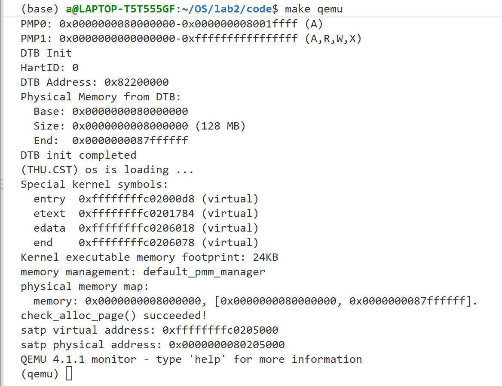
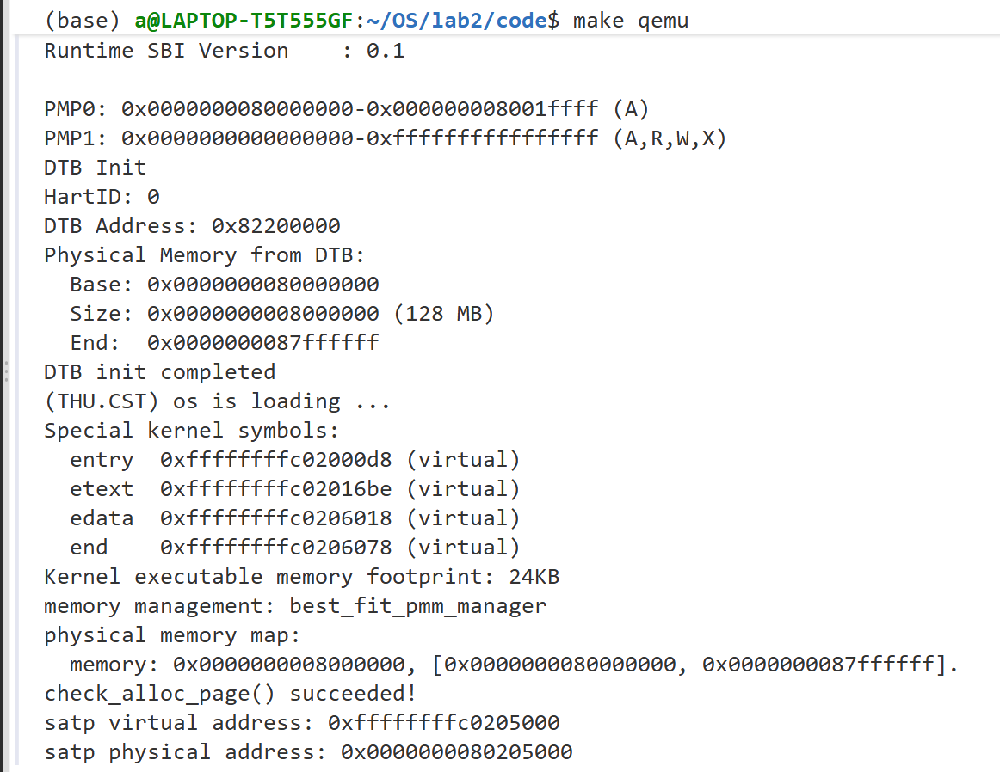
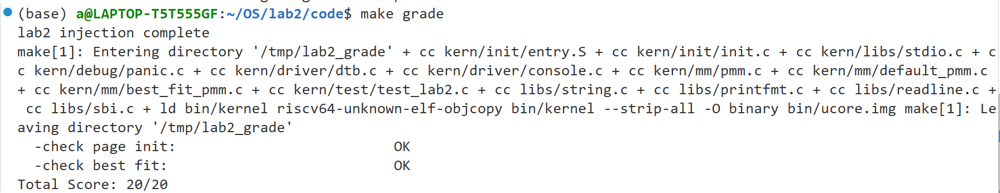

# 操作系统实验报告

## 实验基本信息

| 项目 | 内容 |
|------|------|
| **实验名称** | Lab 2: 物理内存和页表 |
| **小组成员** | 2411033-季艾佳、2412102-聂海丽、2413346-易响 |
| **完成日期** | 2026-10-25 |  

### 小组分工

练习如何分工？

| 成员 | 负责的练习/模块 |
|------|----------------|
| 2411033-季艾佳 | 功能模块一·任务一：物理内存探测与 `page_init()`；功能模块二·任务一：First-Fit 算法理解；功能模块二·任务二：Best-Fit 算法实现并切换物理内存管理器；Challenge：硬件可用物理内存范围获取的思考题；分支任务（GDB 调试 QEMU）丙部分：未开启分页与开启分页的访存路径对比、QEMU TLB 与真实 CPU TLB 的区别；集成测试（`make qemu`、`make grade`） |
| 2412102-聂海丽 | 功能模块二·任务三：Buddy System 分配器实现与测试；分支任务（GDB 调试 QEMU）甲部分：地址翻译的关键调用路径与单步页表遍历 |
| 2413346-易响 | 功能模块三：SLUB 分配器实现与测试；分支任务（GDB 调试 QEMU）乙部分：QEMU 模拟 TLB 查找的 C 代码分析 |

实验报告如何分工？

| 成员 | 负责的报告内容 |
|------|----------------|
| 2411033-季艾佳 | 实验基本信息、实验目的、实验环境、实验整体逻辑分析、测试与验证（截图）、全文整合；以及自己所负责模块与练习的提示词、迭代过程和文字解答 |
| 2412102-聂海丽 | 自己所负责模块与练习的提示词、迭代过程和调试记录；实验总结中“对操作系统的理解”（知识点与 OS 原理的对应与差异、本实验未对应的原理知识点） |
| 2413346-易响 | 自己所负责模块与练习的提示词、迭代过程和调试记录；实验总结中“AI 协作经验” |

---

## 一、实验目的

本实验的主要目的是：

1. **理解页表的建立和使用方法**：理解启动阶段 Sv39 页表如何建立虚拟地址到物理地址的映射，并通过 GDB 同时调试 QEMU 与 ucore，观察一次访存中地址翻译与 TLB 的工作过程，对比未开启分页与开启分页后访存路径的差异。
2. **理解物理内存的管理方法**：理解内核如何通过设备树发现物理内存范围，如何用 `page_init()` 建立物理页描述符（`Page` 数组），排除 OpenSBI、内核镜像和描述符数组占用的空间，并把完整的空闲页面交给 `pmm_manager` 管理，掌握 `pmm_init() → init_pmm_manager() → page_init() → init_memmap() → alloc_pages()/free_pages()` 这条主线。
3. **理解页面分配算法**：在读懂 First-Fit 连续物理内存分配流程的基础上，实现 Best-Fit，并通过 Buddy System 理解另一类页级分配思想；通过 SLUB 进一步理解“页级分配 + 任意大小对象分配”的两层结构。
4. **学习使用 AI 辅助开发操作系统核心功能**：学会为 `page_init()`、Best-Fit、Buddy System、SLUB 设计带有明确接口、约束和测试要求的提示词，并能根据编译报错、测试失败和调试结果迭代优化提示词，识别和修正 AI 生成代码中的错误。

---

## 二、实验环境

你们使用的 AI 工具

| 成员 | AI 编程工具 | 底层模型 | 备注 |
|------|------------|---------|------|
| 2411033-季艾佳 | Cline（VS Code插件） | GPT-5.5| |
| 2412102-聂海丽 |claudecode |deepseekv4flash | |
| 2413346-易响 | DeepSeek Harness| DeepSeek-V4-Flash| |

**说明：**
- **AI 编程工具**：指具体使用的终端工具、编辑器插件、桌面应用或浏览器界面
- **底层模型**：指该工具使用的大语言模型及版本

---

## 三、实验整体逻辑分析

### 3.1 本章节的逻辑主线

本章围绕**物理内存管理**展开，要解决的问题是：内核启动之后，如何发现机器上有多少物理内存，如何把它们组织成可管理的“页”，并提供分配和回收页面的能力，为后续的虚拟内存、进程管理打下基础。

整条主线可以概括为：

`pmm_init() → init_pmm_manager() → page_init() → init_memmap() → alloc_pages() / free_pages()`

1. 内核启动时先由 `entry.S` 建立启动页表并进入虚拟地址空间，同时保存设备树地址。
2. `pmm_init()` 先通过 `init_pmm_manager()` 选定物理内存管理器（`pmm_manager`），它以一组函数指针的形式规定了初始化、分配、回收等接口，具体算法可以随时替换。
3. `page_init()` 从设备树读出物理内存的起点和大小，建立 `Page` 描述符数组，排除 OpenSBI、内核镜像和描述符数组自身占用的区域，再通过 `init_memmap()` 把剩下的完整空闲页交给管理器。
4. 之后所有的页面分配与回收都由管理器的 `alloc_pages()` 和 `free_pages()` 完成，并由各自的 `check` 函数检验正确性。

也就是说，本章把“探测与建立页描述符”（与具体算法无关）和“分配算法”（可替换）分开：前者只做一次，后者通过统一接口实现多种策略。

### 3.2 功能的逐步实现

1. 首先实现 **`page_init()`**：它是所有分配算法的共同前提。没有物理页描述符和初始空闲区，任何分配器都没有可管理的对象，内核检查函数也无法运行。
2. 接着**理解 First-Fit**：它是框架已经提供的基线实现，先读懂空闲链表的初始化、分配、回收与相邻块合并，才能知道 `pmm_manager` 各个接口分别要做什么，也为后面写 Best-Fit 的提示词提供参照。
3. 然后实现 **Best-Fit** 并切换管理器：它与 First-Fit 的区别只在于选块策略，在同一接口下替换算法，既检验了对接口和空闲链表的理解，也验证了管理器可替换的设计。
4. 再实现 **Buddy System**：它是另一类按 2 的幂划分块的页级算法，重点在块的拆分与伙伴合并，是对前面“连续空闲块”思路的扩展。
5. 最后补充 **SLUB**：前面的算法都以页为单位，而内核经常需要几十字节的小对象，因此在页级分配之上再增加一层任意大小的对象分配，形成“页级 + 对象级”的两层结构。
6. 此外通过 **GDB 同时调试 QEMU 与 ucore**，从模拟器的角度观察一次访存中地址翻译与 TLB 的行为，把启动页表和虚拟地址访问联系起来，加深对“页表的建立和使用”的理解。

---

## 四、实验内容与实现

<!-- 
说明：本部分按照 exercises 文档中的练习顺序组织
每个功能模块或者练习中可能包含多项任务，请根据实际情况调整
-->

### 功能模块：page_init()

**负责人：** 2411033-季艾佳

#### 模块功能描述

**需要实现/修改的函数：**

```c
static void page_init(void);
```

**功能说明：**

- `page_init()` 负责物理内存管理的初始化，为后续页面分配和回收建立基础。它读取设备树提供的物理内存起点和大小，设置虚实地址转换偏移，并结合框架的内存上界确定可管理的完整页面范围。随后，在内核镜像结束位置之后按页对齐放置 `Page` 描述符数组，为每个可管理物理页记录状态。

- 初始化时，函数先将所有页面标记为保留，再将描述符数组之后剩余的完整页面登记为空闲页，确保 OpenSBI、内核和描述符数组占用的页面不会被分配。对于设备树信息无效、地址计算溢出或描述符空间不足等情况，函数调用 `panic()` 终止；如果数组能够放下但没有剩余完整页，则不登记空闲区。

- 该函数由 `pmm_init()` 在物理内存管理器初始化后调用，通过 `get_memory_base()` 和 `get_memory_size()` 获取内存信息，借助 `PADDR()`、`pa2page()` 完成地址与描述符之间的转换，最后通过 `init_memmap()` 将空闲页交给当前选中的分配器。因此，它不依赖具体的分配策略，可以为 First-Fit、Best-Fit 和 Buddy 等页分配器提供统一的初始化基础。

#### 最终提示词

以下是经过迭代优化后，最终成功实现该功能的提示词：

````markdown
[PROMPT]
你在为 RISC-V 架构的教学操作系统 ucore（lab2）实现物理内存初始化功能。
内核已经从设备树中读出了内存起点和大小，现在需要建立 Page 描述符数组，
把内核和描述符数组占用的空间保留下来，再把剩余的完整页交给物理内存管理器。
请修改 kern/mm/pmm.c，在 lab2 function1 标记下面实现 page_init()。

实现方式：
  - 先读 pmm.h、memlayout.h、dtb.h 和 default_pmm.c，按现有接口写，
    保持 cprintf 打印、panic 报错和 list.h 链表节点初始化的代码风格。
  - 使用设备树给出的物理内存范围，不要直接把内存大小写死。
  - Page 数组放在内核 end 之后，起点按页对齐，数组本身占用的页也要保留。
  - 先把所有可管理页标成保留，再把剩余完整页交给 init_memmap()。
  - 直接修改实际文件，只补这个函数，不改 pmm.h、memlayout.h、entry.S、Makefile 和测试。
  - 保留已有 Buddy、SLUB 开关，默认仍用 First-Fit，不要在这里切换 Best-Fit。
请先说明地址怎么转换、描述符数组放在哪里、空闲区怎么计算，再给代码。
最后输出完整的 page_init()，不要省略，也不要写“其余同上”。

[RELY]
可以依赖的东西：
- 设备树接口：get_memory_base()、get_memory_size()，返回物理内存起点和字节数。
- 数据结构：struct Page（kern/mm/memlayout.h），字段为 ref / flags / property / page_link。
- 全局变量：pages / npage / nbase / va_pa_offset；链接符号 end 是内核结束的虚拟地址。
- 地址宏：DRAM_BASE=0x80000000，KERNEL_BEGIN_PADDR=0x80200000，
  PHYSICAL_MEMORY_END=0x88000000，PHYSICAL_MEMORY_OFFSET=0xFFFFFFFF40000000。
- 页大小：PGSIZE=4096，PGSHIFT=12；可以用 PPN / ROUNDUP / ROUNDDOWN。
- 地址转换：PADDR、pa2page；页面操作：SetPageReserved、set_page_ref、list_init。
- 已有函数：init_memmap、panic、cprintf。
- 参考 default_init_memmap()：输入页必须是 Reserved 状态，它负责清除保留状态并登记空闲页。

注意：pages[i] 对应物理页号 nbase+i，数组长度是 npage-nbase，不是 npage。
PADDR 会减去 va_pa_offset，使用前要先设置偏移。不要使用项目没有提供的 MIN 或 KADDR。

[GUARANTEE]
必须交付：
1. kern/mm/pmm.c 中完整的 static void page_init(void)。
2. 正确设置 va_pa_offset、npage 和 pages，输出探测到的物理内存范围。
3. 描述符覆盖 [nbase, npage) 内的物理页，只把剩余完整空闲页交给当前管理器。
4. 保留 lab2 function1 注释和其他已有代码，不新增对外接口，不重新实现已有函数。

[SPECIFICATION]
page_init(void)
  Pre-Condition：
  - entry.S 已建立固定映射并开启分页，设备树初始化已经执行。
  - pmm_manager 已经初始化，当前默认使用 First-Fit。

  Post-Condition：
  - Page 数组从内核 end 之后的页边界开始，完整放在可管理内存中。
  - OpenSBI、内核和 Page 数组占用的页保持保留，剩余完整页登记为空闲页。

  Case 1：内存信息有效，而且还有完整空闲页。
  - 管理上界取设备树结束地址和 PHYSICAL_MEMORY_END 中较小的值，再向下按页对齐。
  - npage 是这个上界对应的物理页号，描述符数量是 npage-nbase。
  - 先检查数组能否放下，再初始化 ref / flags / property / page_link，并设置 Reserved。
  - 数组结束地址向上按页对齐后就是空闲区起点，用 pa2page() 转成描述符指针，
    把剩余完整页一次性交给 init_memmap()。

  Case 2：设备树信息无效。
  - 起点或大小为零、起点加大小溢出时，panic 终止。
  - 起点低于 DRAM_BASE、起点高于 KERNEL_BEGIN_PADDR，或结束地址不超过
    KERNEL_BEGIN_PADDR，也要终止，不能继续写描述符或登记空闲页。

  Case 3：没有可管理页，或者放不下描述符数组。
  - panic 终止。容量检查必须放在写数组之前，检查时避免地址加法溢出。

  Case 4：描述符数组放得下，但是没有完整空闲页。
  - 完成描述符初始化并保留这些页，直接返回，不调用 init_memmap(..., 0)。

全局约束
  - 先设置 va_pa_offset，再使用 PADDR；分清虚拟地址、物理地址、物理页号和描述符指针。
  - 内存末尾不足一页的部分不能登记为空闲页。打印末地址时用结束地址减一。
  - 代码按现有 gnu99、-Wall、-Werror 编译，不修改测试，也不自行打印测试通过的信息。
  - 用 make 检查编译，make qemu 检查 First-Fit 自检，make grade 检查 Page Init。
    M0 阶段 Best-Fit 尚未完成，10/20 是预期结果。
````

#### 实现迭代过程

本模块的实现经历了 [1] 次迭代，过程如下：

---

##### 第一次迭代

**最终结果：**

经过 1 次提示词生成迭代，该模块最终：

- ✅ RISC-V 交叉编译、链接通过。
- ✅ 适配后的 QEMU 验证副本中，First-Fit 自检及官方 Page Init 评分项通过。
- ✅ 12 项补充主机模拟检查通过。
- ✅ 已验证行为符合本次规格；主机模拟不证明真实 MMU 行为，也不覆盖所有可能硬件布局。
- 当前完整评分为 10/20；Best-Fit 不在本次完成范围。


**关键改进点总结（如有）：**
1. 在 [RELY] 中使用真实工程名称及地址关系，明确没有 MIN 和可用 KADDR，减少 API 猜测。
2. 在 [SPECIFICATION] 中区分无效范围、数组空间不足、没有完整空闲页三类边界，而不只描述正常路径。
3. 明确数组覆盖 `[nbase,npage)`，避免把物理页号上界误当成描述符数量。
4. 明确先设置地址偏移、先检查数组容量、先保留全部页面的时序，避免越界写或误释放内核内存。
5. 将阶段验收定义为 Page Init 通过，避免为获得 Best-Fit 分数而越界修改其他模块。

---

### Challenge：获取硬件可用物理内存范围

**负责人：** [2411033-季艾佳]

本实验通过**固件传入的设备树 DTB**获取物理内存信息，使内核能够在启动时确定当前硬件的内存范围。

#### 1. **接收设备树地址**

   OpenSBI 启动内核时，通过 `a1` 寄存器传入设备树的物理地址。`entry.S` 将它保存到 `boot_dtb`：

   ```asm
   la t0, boot_dtb
   sd a1, 0(t0)
   ```

#### 2. **解析内存起点和大小**

   `dtb_init()` 将设备树物理地址转换为内核虚拟地址，检查设备树格式，再查找内存节点的 `reg` 属性：

   ```c
   uintptr_t dtb_vaddr = boot_dtb + PHYSICAL_MEMORY_OFFSET;
   ```

   解析代码从该属性中读取物理内存起点和大小：

   ```c
   *mem_base = fdt64_to_cpu(reg_data[0]);
   *mem_size = fdt64_to_cpu(reg_data[1]);
   ```

#### 3. **确定可分配区域**

   `page_init()` 通过接口获取解析结果：

   ```c
   uint64_t mem_base = get_memory_base();
   uint64_t mem_size = get_memory_size();
   ```

   本实验获得的内存起点为 `0x80000000`，大小为 128 MiB。代码在该范围内保留 OpenSBI、内核和页描述符数组占用的空间，再将剩余完整页交给分配器。

因此，**内核可以通过启动时接收并解析设备树，获取当前硬件的物理内存范围，再确定其中可供分配的页面。**
#### 4. **其他主流操作系统的处理方式**

主流操作系统也通过**固件或引导程序提供的内存布局**获取物理内存范围，具体接口取决于硬件平台和启动方式。

**Linux**

- **传统 x86 BIOS 启动**：启动阶段通过 BIOS E820 接口获取内存映射，记录各区域的起点、长度和类型，供内核初始化使用。
- **UEFI 启动**：启动代码通过 `GetMemoryMap()` 获取内存描述符，区分普通内存、固件运行时内存和保留区域。
- **使用设备树的平台**：内核解析 DTB 中的内存节点，确定 RAM 的位置和大小。这与本实验的实现思路相近。

**Windows**

在 UEFI 启动环境中，Windows 的启动加载阶段依据固件内存映射获取物理内存布局。UEFI 通过 `GetMemoryMap()` 提供各区域的地址、页数和类型，供操作系统识别可用内存，并保留固件运行时需要的区域。

这些实现与本实验具有相同的基本流程：
即**固件或引导程序提供内存布局->操作系统读取地址范围和区域属性->保留已占用区域，将可用页面纳入内存管理**


### 练习：理解 First-Fit 连续物理内存分配算法

**负责人：** 2411033-季艾佳

#### 1. 空闲页的组织方式

实验使用 `free_area` 管理空闲页：

```c
static free_area_t free_area;

#define free_list (free_area.free_list)
#define nr_free   (free_area.nr_free)
```

| 成员或标志 | 含义 |
|---|---|
| `free_list` | 空闲块链表的头节点 |
| `nr_free` | 所有空闲块包含的**总页数** |
| 首页的 `property` | **当前空闲块**包含的页数 |
| `PageProperty` | 标记该页是空闲块首页 |

每个物理页都有一个 `Page` 描述符。代码将**空闲块首页的 `page_link`** 挂入链表，并按地址从低到高排列。

```text
free_list ⇄ A块首页 ⇄ B块首页 ⇄ free_list
             3页        5页

nr_free = 3 + 5 = 8
```

#### 2. 初始化空闲页

**第一步：初始化管理结构。**

利用`default_init()` 建立空链表，将已登记的空闲页总数设为零：

```c
list_init(&free_list);
nr_free = 0;
```

**第二步：登记可用页面。**

在`page_init()` 确定可用范围后，通过 `init_memmap()` 调用 `default_init_memmap(base, n)`来将可用页面添加到空闲链表中。

代码先检查并初始化这段页的描述符：

```c
for (; p != base + n; p++) {
    assert(PageReserved(p));
    p->flags = p->property = 0;
    set_page_ref(p, 0);
}
```

随后，用首页记录整个空闲块，并增加空闲页总数：

```c
base->property = n;
SetPageProperty(base);
nr_free += n;
```

最后，代码将首页按地址顺序插入链表。登记完成后，**这段页面即可参与后续分配**。

#### 3. 分配连续物理页

使用`default_alloc_pages(n)`来将可用页面分配给需要的地方。首先检查申请量：

```c
assert(n > 0);

if (n > nr_free) {
    return NULL;
}
```

总页数充足时，代码从头遍历链表，选择**第一个足够大的块**：

```c
while ((le = list_next(le)) != &free_list) {
    struct Page *p = le2page(le, page_link);

    if (p->property >= n) {
        page = p;
        break;
    }
}
```

这就是 **First-Fit（首次适应）** 的选块规则。

```text
按地址排列：A块3页 → B块8页 → C块5页
申请5页：  跳过A → 选中B，停止查找
```

选中后，代码摘下原节点。块大小超过申请量时，将剩余部分挂回原位置：

```c
struct Page *p = page + n;
p->property = page->property - n;
SetPageProperty(p);
list_add(prev, &(p->page_link));
```

例如，从 8 页块中申请 5 页：

```text
[ 分配出去的5页 ][ 剩余空闲的3页 ]
 ↑               ↑
 page            page + 5
```

最后，代码扣减空闲页总数，清除分配块首页的空闲块标志，并返回描述符指针：

```c
nr_free -= n;
ClearPageProperty(page);
return page;
```

另外**分配成功需要存在足够大的连续块。** 

---

### 功能模块：Best-Fit 连续物理内存分配

**负责人：** 2411033-季艾佳

#### 模块功能描述

**需要实现/修改的函数：**

```c
// kern/mm/best_fit_pmm.c：实现
static void best_fit_init(void);
static void best_fit_init_memmap(struct Page *base, size_t n);
static struct Page *best_fit_alloc_pages(size_t n);
static void best_fit_free_pages(struct Page *base, size_t n);
static size_t best_fit_nr_free_pages(void);

```

同时定义 `best_fit_pmm_manager`，将上述函数及已有的 `best_fit_check()` 注册到框架中。

**功能说明：**

- **模块作用**

  Best-Fit 负责连续物理页的分配与回收。申请页面时，代码遍历空闲链表，选择满足申请量的最小空闲块，尽量减少本次分配的剩余空间。

- **空闲页初始化**

  `best_fit_init()` 初始化链表和计数。`best_fit_init_memmap()` 接收 `page_init()` 提供的可用页，初始化描述符，并将块首页按地址顺序插入链表。

- **分配与拆分**

  `best_fit_alloc_pages()` 比较各个合适块的大小，更新候选块。遇到大小恰好等于申请量的块时结束查找。选中块较大时，代码分配前面的页面，将剩余部分作为空闲块挂回链表。

- **释放与合并**

  `best_fit_free_pages()` 将释放区域按地址插入链表，再合并前后物理连续的空闲块。`nr_free` 只增加本次释放的页数，合并时保持原值。

- **与其他模块的交互**

  内核通过 `pmm_manager` 调用分配器。完成注册后，`init_pmm_manager()` 的默认分支选择 Best-Fit。
  后续 `alloc_pages()`、`free_pages()` 和分配器自检均通过对应回调执行。

#### 最终提示词

本次使用以下提示词生成实现，随后完成管理器切换和运行验证。

````markdown
[PROMPT]
我正在完成 RISC-V 教学操作系统 ucore 的 lab2。
目前 page_init() 已完成，默认 First-Fit 可以运行。现在请修改 kern/mm/best_fit_pmm.c，
实现 Best-Fit 连续物理页分配器。

实现方式：
  - 先读 default_pmm.c，参考它的初始化、块拆分、页面回收和相邻块合并方式。
  - 空闲链表仍按地址从低到高排列。
  - 分配时遍历空闲链表，选择能满足申请的最小块。
  - 遇到大小恰好等于申请量的块时，可以结束查找。
  - 文件里目前有 M0 临时骨架，请将它补成真实实现，移除未实现时的 panic 入口。
  - 保留 basic_check() 和 best_fit_check()，两个测试函数的内容保持原样。
  - 本次只修改 best_fit_pmm.c，管理器切换随后单独完成。

请直接修改实际文件。先说明设计，再给出完整实现，最后检查编译结果。

[RELY]
可以依赖的东西：
- 框架接口：struct pmm_manager（pmm.h），成员为 name / init / init_memmap /
  alloc_pages / free_pages / nr_free_pages / check。
- 数据结构：struct Page，字段为 ref / flags / property / page_link；
  free_area_t，成员为 free_list 和 nr_free。
- 页面操作：PageReserved / SetPageProperty / ClearPageProperty / PageProperty /
  set_page_ref。
- 链表操作：list_init / list_empty / list_next / list_prev / list_add /
  list_add_before / list_del，以及 le2page。
- 已有函数：assert、cprintf。
- 参考实现：default_pmm.c 中的对应管理函数。
- 已有测试：本文件中的 basic_check() 和 best_fit_check()。

测试函数直接使用 free_list 和 nr_free。请保留或补齐模块内的 free_area，
以及对应的两个宏，保持测试所需的状态约定。

[GUARANTEE]
必须实现：
1. best_fit_init(void)
2. best_fit_init_memmap(struct Page *base, size_t n)
3. best_fit_alloc_pages(size_t n)
4. best_fit_free_pages(struct Page *base, size_t n)
5. best_fit_nr_free_pages(void)

上述管理函数均设为 static。
定义 const struct pmm_manager best_fit_pmm_manager，将管理函数注册到对应成员，
.check 指向已有的 best_fit_check，.name 为 "best_fit_pmm_manager"。

[SPECIFICATION]
best_fit_init(void)
  - 初始化本模块的空闲链表，将空闲页总数设为0。
  - 此时 page_init() 尚未执行，只初始化管理结构。

best_fit_init_memmap(struct Page *base, size_t n)
  - 检查 n 大于0，输入页处于 Reserved 状态。
  - 初始化页面状态和引用计数，设置首页的 property 和 PageProperty 标志。
  - 增加空闲页总数，按地址顺序将块首页插入链表。

best_fit_alloc_pages(size_t n)
  - 检查 n 大于0。
  - 遍历空闲块，选择 property 大于等于 n 且最小的块。
  - 同样大小的块选择先遇到的一个；找到恰好 n 页的块时结束查找。
  - 找到后摘下原节点，块大小超过 n 时，将剩余部分作为新空闲块挂回原位置。
  - 空闲页总数减去 n，清除分配块首页的 PageProperty，返回首页描述符。
  - 找不到合适块时返回 NULL，链表和计数保持原样。

best_fit_free_pages(struct Page *base, size_t n)
  - 参考 default_free_pages() 检查页面状态并初始化释放区域。
  - 按地址插入链表，与前后物理连续的空闲块合并。
  - 更新块长度、首页标志和链表节点；空闲页总数只增加本次释放的 n 页。

best_fit_nr_free_pages(void)
  - 返回当前空闲页总数。

全局约束
  - 保持现有头文件和公开接口，通过项目的 gnu99、-Wall、-Werror 编译。
  - 保留 lab2 function2-2 注释，保留已有两个测试函数。
  - 当前默认管理器仍是 First-Fit；本次编译通过后，还需要切换管理器，
    才能通过内核启动流程执行 Best-Fit 自检。
````

#### 实现迭代过程

本模块经历了 **1 次代码生成迭代**，随后完成管理器切换和本机验证。

---

##### 第一次迭代

**生成结果：**

- 补齐五个管理函数及 `best_fit_pmm_manager` 注册结构。
- 保留模块内的 `free_area`、`free_list` 和 `nr_free`。
- 将 First-Fit 的首次匹配逻辑调整为最小合适块选择。
- 保持两个已有检查函数的内容原样。

**编译与运行验证：**

将生成代码写入 `best_fit_pmm.c`，并在 `pmm.c` 中选择 Best-Fit 后，执行：

```bash
make qemu
```

运行输出：

```text
memory management: best_fit_pmm_manager
check_alloc_page() succeeded!
```

这表明内核选择了 Best-Fit，且其 `basic_check()`、`best_fit_check()` 执行通过。

随后执行：

```bash
make grade
```

评分结果：

```text
-check page init:                          OK
-check best fit:                           OK
Total Score: 20/20
```

**最终结果：**

经过 1 次代码生成迭代，该模块达到以下结果：

- ✅ 编译、链接通过。
- ✅ Best-Fit 内置检查通过。
- ✅ 官方评分达到 20/20。
- ✅ 完成默认管理器切换。

**实现要点：**

1. 保持空闲链表按地址排序，方便释放时合并相邻块。
2. 分配时比较块大小，选择最小合适块；相同大小保留先遇到的块。
3. 保留已有测试所依赖的状态约定，使生成实现能够接入现有检查流程。

本次生成后即通过上述验证，提示词保持原样。

---

#### Best-Fit 的改进空间

| 方向 | 当前实现 | 改进思路 |
|---|---|---|
| **查找效率** | 当前最坏情况下遍历全部空闲块，时间复杂度为 `O(k)` | 可以增加按块大小组织的辅助索引，加快最小合适块查找 |
| **碎片控制** | 每次选择最小合适块，可能留下较小的剩余块，同样造成碎片化问题 | 结合不同申请序列，比较碎片数量、最大空闲块及分配成功率，尝试不同算法混用 |
| **代码维护** | 初始化与释放包含重复的有序插入逻辑 | 提取内部辅助函数，统一维护插入操作 |

但是，增加辅助索引需要额外内存和更新操作。现在并不能证明当前的实现不好，**优化时应同时考虑查找开销、维护成本和实际碎片情况**。

### 功能模块：Buddy System（伙伴系统）

**负责人：** 2412102-聂海丽

#### 模块功能描述

**需要实现/修改的函数（新建文件 `kern/mm/buddy_pmm.h` + `kern/mm/buddy_pmm.c`）：**

```c
extern const struct pmm_manager buddy_pmm_manager;   // 供 pmm.c 在 PMM_USE_BUDDY 下选用

static void        buddy_init(void);
static void        buddy_init_memmap(struct Page *base, size_t n);
static struct Page *buddy_alloc_pages(size_t n);
static void        buddy_free_pages(struct Page *base, size_t n);
static size_t      buddy_nr_free_pages(void);
static void        buddy_check(void);
```

**功能说明：**

Buddy System 是本实验里与 First-Fit / Best-Fit 并列的另一种**页级**物理内存分配算法，通过 `struct pmm_manager` 这个函数指针表接入 ucore 的内存管理框架：内核只调用 `alloc_pages / free_pages / nr_free_pages`，具体策略由被选中的管理器实现。本模块把空闲物理页按**阶（order）**组织：第 order 阶的一个空闲块由 `2^order` 个连续物理页组成，块首页挂在 `buddy_free_area[order]` 链表上，首页的 `Page.property` 记录块内页数。

它解决的问题是**外部碎片的可控化**：First-Fit 把空闲区切成任意长度后，长期分配/释放会留下大量难以复用的小碎片；Buddy 把块大小限制为 2 的幂、并要求块按自身大小对齐，换来的是"释放时能以 O(log n) 逐级合并回大块"，代价是**内部碎片**（申请 3 页要占 4 页）。

与其他模块的交互：`page_init()` 把"内核与页描述符数组之后的完整空闲页"交给 `init_memmap()`，本模块负责把它拆成对齐的 2 的幂块；此后 `alloc_pages / free_pages` 供内核（以及 C 的 SLUB）使用；`check()` 由框架在 `pmm_init()` 末尾通过 `check_alloc_page()` 调用。模块内所有非 static 符号统一加 `buddy_` 前缀，宏只写在 `.c` 里，不碰任何共享头文件。

**四个关键设计决定（First-Fit 的习惯写法不能直接搬到 Buddy 上）：**

1. **伙伴运算用"页数组下标"而不是物理地址**：伙伴下标 = `下标 ^ (1 << order)`。因为 `DRAM_BASE = 0x80000000` 是 2³¹ 对齐的，下标的对齐性等价于物理地址的对齐性，用下标运算既简单又不会漏掉 `nbase` 偏移。
2. **初始空闲区必须"对齐拆分"**：`init_memmap()` 拿到的区间长度和起始页号通常都不是 2 的幂、也不按 2 的幂对齐（实测约 31929 页），必须拆成若干个"长度为 2 的幂、起始下标按该幂次对齐"的块。这个分解是唯一的，天然满足"同阶伙伴不会同时空闲"这一不变量——`check()` 的两条强断言正是建立在它之上。
3. **`free` 只能整块回收**（与 First-Fit 最大的行为差异）：`base` 必须按 `round_up(n)` 的块大小对齐，回收的正是那一整块。First-Fit 那种 `free_pages(p0 + 1, 2)`（想把哪一段还回去就还哪一段）在 Buddy 上不成立，代码里用 `assert` 明确拦住了。
4. **`buddy_init()` 里不能访问 `pages` / `npage`**：框架调用顺序是 `init_pmm_manager()`（先调 `init()`）→ `page_init()`，所以 `init()` 执行时 `pages` 还是 `NULL`、`npage` 还是 0，只能初始化模块自己的链表与计数器。

`MAX_ORDER` 取 15（128MB = 32768 页 = 2¹⁵，留足余量）。

---

#### 最终提示词

**提示词①**

````markdown
[PROMPT]
你在为一个 RISC-V 架构的教学操作系统 ucore（lab2）实现页级物理内存管理器。
本 lab 把"物理页分配算法"抽象成可插拔的 struct pmm_manager，内核只通过 pmm_manager->xxx
回调使用它。请**新建**两个文件，实现一个页级 Buddy System（伙伴系统）管理器并接入该框架：
  - 新建 kern/mm/buddy_pmm.c
  - 新建 kern/mm/buddy_pmm.h
实现方式：
  - 先读 kern/mm/default_pmm.c（现成的 First-Fit 参考实现）与 kern/mm/best_fit_pmm.h，
    保持同样的代码风格：cprintf 打印、assert 断言、list.h 双向链表。
  - 空闲块按阶（order）组织：模块内一个 static 的 free_area_t 数组，下标即阶，
    最大阶用宏 MAX_ORDER 表示（取 15）。这类宏只写在 .c 里，不要放进头文件。
  - 分配：块大小向上取整到 2 的幂；若目标阶没有空闲块就向上找更大的阶，取到后逐级对半拆分，
    把拆出的另一半挂到对应阶的空闲链表。
  - 释放：按"伙伴下标 = 当前块下标 XOR (1 << 当前阶)"逐级合并，直到不可合并。
  - 不要修改任何已有文件（尤其 pmm.h / memlayout.h / pmm.c / Makefile）。
请先说明你的设计（阶数怎么记录、初始空闲区怎么拆、合并循环的终止条件），再给代码。
最后输出两份**完整**文件内容（buddy_pmm.h 和 buddy_pmm.c），不要省略、不要写"…其余同上"。

[RELY]
可以依赖的东西：
- 框架接口：struct pmm_manager（kern/mm/pmm.h），成员为 name / init / init_memmap /
  alloc_pages / free_pages / nr_free_pages / check。
- 数据结构：struct Page（kern/mm/memlayout.h，字段 ref / flags / property / page_link）、
  free_area_t{ list_entry_t free_list; unsigned int nr_free; }；
  页标志宏 SetPageReserved / ClearPageReserved / PageReserved / SetPageProperty /
  ClearPageProperty / PageProperty。
- 链表工具：list.h 的 list_init / list_add / list_del / list_empty / list_next 和 le2page。
- 已有函数：cprintf（stdio.h）、assert（assert.h）、memset（string.h）、
  page2pa / pa2page / page_ref / set_page_ref（pmm.h）。
- 参考实现：default_pmm.c 里的 default_init、default_init_memmap、default_alloc_pages、
  default_free_pages、default_nr_free_pages、basic_check，请对照它写。
- 允许 #include 的只有：<pmm.h> <memlayout.h> <list.h> <defs.h> <assert.h> <stdio.h> <string.h>。

[GUARANTEE]
必须交付：
1. kern/mm/buddy_pmm.h —— 仿照 best_fit_pmm.h：include guard + #include <pmm.h>
   + 只导出一行 extern const struct pmm_manager buddy_pmm_manager;
2. kern/mm/buddy_pmm.c —— 定义 const struct pmm_manager buddy_pmm_manager，六个成员
   一个都不能是 NULL：
     .name          = "buddy_pmm_manager"
     .init          = buddy_init
     .init_memmap   = buddy_init_memmap
     .alloc_pages   = buddy_alloc_pages
     .free_pages    = buddy_free_pages
     .nr_free_pages = buddy_nr_free_pages
     .check         = buddy_check
3. 所有非 static 符号一律加 buddy_ 前缀（避免与 default_pmm.c / best_fit_pmm.c 重名）；
   不新增任何导出的全局变量；不修改任何已有文件。

[SPECIFICATION]
每个函数的行为规格：

buddy_init(void)
  - 只初始化你自己的各阶空闲链表与空闲页计数器（模块内 static 数据）。
  - **关键约束**：框架调用顺序是 init_pmm_manager()（先调 pmm_manager->init()）→ page_init()
    → check_alloc_page()。也就是说 buddy_init() 执行时全局变量 pages 仍是 NULL、npage 仍是 0，
    因此这里**不能**遍历 pages 数组，也不能使用 npage。

buddy_init_memmap(struct Page *base, size_t n)
  - 输入区间 [base, base+n) 是"内核与页描述符数组之后、全部可用的完整物理页"，其长度与起始
    页号通常都不是 2 的幂、也不按 2 的幂对齐。
  - 必须把它拆成**若干对齐的 2 的幂块**再挂到对应阶的空闲链表：从区间起点开始，在"不超过剩余
    长度"且"不越过按 2^k 对齐的边界"两个约束下取尽可能大的 k，挂一个块，推进指针，重复到结束。
  - 进入本函数时区间内的页是 Reserved 状态（框架 page_init 先把所有页标为保留，再把这段空闲区
    交给你）。请按 default_init_memmap 的约定：先 assert(PageReserved(p))，然后清零
    flags / property / ref，并统计 nr_free。区间之外的页绝对不要碰。

buddy_alloc_pages(size_t n)
  - 分配 n 页**连续**内存，块大小向上取整到 2 的幂（把该幂次记为阶 k）。
  - 若第 k 阶没有空闲块，就向上找更大的阶，取一块后逐级对半拆分，把拆出的另一半挂到对应阶的
    空闲链表，直到剩下第 k 阶的块并返回。
  - 返回块首页的 struct Page *；分配出去的块要 ClearPageProperty，并扣减空闲页计数。
  - 找不到足够大的块时返回 NULL，**且不得改动任何链表和计数**（失败路径不能有副作用）。

buddy_free_pages(struct Page *base, size_t n)
  - 先按与 alloc **完全相同**的规则把 n 向上取整到 2 的幂，得到阶 k。
  - 然后循环合并：伙伴下标 = 当前块下标 XOR (1 << 当前阶)；若伙伴是同阶空闲块（在同一阶空闲
    链表里）就合并成高一阶的块并继续尝试，直到伙伴不可合并或到达 MAX_ORDER。
  - 合并后更新块的 property 与该阶链表，并增加空闲页计数。
  - 注意：alloc 与 free 的取整必须由同一个函数（或完全一致的规则）实现。

buddy_nr_free_pages(void)
  - 返回所有阶空闲链表里空闲页数的总和。

buddy_check(void)
  - 自测函数，用 assert 判定（失败即 panic），并用 #ifdef ucore_test … #endif 包裹进度打印，
    格式 cprintf("grading: %d / %d points\n", score, sumscore);（便于 make test 观察）。
  - 结束时必须把系统状态恢复原样（保存/恢复 nr_free 与各阶链表）。
  - 至少覆盖：分配大小向上取整到 2 的幂、拆分与伙伴合并、释放后可重新分配、分配失败返回 NULL、
    nr_free_pages 的一致性、边界（最小块 1 页、最大块、非 2 的幂页数）。

全局约束
  - 代码必须通过 -Wall -Werror（发行工具链是 GCC 15，隐式函数声明是硬错误）。
  - cprintf 的格式串必须与参数类型严格匹配：size_t 用 %lu，int 用 %d，地址用 0x%016lx。
````

**提示词②**

````markdown
[PROMPT]
根据我刚生成的 kern/mm/buddy_pmm.c 完整实现。框架要求每个管理器提供一个
check() 自测函数，内核在 pmm_init() 末尾通过 check_alloc_page() 调用它。
请为它写 buddy_check()，并把 pmm_manager 里的 .check 指向它。

[RELY]
- 可用 assert（assert.h）、cprintf（stdio.h）、list.h 的宏（list_next / le2page）、
  PageProperty 等页标志宏（memlayout.h）、alloc_pages / free_pages / nr_free_pages（pmm.h）。
- 可以参考 kern/mm/best_fit_pmm.c 里 best_fit_check 的组织方式：保存状态 → 分段测试 →
  恢复状态 → 遍历空闲链表核对计数。
- 注意：buddy 用的是模块内 static 的各阶空闲链表，不能照抄 best_fit_check 里的
  free_list / nr_free 宏用法，请按 buddy 自己的实现来遍历。

[GUARANTEE]
- 交付完整的 buddy_check() 函数代码（不要省略、不要写"…其余同理"）。
- 该函数要能直接赋给 pmm_manager.check；不需要额外导出其它符号，
  除 buddy_pmm.c 之外不要修改任何文件。

[SPECIFICATION]
1. 只用 assert 做判定，失败即 panic（这是 ucore 的风格，不要用 printf 报告失败）。
2. 用 #ifdef ucore_test … #endif 包裹进度打印，格式：
   cprintf("grading: %d / %d points\n", score, sumscore);
   每完成一类测试打印一次。
3. 必须覆盖以下 7 类：
   (1) 分配大小向上取整到 2 的幂
   (2) 拆分与伙伴合并（释放后能重新拿到同样大小的块）
   (3) 释放后可重新分配（alloc → free → alloc 得到同一个 Page*）
   (4) 分配失败返回 NULL（请求超过最大阶），且失败后 nr_free 不变
   (5) nr_free_pages() 与各阶空闲链表页数总和一致
   (6) 边界：1 页（最小块）、最大阶的块、非 2 的幂页数（3 / 5 / 7 页）
   (7) 碎片场景：分配 A B C 三块，只释放中间的，验证不会错误合并相邻的不同阶块
4. 遍历空闲链表时用 list.h 的宏，并对每个空闲块 assert(PageProperty(p))。
5. 测试结束前把系统状态（各阶链表与空闲页计数）还原原样，避免影响后续内核流程。
````

---

#### 实现迭代过程

本模块经历了 **2 次迭代**（第一轮生成实现，第二轮重新生成并加强测试），另有 1 次**变异测试**用于验证测试本身的有效性。

---

##### 第一次迭代

**做法：** 用提示词①生成 `buddy_pmm.h`（8 行）与 `buddy_pmm.c`（398 行），接入 `pmm_manager`；生成后按计划只做编译，不跑内核。

**结果：**

- ✅ 默认构建 `make` 与 Buddy 构建 `make DEFS="-DPMM_USE_BUDDY"` 均 0 error / 0 warning（GCC 15 的 `-Wall -Werror`）
- ✅ 符号表检查：`obj/kernel.sym` 中新增的非 static 符号只有 `buddy_pmm_manager`，符合"非 static 符号一律加 `buddy_` 前缀"的约束
- ✅ 运行 `make qemu DEFS="-DPMM_USE_BUDDY"` 一次通过：

```
memory management: buddy_pmm_manager
physical memory map:
  memory: 0x0000000008000000, [0x0000000080000000, 0x0000000087ffffff].
check_alloc_page() succeeded!
```

**这一轮没有出现问题**，原因是我们把三条最容易踩的坑**事先写进了提示词的 `[SPECIFICATION]`**，而不是等 AI 生成后再修：

1. **取整规则不对称**（最常见的 bug）：如果 alloc 按 2 的幂取整、free 按原始 `n` 找阶，释放时算出的阶就与分配时不同，伙伴地址随之算错，链表会被破坏。提示词里明确要求"alloc 与 free 的取整必须由同一个函数（或完全一致的规则）实现"，代码里两者都走 `buddy_order_of()`。
2. **初始空闲区被当成一整块**：`init_memmap()` 收到的区间长度（实测约 31929 页）与起始页号都不是 2 的幂，直接当成一个块挂上去会让后续所有伙伴运算失效。提示词里明确要求"拆成若干对齐的 2 的幂块"。
3. **在 `init()` 里遍历 `pages` / 使用 `npage`**：框架的调用顺序决定了此时两者还不可用。提示词里把这一点标为"关键约束"，代码里也留了注释。

**关键改进点总结（迭代前的提示词设计）：**

1. 在 `[RELY]` 里**穷举了可依赖的宏与函数**，避免 AI 自己去猜接口或造轮子；
2. 在 `[SPECIFICATION]` 里**按函数逐条写规格**（而不是按"分配/释放"这种维度），保证 `nr_free_pages` 这类小函数不会被漏掉；
3. 显式写出**框架调用时序**（`init()` 早于 `page_init()`）这一条隐含约定——这是读 `pmm.c` 才能发现的信息，不写进提示词 AI 必然会踩。

---

##### 第二次迭代

**做法：** 用提示词②重新生成测试套件，替换第一次自带的 7 类基础测试；生成后编译并运行。

**这一轮把测试加强了三个地方**（第一次的自测只有"逐条断言"，颗粒度偏粗）：

| 增强 | 内容 | 为什么需要 |
|---|---|---|
| ① 全局结构不变量扫描 | 用 `buddy_check_invariants()` 取代原来的简单统计，在每个阶段后都扫描全部空闲链表：块头标记与 `property` 是否自洽、整块是否落在可管理区间内、**块内除首页外不能出现别的空闲块头**、**同阶伙伴不能同时空闲** | 前两条抓"阶数记错/块越界"，后两条抓"空闲区间重叠（会导致双重分配）"和"该合并的没合并（碎片泄漏）"——这些是逐条断言难以覆盖的结构性错误 |
| ② 拆分形态的精确断言 | 先找一个"本级链表为空、但更高阶有空闲块"的阶 k（这样的请求**必然**触发拆分），分配后逐阶核对块数变化：`j` 阶 −1、`k..j−1` 每阶 +1、其余阶不变 | 原来的 (2) 只断言"分布确实变了"，但其实拿的是整块、可能根本没触发拆分；现在把"拆分"从"应该发生了"变成"确切的形态" |
| ③ 乱序释放压力测试 | 12 个不同大小的块（含 3/5/7 等非 2 的幂），按"逆序释放"和"奇偶分两批释放"两种顺序各跑一轮，结果都必须与初始分布完全一致 | 不同释放顺序会走不同的合并路径，能暴露只在特定合并顺序下才出现的错误 |

另外每个阶段后都补了 **"各阶空闲块分布完全复原"** 的断言（比只比较 `nr_free` 强得多），并在 (1)(6) 增加了"分配出去的块内部不能残留块头标记""按取整后大小释放也合法（`alloc(3)` 之后用 `free(p, 4)`）"两项。

**结果：**

- ✅ 编译 0 error / 0 warning；运行 `check_alloc_page() succeeded!`，7 类测试全部通过
- ✅ `make test DEFS="-DPMM_USE_BUDDY"` 可以看到 7 次 `grading: x / 7 points` 进度打印

**变异测试（验证"测试本身是否有效"）：**

只报告"测试通过"并不能说明测试有没有杀伤力，所以我们做了一个反向实验：**故意在 `buddy_free_pages()` 的合并循环前插入一句 `return;`，即释放时完全不与伙伴合并**，再跑同一套测试：

```
kernel panic at kern/mm/buddy_pmm.c:241:
    assertion failed: !(PageProperty(buddy) && buddy->property == size)
```

报错的正是 `buddy_check_invariants()` 里"同阶伙伴不能同时空闲"那一条（对应源码第 240 行），而且是在**第一次不变量扫描**就抓住了。这证明这套测试确实能识别"漏合并"这一类错误。实验后已把注入的代码还原并重新编译运行，确认恢复正常。

---

#### 测试覆盖说明

`buddy_check()` 共 7 类测试，除 (4) 外每一类结束时都会额外断言"各阶空闲块分布完全复原"，因此任何"该合并没合并"或"错误合并了不该合并的块"都会被立即发现。

| 测试 | 具体做法 | 能抓住什么 bug |
|---|---|---|
| (1) 向上取整到 2 的幂 | `alloc_pages(3)` 后断言 `nr_free` 恰好减少 **4**、返回块按 4 页对齐、块内 4 页均无 `PG_property` | 取整规则不对称；块内部残留块头标记（合并时漏 `ClearPageProperty`） |
| (2) 拆分与伙伴合并 | 强制走拆分路径后，逐阶核对块数变化（`j` 阶 −1、`k..j−1` 每阶 +1）；释放后分布必须**完全复原** | 拆分时高半块没挂进链表、阶数算错；合并没有逐级向上、或合并后没更新 `property` 与链表 |
| (3) 释放后可重新分配 | 记录分配块的伙伴是否被占用，释放后重新分配；若伙伴被占用则必须**原样拿回同一块** | 释放后块没有真正回到空闲链表、或把仍被占用的邻块也回收了 |
| (4) 失败路径 | 请求 `0` 页、超过最大阶、超过全部物理页，都必须返回 `NULL` 且 `nr_free` 不变 | 失败时已经改动了链表或计数（例如拆了一半才发现不够） |
| (5) 计数一致性 | `nr_free_pages()` 与各阶链表页数总和、以及不变量扫描的累计值三者相等 | "扣了计数没摘链表"这类记账错误 |
| (6) 边界 | 最小块（1 页）、非 2 的幂（3/5/7 页，分别按 4/8/8 页计）、按取整后大小释放（`alloc(3)` → `free(p,4)`）、最大块（取当前最高阶的块） | 1 页走的是"从最大阶一路拆到最后"的最长拆分链；最大阶验证 `MAX_ORDER` 边界；取整后大小释放验证 `free` 的取整与 `alloc` 一致 |
| (7) 碎片与释放顺序 | 7a：分配 A、B 后只释放 A，断言只回收 2 页且再分配不会与 B 重叠；7b：12 个不同大小的块按两种顺序释放，分布都必须复原 | 错误地把仍被占用的邻块合并进来（内存重叠 → 后续双重分配）；只在特定释放顺序下才出现的合并路径错误 |

**为什么这套测试能有效检验**，除了逐条覆盖之外，还有三点结构性保证：

1. **每类测试都用真实操作序列驱动**，不直接摆弄内部链表，因此测的是"框架看到的接口行为"，而不是"实现内部的私货"；
2. **每次操作后都做全量不变量扫描**（而不是只看返回值），把"返回值正确但内部结构已经坏了"的情况也纳入检查；
3. **变异测试给出了反向证据**：注入"释放不合并"这一典型错误后，测试在第一次扫描就 panic，说明断言确实卡在了关键不变量上。

---


### 练习：GDB 调试 QEMU（甲：调用路径与页表遍历）

**负责人：** 2412102-聂海丽


本部分对应调试要求 ①（给出访存的虚拟地址如何被 QEMU 翻译成物理地址的**关键调用路径与关键分支**）与 ②（**单步调试页表遍历**并解释流程）。完整原始会话记录见 `report/gdb_rst.md`。

---

#### 0. 调试环境与准备

| 项 | 值 |
|---|---|
| QEMU | **4.1.1**（自建：`~/qemu-src/qemu-4.1.1-inst/bin/qemu-system-riscv64`；`--target-list=riscv64-softmmu --enable-debug`） |
| 编译优化 | **-O0 -g**（`--enable-debug` 关闭优化并保留调试信息，变量不会被优化掉，适合单步） |
| 宿主 gdb | GNU gdb (Ubuntu 15.1) |
| 被调试对象 | 内核 `bin/ucore.img`（`-device loader,file=...,addr=0x80200000`） |

> **说明：为什么必须先解决 QEMU 版本问题。** 本 lab 的内核在当前环境（QEMU 7.0/8.2）下**完全起不来**：`-bios default` 在新版 QEMU 上是 `fw_dynamic` 固件，配 Makefile 的 `-device loader` 时 OpenSBI 打印 `Domain0 Next Address : 0x0` 并跳到 0；即便让它跳到 `0x80200000`，内核也会在 `kern/init/entry.S` 启用分页后立刻陷入 `exec_page_fault`（`epc = tval = 0x80200000`）的死循环。根因见第 5 节"有趣的细节"。因此我们自建了 QEMU 4.1.1 用于本实验与调试。

调试入口是 `bin/kernel` 里 `kern_init` 的地址——**这个地址每次重新编译都可能变化**，所以每次都从符号表现取，不硬编码：

```bash
grep -E " kern_init$" obj/kernel.sym
# ffffffffc02000d8 kern_init      ← 本次调试取到的值
```

---

#### 一、要求①：关键调用路径

##### 1.1 分层结构

一次访存/取指要拿到物理地址，QEMU 里跨了两层：**与架构无关的通用 TCG 层**（软件 MMU 的通用框架）和**RISC-V 专属层**（页表遍历本体）。两条路径最终在通用层的 `tlb_fill()` 汇合，再由函数指针 `cc->tlb_fill` 进入 RISC-V 的实现。

##### 1.2 取指路径（实测 `bt`，条件断点命中时）

```
#0  get_physical_address     target/riscv/cpu_helper.c:158   ← RISC-V 翻译本体
#1  riscv_cpu_tlb_fill       target/riscv/cpu_helper.c:451   ← 由 cc->tlb_fill 调用
#2  tlb_fill                 accel/tcg/cputlb.c:878          ← 通用 TCG 层收口
#3  get_page_addr_code       accel/tcg/cputlb.c:1032         ← 取指专用入口
#4  tb_htable_lookup         accel/tcg/cpu-exec.c:339
#5  tb_lookup__cpu_state     include/exec/tb-lookup.h:43
#6  helper_lookup_tb_ptr     accel/tcg/tcg-runtime.c:154
#7  code_gen_buffer                                          ← JIT 生成的宿主代码
```

##### 1.3 访存路径（把条件断点换成一条**数据访问**地址后实测）

数据访问的地址不能硬编码（内核一重新编译，`.data`/栈的地址就会移位），做法是先从 `-d mmu` 日志里挑一条 `rw 1`（store）或 `rw 0`（load）的地址，再拿它设条件断点：

```bash
# 1) 先抓一份翻译日志，从里面挑一条数据访问地址
$LAB2_QEMU -machine virt -nographic -bios default \
    -device loader,file=bin/ucore.img,addr=0x80200000 -monitor null -no-reboot \
    -d mmu -D /tmp/mmu.log
grep "rw 1" /tmp/mmu.log | head        # 挑一条，例如 ad ffffffffc0204ff8 rw 1（栈上的写）

# 2) 用它设条件断点，再取调用链
(gdb) break get_physical_address if addr == <上一步挑到的地址>
```

实测得到的调用链：

```
#0  get_physical_address     target/riscv/cpu_helper.c:158
#1  riscv_cpu_tlb_fill       target/riscv/cpu_helper.c:451
#2  tlb_fill                 accel/tcg/cputlb.c:878          ← 与取指同一个收口
#3  store_helper             accel/tcg/cputlb.c:1522         ← 数据访问专用入口
#4  helper_le_stq_mmu        accel/tcg/cputlb.c:1672         ← 8 字节 store 的软 MMU helper
#5  code_gen_buffer
#6  cpu_tb_exec              accel/tcg/cpu-exec.c:173
#7  cpu_loop_exec_tb         accel/tcg/cpu-exec.c:621
```

##### 1.4 结论

**取指与访存在 `tlb_fill()` 处分叉、又在 `tlb_fill()` 处汇合**：

- **取指**走的是"**TB 查找**"这条线（`helper_lookup_tb_ptr` → `tb_lookup__cpu_state` → `tb_htable_lookup` → `get_page_addr_code`）。因为 QEMU 要先把这个虚拟地址翻译成物理地址、取出指令，才能生成/执行下一个翻译块（TB）。
- **数据访问**走的是"**软 MMU helper**"这条线（`helper_le_stq_mmu` → `store_helper`），即由 JIT 代码在遇到未命中的访存时调用 helper。
- 两者进入 `tlb_fill()`（`cputlb.c:878`）后路径完全相同：`cc->tlb_fill` → `riscv_cpu_tlb_fill()`（`cpu_helper.c:435/451`）→ `get_physical_address()`（`cpu_helper.c:155`）→ 成功后 `tlb_set_page()`（`cpu_helper.c:472`）把结果**回填进 QEMU 的 TLB**。

---

#### 二、要求①：关键分支

以 QEMU 4.1.1 源码为准（`~/qemu-src/qemu-4.1.1/`）。这些分支决定了翻译走哪条路、成功还是失败，也就是"关键调用路径上会改变结果的判断点"。

| # | 位置（文件:行） | 分支 / 判断 | 结果 |
|---|---|---|---|
| 1 | `cpu_helper.c:163-175` | `mode == PRV_M` 或未启用 MMU | 直接恒等映射，`*physical = addr`，返回成功（M 模式的访存不翻译） |
| 2 | `cpu_helper.c:183-186` | 取 `base = satp.PPN << 12`、`vm = satp.MODE` | 决定页表根地址与分页模式 |
| 3 | `cpu_helper.c:187-202` | `switch (vm)`：SV32/SV39/SV48/SV57 → 定 `levels/ptidxbits/ptesize`（Sv39 → 3/9/8）；**`VM_1_10_MBARE` → 恒等映射直接返回** | 关键分支，启动阶段走的就是 MBARE 这一条（见 4.1 节日志） |
| 4 | `cpu_helper.c:224-229` | 高位地址与规范地址检查 | 非法 VA → `TRANSLATE_FAIL` |
| 5 | `cpu_helper.c:237-239` | 主循环 `for (i = 0; i < levels; i++, ptshift -= ptidxbits)`，`idx = (addr >> (12 + ptshift)) & 0x1FF` | 决定每一级取的是 VPN[2]/VPN[1]/VPN[0] 中的哪一个 |
| 6 | `cpu_helper.c:242` | `pte_addr = base + idx * ptesize` | 本轮 PTE 的物理地址 |
| 7 | `cpu_helper.c:244-248` | PMP 是否允许访问该 PTE 所在物理地址 | 不允许 → `TRANSLATE_PMP_FAIL` |
| 8 | `cpu_helper.c:256-258` | **`!(pte & PTE_V)`** | 无效 PTE → `TRANSLATE_FAIL`（"未映射"就是这一条） |
| 9 | `cpu_helper.c:259-261` | `!(pte & (PTE_R\|PTE_W\|PTE_X))`：是**非叶子** PTE | `base = ppn << 12`，**继续下一级遍历**（这是"三级遍历"能走下去的原因） |
| 10 | `cpu_helper.c:262-275` | 保留的叶标志组合（W、W\|X）、`PTE_U` 与特权级/`mstatus.SUM` 是否匹配 | 不合法 → `TRANSLATE_FAIL` |
| 11 | `cpu_helper.c:276-278` | 大页 PPN 对齐检查 `ppn & ((1 << ptshift) - 1)` | 不对齐 → `TRANSLATE_FAIL`；通过则认定为**大页叶子** |
| 12 | `cpu_helper.c:279-288` | 按访问类型查权限：LOAD 要 `PTE_R`（或 `PTE_X && mstatus.MXR`）、STORE 要 `PTE_W`、INST_FETCH 要 `PTE_X` | 权限不足 → `TRANSLATE_FAIL` |
| 13 | `cpu_helper.c:289-329` | 需要时**原子更新 PTE 的 A/D 位**（RAM 里用 `atomic_cmpxchg`；PTE 在 ROM/IO 空间则失败）；CAS 失败则 `goto restart` 重新遍历 | 这是 QEMU 与真实硬件的一个实现差异（硬件由 MMU 自动置位） |
| 14 | `cpu_helper.c:331-334` | 大页合成：`*physical = (ppn \| (vpn & ((1 << ptshift) - 1))) << 12` | 得到最终物理地址（**按页对齐**） |
| 15 | `cpu_helper.c:337-349` | 由 PTE 的 R/W/X 位算出 `*prot`（`PAGE_READ/WRITE/EXEC`） | 成功返回 `TRANSLATE_SUCCESS` |
| 16 | `cpu_helper.c:352` | 三级走完仍未遇叶子 | `TRANSLATE_FAIL` |
| 17 | `cpu_helper.c:355-374` | 失败时选异常号：SATPG 模式非 MBARE 且非 PMP 违例 → 按访问类型报 **INST/LOAD/STORE PAGE_FAULT**，否则报 **ACCESS_FAULT** | 决定 guest 收到哪种异常 |
| 18 | `cpu_helper.c:463-480` | 最后再做一次 PMP 检查；成功则 `tlb_set_page()` 回填 TLB，失败则 `raise_mmu_exception()` + `riscv_raise_exception()` 抛给 guest；（`probe=true` 时只探测不写 TLB） | 路径终点 |

关键常量（`target/riscv/cpu.h:85-87`、`cpu_bits.h:454-473`、`include/qom/cpu.h:66-70`）：`TRANSLATE_SUCCESS 0 / FAIL 1 / PMP_FAIL 2`；`VM_1_10_MBARE 0 / SV39 8`；`PTE_V 0x1 R 0x2 W 0x4 X 0x8 U 0x10 G 0x20 A 0x40 D 0x80`，`PTE_PPN_SHIFT 10`；`MMUAccessType`：`MMU_DATA_LOAD 0 / MMU_DATA_STORE 1 / MMU_INST_FETCH 2`。

---

#### 三、要求②：单步调试页表遍历

##### 3.1 断点脚本

用条件断点只在**目标虚拟地址被翻译时**停下（否则启动过程上千次翻译会把调试淹没）。地址取自 `obj/kernel.sym` 的 `kern_init`：

```bash
gdb --args $LAB2_QEMU -machine virt -nographic -bios default \
    -device loader,file=bin/ucore.img,addr=0x80200000 -monitor null -no-reboot

(gdb) set pagination off
(gdb) break get_physical_address if addr == 0xffffffffc02000d8   # 条件断点
(gdb) run
(gdb) bt 8                       # 调用路径（见第一节）
(gdb) break cpu_helper.c:242     # 循环体内，此时 idx 已算好
(gdb) continue
(gdb) print i                    # 第几级
(gdb) print/x idx                # 本级的页表索引
(gdb) next
(gdb) print/x pte_addr           # 本级 PTE 的物理地址
(gdb) break cpu_helper.c:256     # 此时 pte 已从内存读出
(gdb) continue
(gdb) print/x pte
(gdb) print/x ppn
(gdb) break cpu_helper.c:337     # 物理地址已在 331-334 行算好
(gdb) continue
(gdb) print levels / ptidxbits / ptesize / vm / base / vpn / *physical
(gdb) break cpu_helper.c:349
(gdb) continue
(gdb) print/x *prot
```

> **踩过的坑（重要）**：行断点停在"**该行还没执行**"的位置。如果在 `cpu_helper.c:254` 处直接 `print/x ppn`，拿到的是未初始化的栈垃圾值（我们实测拿到过 `0x555555e22d10` 这种宿主地址）。要读某个变量的值，必须在**它的下一条语句**处设断点。

##### 3.2 实测会话（节选自 `report/gdb_rst.md`）

```
Thread 3 "qemu-system-ris" hit Breakpoint 1, get_physical_address (
    env=0x555556558110, physical=0x7ffff4ffd1f0, prot=0x7ffff4ffd1e4,
    addr=18446744072637907160, access_type=2, mmu_idx=1)          ← addr = 0xffffffffc02000d8
    at .../target/riscv/cpu_helper.c:158
(gdb) print i
$1 = 0
(gdb) print/x idx
$2 = 0x1ff
(gdb) next
244             if (riscv_feature(env, RISCV_FEATURE_PMP) &&
(gdb) print/x pte_addr
$3 = 0x80205ff8
(gdb) print/x pte
$4 = 0x200000cf
(gdb) print/x ppn
$5 = 0x80000
(gdb) print levels          $6 = 3
(gdb) print ptidxbits       $7 = 9
(gdb) print ptesize         $8 = 8
(gdb) print vm              $9 = 8
(gdb) print/x base          $10 = 0x80205000
(gdb) print/x vpn           $11 = 0xffffffffc0200
(gdb) print/x *physical     $12 = 0x80200000
(gdb) print/x *prot         $13 = 0x7
```

##### 3.3 数值汇总与逐级解释

| 变量 | 实测值 | 含义 |
|---|---|---|
| `addr` | `0xffffffffc02000d8` | 被翻译的虚拟地址（`kern_init` 第一条指令的取指） |
| `access_type` | `2` = `MMU_INST_FETCH` | 这是一次**取指**翻译 |
| `mmu_idx` | `1` | 特权级 = **S 模式**（`cpu_mmu_index` 就是特权级：1=S、3=M） |
| `base` | `0x80205000` | 页表根物理地址（= `satp.PPN << 12`，与启动后打印的 `satp physical address: 0x0000000080205000` 一致） |
| `vm` / `levels` / `ptidxbits` / `ptesize` | `8` / `3` / `9` / `8` | 分页模式 Sv39 → 三级，每级 9 位索引，PTE 8 字节 |
| `i` | `0` | 当前在第 0 级（最高级，取 VPN[2]） |
| `idx` | `0x1ff` | `(addr >> 30) & 0x1ff` = VPN[2] = 511 |
| `pte_addr` | `0x80205ff8` | `base + idx * ptesize = 0x80205000 + 511*8`，即页表第 511 项的物理地址 |
| `pte` | `0x200000cf` | 读出的 PTE 原始值，与 `entry.S` 里 `.quad (0x80000 << 10) \| 0xcf` 完全对应 |
| `ppn` | `0x80000` | `pte >> 10`，物理页号 → 大页基址 `0x80000000` |
| `vpn` | `0xffffffffc0200` | `addr >> 12` |
| `*physical` | `0x80200000` | 翻译结果（**按页对齐**，页内偏移 0xd8 由 TLB 的记录方式另行处理） |
| `*prot` | `0x7` | `PAGE_READ \| PAGE_WRITE \| PAGE_EXEC` |

**逐级解释（这一例只走了一级，原因见下）：**

1. 第 0 级（i=0，ptshift=18）：`idx = (addr >> 30) & 0x1FF = 511`，`pte_addr = 0x80205000 + 511*8 = 0x80205FF8`，读出 `pte = 0x200000CF`。
2. 判 `PTE_V` 置位 ✔；再判 `PTE_R|PTE_W|PTE_X`：`0xCF & 0xE = 0xE ≠ 0`，说明**这是一个叶子 PTE**，不需要再往下走。
3. 大页对齐检查：`ppn & ((1 << ptshift) - 1) = 0x80000 & 0x3FFFF = 0` ✔，通过——因此这个 PTE 被认定为合法的 **1GB 大页**（2^18 页）。
4. 权限检查：本次是取指（`access_type = 2`），要求 `PTE_X` 置位；`pte & PTE_X = 8` ✔。
5. 计算物理地址：`*physical = (ppn | (vpn & ((1 << 18) - 1))) << 12`，即把 `vpn` 的低 18 位并进 `ppn`，得到 `0x80200 << 12 = 0x80200000`。
6. 回到 `riscv_cpu_tlb_fill()`，`prot = 0x7`，调用 `tlb_set_page()` 把这条映射回填进 QEMU 的 TLB，并返回成功。

**为什么只走了一级？** 因为启动页表 `boot_page_table_sv39` 只填了第 511 项（`.zero 8 * 511` 之后一个 `.quad`），把 `0xFFFFFFFFC0000000` 起的 1GB 空间整体映射到 `0x80000000`。所以内核在启动页表下的每一次翻译都是"第 0 级就命中大页叶子"，不会走到第 1、2 级。这也是报告里一个值得写下来的观察：**"三级页表遍历"在本实验的启动阶段只执行了一级**。

---

#### 四、补充实验：`-d mmu` 翻译日志

除了 gdb 打断点，QEMU 自带的 `-d mmu` 日志能把**全部**地址翻译流水打出来（源码里 `cpu_helper.c:448/459` 两处 `qemu_log_mask(CPU_LOG_MMU, ...)`），适合先用它锁定"要看的那个地址"，再用条件断点精确停下：

```bash
$LAB2_QEMU -machine virt -nographic -bios default \
    -device loader,file=bin/ucore.img,addr=0x80200000 \
    -monitor null -no-reboot -d mmu -D /tmp/mmu.log
```

实测输出（1016 行）中的关键片段（示例取自某一次构建；其中与内核镜像布局相关的地址会随重新编译变化，判断结论不受影响）：

```
riscv_cpu_tlb_fill ad 80200000 rw 2 mmu_idx 1              ← 第 1 条 S 模式翻译：bare 模式下取指
riscv_cpu_tlb_fill address=80200000 ret 0 physical 0000000080200000 prot 7
riscv_cpu_tlb_fill ad 80206000 rw 1 mmu_idx 1              ← 写 boot_hartid（仍是 bare）
riscv_cpu_tlb_fill ad ffffffffc02000d8 rw 2 mmu_idx 1      ← 第 1 条 Sv39 翻译（jr 之后取 kern_init）
riscv_cpu_tlb_fill address=ffffffffc02000d8 ret 0 physical 0000000080200000 prot 7
```

**判读方法**：`ret` 0=成功 / 1=失败 / 2=PMP 失败；`rw` 0=load、1=store、2=取指（`MMUAccessType`）；`mmu_idx` 是特权级（1=S、3=M）；`physical` 已按页对齐；`prot` 7=R\|W\|X。实测分布：S 模式 454 条、M 模式 54 条；取指 24 条、读 120 条、写 364 条。

**这条日志与 gdb 结论互相印证**：启用分页**之前**，S 模式取指 `0x80200000` 走的是**恒等映射**（即第二节分支 3 的 `VM_1_10_MBARE` 提前返回）；`entry.S` 里 `jr` 跳到虚拟地址之后，**第一条 Sv39 翻译**就把 `0xFFFFFFFFC02000D8` 映射成了 `0x80200000`——正是第三节单步得到的同一条结论。

---

#### 五、细节部分

1. **为什么必须用 QEMU 4.1.1：一个"被修掉的旧行为"救了这套启动代码。**
   `entry.S` 启用 Sv39 时，PC 还停在物理地址 `0x80200000`，而启动页表只映射了 `0xFFFFFFFFC0000000` 起的 1GB，**低半区没有映射**。这段代码之所以能跑完并 `jr` 到虚拟地址，靠的是 QEMU 4.1.1 的 `write_satp()`（`target/riscv/csr.c:729`）**只在 ASID 变化时才 `tlb_flush`**：本例中 ASID 前后都是 0，于是 bare 模式下建立的旧 TLB 映射被继续复用，几条指令取完才跳到虚拟地址。
   新版 QEMU 把这里改成了**无条件刷 TLB**——7.0 的源码注释写得很直白：*"Flushing the TLB on SATP writes with paging enabled avoids leaking those invalid cached mappings."* 这个"修 bug"恰好修掉了本 lab 赖以工作的旧行为，于是 `csrw satp` 之后在 `0x80200000` 上的取指立刻变成未映射的取指页错误（`-d int` 里表现为同一条 `exec_page_fault` 无限循环），内核完全起不来。
   *（这条与 ⑤ 丙"QEMU 的 TLB 与真实 CPU 的 TLB 在逻辑上的区别"直接相关，可作为 A 那部分的素材。）*
2. **1GB 大页与"伪造的叶 PTE"。** 启动页表把整个 1GB 空间塞进一个 PTE，所以本实验的启动阶段只用到三级遍历中的第一级；`cpu_helper.c:331-334` 用 `(ppn | (vpn & ((1 << ptshift) - 1))) << 12` 把虚拟地址的低位并回物理地址——这解释了为什么 `-d mmu` 日志里的 `physical` 总是页对齐的。
3. **`mmu_idx` 就是特权级。** `target/riscv/cpu.h:273` 把 `cpu_mmu_index` 重定向到 `riscv_cpu_mmu_index`，而它返回 `env->priv`；这个值还会进入 TB 的 flags（`cpu_get_tb_cpu_state`，`cpu.h:293-303`），也就是说**特权级是翻译块的键的一部分**。用它可以给 `-d mmu` 日志分段：M 模式（OpenSBI）54 条、S 模式（内核）454 条。
4. **PTE 的 A/D 位由 QEMU 软件更新，而且更新失败会导致重新遍历。** `cpu_helper.c:289-329` 在需要时用 `atomic_cmpxchg` 原子地把 `PTE_A`（以及 store 时的 `PTE_D`）写回内存；如果 CAS 失败（说明别的 vCPU 改过），会 `goto restart` **重新走一遍页表**。真实硬件上这一步是 MMU 自动完成的，软件看不到。

---

#### 六、与大模型的交互记录

**有效的部分：**

- 让 AI 先给出"通用 TCG 层 → RISC-V 层"的分层和两条路径的分叉点，实测 `bt` 证实了它的判断（`tlb_fill` 收口、取指走 `get_page_addr_code`、访存走 `store_helper`）——这部分直接变成了第一节的结论。
- 让 AI 逐条列出 `get_physical_address()` 里的关键分支并标注行号，再自己到源码里核对，效率比通读 200 行 C 代码高很多。

**AI 出错 / 需要人工纠正的部分（都已修正）：**

| 问题 | 表现 | 纠正方式 |
|---|---|---|
| **行号是别的版本的** | AI 一开始给的行号来自 QEMU 7.0（我们机器上恰好有它的源码），与 4.1.1 对不上 | 所有行号都回到 `~/qemu-src/qemu-4.1.1/` 里重新 grep 核对，凡引用必标注版本 |
| **条件断点的地址写错** | AI 给的 `kern_init` 地址是 `0xffffffffc02000d6`，实际是 `0xffffffffc02000d8`，断点打不中、gdb 一直卡住 | 改为**每次从 `obj/kernel.sym` 现读**；并意识到该地址会随重新编译变化，不能硬编码 |
| **`print` 的时机不对** | 按 AI 给的顺序在 `cpu_helper.c:254` 处 `print/x ppn`，得到 `0x555555e22d10` 这种宿主栈地址 | 理解"行断点停在语句执行**之前**"，改成在**下一条语句**处设断点再取值（见 3.1 的提示） |
| **QEMU 版本前提缺失** | AI 最初没有指出"这套内核在 QEMU 7.0/8.2 上根本起不来"，导致前期大量时间花在"为什么没有输出"上 | 通过 `-d int`（看异常）与 `-d in_asm`（看翻译块边界）自行定位，最终在源码层面对比 `write_satp()` 确认根因，并自建 QEMU 4.1.1 |

**体会：** AI 在"给出结构化线索、缩小阅读范围"上非常高效，但**它给的行号、地址、时序细节必须逐条到源码里核对**——尤其是跨越多个版本的项目，"版本对不对"比"逻辑对不对"更容易出问题。

---

### 练习：GDB 调试 QEMU（乙：TLB 查找代码）

**负责人：** 2413346-易响

#### 1. 结论先行

QEMU 4.1.1 里的"TLB"是**软件 TLB**（softmmu 的 `CPUTLBEntry` 表），不是硬件单元：

- **命中**时没有任何 C 函数被调用——TLB 比较被 TCG **编译进宿主机指令**里，由生成的代码内联完成；
- **未命中**时才回到 C：`tlb_fill()` → `riscv_cpu_tlb_fill()` → `get_physical_address()`（页表遍历），翻译成功后由 `tlb_set_page()` 把新映射**回填**进 TLB 表项。

#### 2. 关键代码定位（qemu-4.1.1 源码树）

| 环节 | 文件 / 函数（行号） | 作用 |
|---|---|---|
| 取指查 TLB | `accel/tcg/cputlb.c:1032` `get_page_addr_code()` | 取指时由虚拟地址求宿主机地址，查软件 TLB |
| TLB miss 入口 | `accel/tcg/cputlb.c:868` `tlb_fill()`；`:878` 调用 `cc->tlb_fill(...)` | 通用 miss 处理，转到架构回调 |
| RISC-V 回调 | `target/riscv/cpu_helper.c:435` `riscv_cpu_tlb_fill()` | 真正做地址翻译 |
| 页表遍历 | `target/riscv/cpu_helper.c:155` `get_physical_address()`；循环 237–262 行 | `ldq_phys` 读 PTE、判 `PTE_V` |
| TLB 回填 | `target/riscv/cpu_helper.c:472` `tlb_set_page()` → `accel/tcg/cputlb.c:843/697` `tlb_set_page_with_attrs()` | 写入 TLB 表项 |
| TLB 命中判定（C 描述） | `accel/tcg/cputlb.c:383` `tlb_hit_page_anyprot()`；`:386-388` | 对表项 `addr_read/addr_write/addr_code` 做页比较 |
| 命中路径的代码生成 | `tcg/i386/tcg-target.inc.c:2101` `tcg_out_qemu_ld()` | 在 x86 宿主机上生成内联 TLB 比较+访存代码 |

#### 3. 实测一：TLB 未命中 → 回落到页表遍历

断点（条件断点，避免每次翻译都停）：

```
(gdb) break riscv_cpu_tlb_fill if address == 0xffffffffc02000d8
```

`0xffffffffc02000d8` 是 `kern_init` 的虚拟地址（`obj/kernel.sym`）。命中后的调用栈：

```
#0  riscv_cpu_tlb_fill (address=0xffffffffc02000d8, access_type=MMU_INST_FETCH, mmu_idx=1)
        target/riscv/cpu_helper.c:438
#1  tlb_fill (addr=0xffffffffc02000d8, access_type=MMU_INST_FETCH, mmu_idx=1)
        accel/tcg/cputlb.c:878
#2  get_page_addr_code (addr=0xffffffffc02000d8)
        accel/tcg/cputlb.c:1032
#3  tb_htable_lookup (pc=0xffffffffc02000d8, ...)
        accel/tcg/cpu-exec.c:339
#4  tb_lookup__cpu_state (...)
        include/exec/tb-lookup.h:43
#5  helper_lookup_tb_ptr (...)
        accel/tcg/tcg-runtime.c:154
#6  code_gen_buffer ()
#7  cpu_tb_exec (...)
        accel/tcg/cpu-exec.c:173
```

解读：取指时先查**翻译块缓存（TB）**，没有对应 TB 就调用 `get_page_addr_code()` 获取宿主机地址；这一步要查软件 TLB，未命中于是进入 `tlb_fill()`，再由 `cc->tlb_fill` 分发到 RISC-V 的 `riscv_cpu_tlb_fill()`。


#### 4. 实测二：页表遍历（Sv39，只走了一级）

在 `get_physical_address()` 的 PTE 读取之后（`cpu_helper.c:256`）设条件断点：

```
(gdb) break cpu_helper.c:256 if addr == 0xffffffffc02000d8
```

命中后的局部变量：

| 变量 | 值 | 含义 |
|---|---|---|
| `i` | `0` | 页表遍历层级（第 0 级） |
| `idx` | `0x1ff` | `VPN[2]`（虚拟地址 38:30 位）= 511 |
| `pte_addr` | `0x80205ff8` | `boot_page_table_sv39`（`0x80205000`）+ 511×8 |
| `pte` | `0x200000cf` | PPN=`0x80000`，`V\|R\|W\|X\|A\|D=1`，是叶子 PTE |
| `ppn` | `0x80000` | 物理页帧号 |

物理地址 = `0x80000 << 12 + 0x2000d8 = 0x802000d8`，与 `kern_init` 的物理地址一致。

**为什么只走一级**：`entry.S` 的启动页表 `boot_page_table_sv39` 只填了最后一个表项（`.zero 8*511` + 一个 gigapage 表项），把 `0xffffffffc0000000` 起的 1GB 映射到 `0x80000000`，属于**一级 gigapage**，所以第 0 级就命中叶子并直接返回 `TRANSLATE_SUCCESS`，不存在走三级的情况。


#### 5. 实测三：TLB 回填

```
(gdb) break tlb_set_page_with_attrs
```

命中结果：

```
#0  tlb_set_page_with_attrs (vaddr=0xffffffffc0200000, paddr=0x80200000,
                             prot=7, mmu_idx=1, size=4096)
        accel/tcg/cputlb.c:700
#1  tlb_set_page (vaddr=0xffffffffc0200000, paddr=0x80200000, prot=7, mmu_idx=1, size=4096)
        accel/tcg/cputlb.c:847
#2  riscv_cpu_tlb_fill (address=0xffffffffc02000d8, ...)
        target/riscv/cpu_helper.c:472
#3  tlb_fill (...)
        accel/tcg/cputlb.c:878
#4  get_page_addr_code (...)
        accel/tcg/cputlb.c:1032
```

解读：

- `vaddr = 0xffffffffc0200000`：页对齐后的虚拟地址（`kern_init` 所在页基址）；
- `paddr = 0x80200000`：对应物理页基址；
- `prot = 7`：`PAGE_READ|PAGE_WRITE|PAGE_EXEC` 全开；
- `mmu_idx = 1`：S 模式（内核态）地址空间；
- `size = 4096`：TLB 表项粒度是一页——**即使 PTE 是 1GB 大页，QEMU 的 TLB 表项仍按 4KB 页记录**。


#### 6. TLB 命中路径

回填之后，同一页的再次访问不会进入任何 C 函数：命中判断由 `tcg/i386/tcg-target.inc.c:2101` 的 `tcg_out_qemu_ld()/tcg_out_qemu_st()` 在生成宿主机代码时内联展开，直接比较 `CPUTLBEntry.addr_read/addr_write/addr_code`，命中则直接访存。

`accel/tcg/cputlb.c:383` 的 `tlb_hit_page_anyprot()` 是这段内联比较逻辑的 C 等价描述：

```c
static inline bool tlb_hit_page_anyprot(CPUTLBEntry *tlb_entry,
                                        target_ulong page)
{
    return tlb_hit_page(tlb_entry->addr_read, page) ||
           tlb_hit_page(tlb_addr_write(tlb_entry), page) ||
           tlb_hit_page(tlb_entry->addr_code, page);
}
```

因此"QEMU 查找 TLB 的 C 代码"要分两部分理解：**表项结构与比较判定**在 `cputlb.c`，**真正的查找动作**被编译进了 TCG 生成的宿主机指令流。

#### 7. 调试中值得记录的细节

1. **1GB 大页导致只走一级**：启动页表用 gigapage，`get_physical_address()` 第 0 级就返回，所以"三级页表遍历"在这个地址上只看得到一次循环。
2. **断在函数入口取不到局部变量**：在 `riscv_cpu_tlb_fill` 入口（438 行）打印 `env->sptbr` 得到的是垃圾值（`0x5f646165725f7563`），因为函数体还没执行赋值；改为断在 `cpu_helper.c:256`（PTE 已读出）后才能拿到 `idx/pte/ppn`。
3. **取指与数据访存都走 `tlb_fill`**：取指路径是 `get_page_addr_code()` 进来的，数据访存取指路径由 `tlb_fill()` 的其他调用点进入，最终都会落到 `riscv_cpu_tlb_fill()`。
4. **TLB 表项粒度是 4KB**：`tlb_set_page_with_attrs(..., size=4096)`，与 PTE 的 1GB 大页无关。

#### 8. 复现命令

```bash
# 1) 生成 bin/ucore.img
cd /home/agony/OS-lab/lab2
make -j$(nproc)

# 2) 断在 TLB miss + 页表遍历
gdb -batch -nx \
  -ex "set pagination off" \
  -ex "break riscv_cpu_tlb_fill if address == 0xffffffffc02000d8" \
  -ex "run" \
  -ex "bt" \
  -ex "break cpu_helper.c:256 if addr == 0xffffffffc02000d8" \
  -ex "continue" \
  -ex "p i" -ex "p/x idx" -ex "p/x pte_addr" -ex "p/x pte" -ex "p/x ppn" \
  --args /home/agony/Desktop/qemu-4.1.1/riscv64-softmmu/qemu-system-riscv64 \
    -machine virt -display none -serial file:/tmp/serial.log \
    -bios default -device loader,file=bin/ucore.img,addr=0x80200000

# 3) 断在 TLB 回填
gdb -batch -nx \
  -ex "set pagination off" \
  -ex "break riscv_cpu_tlb_fill if address == 0xffffffffc02000d8" \
  -ex "run" \
  -ex "break tlb_set_page_with_attrs" \
  -ex "continue" \
  -ex "bt" \
  -ex "p/x vaddr" -ex "p/x paddr" -ex "p prot" -ex "p mmu_idx" \
  --args /home/agony/Desktop/qemu-4.1.1/riscv64-softmmu/qemu-system-riscv64 \
    -machine virt -display none -serial file:/tmp/serial.log \
    -bios default -device loader,file=bin/ucore.img,addr=0x80200000
```

三终端方式（指导书流程）：终端 1 `make debug`，终端 2 `sudo gdb` + `attach <PID>` + 上述断点，终端 3 `make gdb` 后 `b kern_init` 再 `continue`。


---

---

### 练习：GDB 调试 QEMU（丙：对比分页前后的访存路径，理解 QEMU 软件 TLB 与真实 CPU TLB 的逻辑区别）

**负责人：** [2411033-季艾佳]

#### 1. 探究目标与方法

本实验重点探究：

> **QEMU 在 Bare 模式和 Sv39 模式下如何处理访存，以及其软件 TLB 与真实 CPU 的地址翻译 TLB 有什么逻辑区别。**

实验选择两条写入指令进行对比，保持访问类型一致：

| 情形 | 被调试的指令 | 写入地址 |
|---|---|---|
| **S 模式，Bare** | `kern_entry` 中的 `sd a0,0(t0)` | `0x80206000` |
| **S 模式，Sv39** | `kern_init` 中的 `sd ra,8(sp)` | `0xffffffffc0204ff8` |

调试采用两个 GDB：RISC-V GDB 控制 ucore 指令执行，普通 GDB 观察 QEMU 的地址处理和软件 TLB 填充过程。

主要观察位置为：
**riscv_cpu_tlb_fill()->get_physical_address()->tlb_set_page()**

#### 2. Bare 模式：地址直接对应，仍然填充软件 TLB

**探究内容：** 未开启虚拟地址翻译时，QEMU 是否仍使用软件 TLB。

实验在 `riscv_cpu_tlb_fill` 设置 S 模式写访问断点：

```gdb
break riscv_cpu_tlb_fill if mmu_idx == 1 && access_type == MMU_DATA_STORE
```

执行 `kern_entry` 中的第一条 `sd` 后，断点捕获对 `0x80206000` 的写入。此时 `satp=0`，处于 Bare 模式。

进入 `get_physical_address()` 后，代码采用直接地址处理：

```c
case VM_1_10_MBARE:
    *physical = addr;
    *prot = PAGE_READ | PAGE_WRITE | PAGE_EXEC;
    return TRANSLATE_SUCCESS;
```

执行赋值后，调试结果为：


返回 `riscv_cpu_tlb_fill()` 后，日志记录代码继续执行：

```text
472    tlb_set_page(cs, address & TARGET_PAGE_MASK, pa & TARGET_PAGE_MASK,
474    return true;
```

调用前的输出对应：

```text
address = 0x80206000
pa      = 0x80206000
satp    = 0x0
```

**结果说明：Bare 模式省去了页表翻译，但 QEMU 仍将处理结果填入软件 TLB。** 软件 TLB 的作用范围因此超出了客户机虚拟页到物理页的翻译。

#### 3. 同页再次访问：复用已有的软件 TLB 映射

**探究内容：** 第一次填充后，同页访问是否再次进入填充路径。

实验继续执行第二条写入指令：

```asm
0x80200014: sd a1,0(t0)
```

两次写入地址分别为：

```text
第一次：0x80206000
第二次：0x80206008
```

两者属于同一个 4 KiB 页：

```text
0x80206000 >> 12 = 0x80206
0x80206008 >> 12 = 0x80206
```

第二次写入完成后，PC 到达 `0x80200018`，期间终端 2 的填充断点未再次触发。


**结果说明：** 在两次访问之间没有执行 TLB 刷新的情况下，第二次同页写入完成且未再次进入填充路径，与复用已有软件 TLB 映射的行为一致。

#### 4. Sv39 模式：先查询页表，再填充软件 TLB

**探究内容：** 开启分页后，同类写访问在填充 TLB 之前增加了哪些处理。

实验连续执行启动代码，到达高地址 `kern_init` 后，选择栈写入指令：

```asm
0xffffffffc02000ee: sd ra,8(sp)
```

计算有效地址：

```gdb
p/x $sp + 8
```

结果为：


在 QEMU 断点处检查访问参数和分页状态：

```gdb
p/x address
p access_type
p/x $e->satp
p/x ($e->satp >> 60)
```

结果为：
其中模式字段为 8，表明本次访问使用 **Sv39 地址翻译**。


进入 `get_physical_address()`，执行到页表项读取完成后，得到：


本实验的启动页表在根级设置了大页叶子项，因此本次查询在第一轮就取得映射。

函数返回后的日志记录：

```text
Value returned is $13 = 0
$14 = 0xffffffffc0204ff8
$15 = 0x80204000
```

其中，返回值 0 表示翻译成功，`0x80204000` 是物理页基址。加上原地址的页内偏移，可得实际写入地址：

```text
0x80204000 + 0xff8 = 0x80204ff8
```

随后，代码同样执行 `tlb_set_page()` 并返回成功。

**结果说明：Sv39 模式在软件 TLB 填充前增加了页表查询和权限等检查，成功后仍使用同一套软件 TLB 填充接口。**

#### 5. 调用路径与软件 TLB 保存的信息

日志中的写访问调用栈包含：
**code_gen_buffer->helper_le_stq_mmu->store_helper->tlb_fill->riscv_cpu_tlb_fill**

本次两种模式下，实验都观察到 `riscv_cpu_tlb_fill()` 调用 `get_physical_address()`，成功后执行 `tlb_set_page()`。**区别集中在地址处理函数内部：Bare 直接对应地址，Sv39 查询页表取得映射。**

为了说明软件 TLB 的用途，实验进一步查看 `CPUTLBEntry` 定义：

```c
target_ulong addr_read;
target_ulong addr_write;
target_ulong addr_code;
uintptr_t addend;
```


前三个字段保存读、写和取指访问的地址标记及相关标志。源码对 `addend` 的注释为：

```c
/* Addend to virtual address to get host address. */
```

对于适用的 RAM 快速访问路径，其地址计算可以概括为：

```text
宿主机地址 = 客户机虚拟地址 + addend
```

**这说明 QEMU 软件 TLB 还保存了定位宿主机内存所需的信息。** 它服务于模拟器执行客户机访存指令的整个过程。

#### 6. QEMU 软件 TLB 与真实 CPU TLB 的逻辑区别

| 对比内容 | 真实 CPU 的地址翻译 TLB | 本实验中的 QEMU 软件 TLB |
|---|---|---|
| **主要用途** | 加速虚拟地址到物理地址的翻译及权限检查 | 加速客户机访存，包括地址翻译结果与宿主机内存定位 |
| **Bare 模式** | S 模式 Bare 访问直接采用物理地址，省去分页翻译 | 直接取得物理地址后，仍调用软件 TLB 填充接口 |
| **缓存信息** | 虚拟页与物理页的映射、权限等属性 | 读、写、取指标记，以及计算宿主机地址的 `addend` 等 |
| **分页开启后的共同点** | 利用缓存映射减少重复翻译 | 利用缓存结果减少重复的翻译与访存处理 |

**本次实验表明，QEMU 软件 TLB 的逻辑角色覆盖了模拟器的访存加速。** Bare 与 Sv39 两种模式都会使用它；分页是否开启，主要改变填充之前取得物理地址的过程。`addend` 则体现了软件模拟环境特有的客户机地址与宿主机地址之间的联系。


### Challenge：任意大小的内存单元 SLUB 分配算法

**负责人：** 2413346-易响

#### 模块功能描述

| 文件 | 内容 |
|---|---|
| `kern/mm/slub.h` | 对外接口声明 |
| `kern/mm/slub.c` | 两层简化 SLUB 实现 + 自检 `slub_check()` |

```c
void  slub_init(void);            // 初始化 10 个大小类缓存
void  slub_check(void);           // 自检，由 pmm_init() 在 LAB2_SLUB 下调用
void *slub_alloc(size_t size);    // 任意大小分配，失败返回 NULL
void  slub_free(void *ptr);       // 释放，非法指针只告警不破坏结构
```

接入方式：A 已在 `kern/mm/pmm.c` 的 `pmm_init()` 中写好

```c
#ifdef LAB2_SLUB
    slub_init();
    slub_check();
#endif
```

因此本模块不需要修改 `pmm.c`，也不依赖具体页分配器（只调用 `alloc_pages/free_pages`）。


#### 1. 设计说明：为什么"固定大小类"就是"任意大小分配"

##### 1.1 SLUB 的两层架构决定了对象大小必须固定

第一层是页级分配（`alloc_pages/free_pages`），一次给整页；第二层在页内按**固定步长**把页切成等长对象，用空闲对象链表（freelist）串起来。只有步长固定，才能：

- 用"页内偏移 = 对象下标 × 步长"直接算出任意对象地址，不需要额外元数据；
- 用空闲对象自己的前 8 字节存 freepointer，零额外开销；
- 分配和释放都是 O(1)（弹出/压入链表），这正是 SLUB"低开销"的本质。

如果改成"每块按请求字节数精确切分"，就必须给每个对象加头部记录长度、需要扫描找空闲块，SLUB 的全部优点都不复存在——那是通用堆分配器，不是 SLUB。

##### 1.2 "任意大小"由大小类向上取整来服务

这是 Linux 内核 `mm/slub.c` 的实际做法：`kmem_cache` 的 `object_size` 固定，`kmalloc()` 这个"任意大小"接口把请求向上取整到最近的 kmalloc 缓存（8、16、32、…、8k）。我们照搬这套：

| 请求大小 | 大小类 | 步长 | 每页对象数 |
|---|---|---|---|
| 1 ~ 8 | 8 | 8 | 512 |
| 9 ~ 16 | 16 | 16 | 256 |
| 17 ~ 32 | 32 | 32 | 128 |
| 33 ~ 64 | 64 | 64 | 64 |
| 65 ~ 128 | 128 | 128 | 32 |
| 129 ~ 256 | 256 | 256 | 16 |
| 257 ~ 512 | 512 | 512 | 8 |
| 513 ~ 1024 | 1024 | 1024 | 4 |
| 1025 ~ 2048 | 2048 | 2048 | 2 |
| 2049 ~ 4096 | 4096 | 4096 | 1 |

因此从调用者角度看，`slub_alloc(size)` 对 1~4096 的**任意** `size` 都可用，只是内部按大小类近似。代价是内部碎片（例如请求 100 字节实际占 128 字节），换来 O(1) 分配/释放与复用。

##### 1.3 为什么上限是 4096，以及"简化"的边界

指导书对本任务的要求是"**可简化实现，能够体现其主体思想即可**"。本实现把缓存限制在一页以内：`size > PGSIZE` 返回 `NULL`。这样做的好处是实现简单、可完全验证；代价是不支持超过一页的对象（Linux 的 kmalloc 会继续用 order-1/2/3 的多页 slab 支持 8K/16K/32K，属于可选扩展方向）。在"两层架构 + 固定对象大小 + freelist 复用"这个主体思想上，本实现是完整且自洽的。

##### 1.4 与 Linux SLUB 的对应关系

| Linux SLUB 机制 | 本实现的简化版 |
|---|---|
| `struct kmem_cache`（每大小一个缓存） | `struct slub_cache`：步长、每页对象数、current、partial 链表 |
| `struct slab`（页的元数据） | `struct slub_slab`：freelist、inuse、objects、所属桶 |
| `calculate_sizes()`（算布局） | 步长 = 大小类，对象数 = `PGSIZE / 步长` |
| `new_slab()`（伙伴系统取页） | `alloc_pages(1)` 取一页并串 freelist |
| `___slab_alloc` 快/慢路径 | 当前 slab → partial 链表 → 新建 slab 三级 |
| `__slab_free` / `free_slab` | 压回 freelist；非当前 slab 且空则整页归还 |
| kmalloc 固定大小缓存 | 10 个 2 的幂大小类 |
| 砍掉：锁、per-cpu sheaf、NUMA、RCU、redzone/poison 等 | 单线程实验不需要 |


**最终提示词：** 见 [`prompt.md`](./prompt.md) 第 1、2 节（实现与测试两份提示词）。

#### 实现迭代过程

#### 4.1 `Page.property` 与页分配器的复用冲突（关键）

问题：SLUB 需要"由任意对象指针反查所属 slab"。内核没有 `KADDR`（`pmm.h` 里被注释掉了），只能通过 `pa2page(pa)` 拿页描述符。而 `struct Page` 里唯一可自由使用的整型字段是 `property`。

风险：`property` 同时被页分配器当作空闲块大小使用——`alloc_pages` 返回后它可能残留旧值，`free_pages` 又要求 `PG_property` 位必须为 0。

解决：
1. `slab_build()` 里在取到页后立即写 `page->property = slab 下标 + 1`，并 `ClearPageProperty(page)`；
2. 归还页面前**先** `page->flags = 0; page->property = 0;`，再 `free_page()`；
3. `slub_free()` 里做三重校验（页描述符一致、页基址一致、桶号有效），防止陈旧的 `property` 恰好指向一个已被回收复用的 slab。

#### 4.2 空 slab 的回收时机

初版设计里还保留了"当前 slab 变空时也尝试回收"的分支，实现后发现该分支不可达：`cache->current` 只会在"已满（freelist 为空）"时才被替换，而变空的 slab 一定还是 current，下次分配会直接复用。删掉死代码后逻辑更清晰：**非当前 slab 变空就整页归还，当前 slab 永远保留作缓存**。

#### 4.3 4096 桶（一页一个对象）的边界

`4096` 桶的 `objects == 1`，此时 freelist 只有 1 个节点。初版测试没有区分"分配失败"和"对象已被占满"两种情况，容易在跨 slab 测试里误判。最终用"每页对象数 = `PGSIZE / stride`"统一处理，并单独加了整页对象的分配/释放/再分配测试。

#### 4.4 页数守恒的预期值

`slub_check()` 结束时 `delta = 基线 − 当前` 必须等于**用到的桶数**（每个缓存保留 1 页 current 作缓存）。第一版测试只断言"页数不变"，但跨桶测试会合法地多占页，导致误报。改为"`delta ≤ 桶数` 且打印具体值"后既严格又不误伤。


---

#### 测试覆盖与有效性说明

| # | 测试 | 覆盖的核心行为 / 边界情况 | 为什么能有效检验 |
|---|---|---|---|
| 1 | 全大小类 1~4096 | 桶切换点（7→8、8→8、9→16）、非 2 的幂、4096 上界、8 字节对齐、整块读写 | 边界值取在桶切换处，能抓向上取整错误；每个对象写满 `size` 字节再读回，能抓越界或对象重叠 |
| 2 | 64×128B 同时存活 | 多对象并存、跨 2 个 slab | 超过单页 32 个对象，必然触发新 slab，检验 slab 间独立 |
| 3 | 700×8B 跨 slab | freelist 跨页衔接、对象不重叠 | 每个对象写 64 位唯一值，链表断链或对象重叠都会破坏内容 |
| 4 | 200 轮分配/释放 | 对象复用、空 slab 回收、页数不增长 | 页数必须严格相等，能抓"每轮新建 slab"或"释放不还页" |
| 5 | 交叉大小乱序释放 | 桶间隔离、乱序 free 不破坏存活对象 | 先释放中间对象再校验幸存者，能抓跨桶指针混淆 |
| 6 | 4096 整页对象 | 上界单对象页、页对齐、释放后复用 | 校验 4096 对齐与整页读写，能抓 4096 桶步长/对象数错误 |
| 7 | 非法输入 | `size=0`、`>PGSIZE`、`free(NULL)` | 检验参数校验与防御路径，保证不破坏状态 |
| 8 | 页数守恒 | 全部释放后页数回到基线 + 缓存页 | 全局泄漏不变量：`delta` 恰好等于用到的桶数（10），多泄漏一页即失败 |

有效性小结：测试同时从**内容维度**（逐字节模式校验，抓重叠/链表破坏）、**数量维度**（对象数/页数守恒，抓泄漏）、**边界维度**（桶切换点、单页上限、非法输入）三个方向覆盖；任何一类错误都会触发 `panic` 并打印是哪项测试失败，便于定位。


---

#### 运行输出

```
memory management: best_fit_pmm_manager
check_alloc_page() succeeded!
[SLUB] slub_check start, size classes 8..4096
[SLUB] size classes 1..4096, alignment and content: passed
[SLUB] 64 x 128B objects across two slabs: passed
[SLUB] 700 x 8B objects crossing a slab boundary: passed
[SLUB] 200 alloc/free cycles without page growth: passed
[SLUB] cross size isolation with reordered frees: passed
[SLUB] whole-page object (4096) alloc/free/realloc: passed
[SLUB] invalid requests (0, >PGSIZE, NULL free): passed
[SLUB] page conservation: base=31920 now=31910 delta=10 (<= 10)
[SLUB] page conservation after releasing everything: passed
SLUB check passed!
```

默认构建（不定义 `LAB2_SLUB`）下模块只编译不运行，`make grade` 仍为 20/20。

---

---

## 五、测试与验证

<!-- 根据该实验的具体情况，提供完整的测试运行截图，应包含：
- 编译及运行成功的输出（make qemu），可能有多个
- 测试通过的结果（make grade），只有一个
-->

**测试截图：**
- 使用first-fit:

- 使用best-fit:

- make grade结果:

- SLUB 自检（`make qemu DEFS="-DLAB2_SLUB"`，8 项全部通过、`SLUB check passed!`）:


---

## 六、实验总结与收获

### 一、本实验的重要知识点，及其对应的 OS 原理知识点

| # | 本实验的知识点 | 对应的 OS 原理知识点 | 二者的关系与差异 |
|---|---|---|---|
| 1 | **从设备树（DTB）探测物理内存**：`get_memory_base()` / `get_memory_size()` 得到 `[0x80000000, 0x88000000)` | 启动阶段的内存发现（BIOS/UEFI 的 E820 内存图、设备树 `/memory` 节点） | **关系**：都属于"OS 无法假设内存布局，必须由固件/硬件描述告知"这一类问题。**差异**：真实 PC 上内存图里会有**多个可用区间和空洞**（保留给 MMIO、ACPI 等），本实验只处理了一个连续区间；真实的 OS 还要处理内存热插拔、NUMA 节点等。 |
| 2 | **`page_init()` 与 `struct Page` 描述符数组**：把所有物理页建成一个描述符数组，保留 OpenSBI、内核镜像、描述符数组自身，把剩下的完整页交给分配器 | 物理内存管理、**页框（page frame）管理**、`struct page` / PFN 数据库 | **关系**：Linux 的 `struct page`（mem_map）与本实验的 `struct Page` 是同一个思路——用"每页一个描述符"来记录页的状态（引用计数、标志、空闲链表指针）。**差异**：本实验的描述符是**静态数组**、只描述一段连续物理内存；Linux 用 `vmemmap`、支持稀疏内存（sparse memory），描述符字段也丰富得多（映射、反向映射、LRU 链等）。 |
| 3 | **First-Fit / Best-Fit**：按空闲链表的顺序找第一块/最合适的一块，切走所需部分，释放时与相邻空闲块合并 | 连续内存分配算法（首次适配、最佳适配、最坏适配）、**外部碎片** | **关系**：这就是教科书里"动态分区分配"的两种经典策略，本实验用 `pmm_manager` 把它做成了可插拔的。**差异**：教科书通常讨论"分区长度任意"，本实验以**页**为最小单位；而且真实内核很少单独用 First-Fit 管理物理页（它更适合 `kmalloc` 这类小对象分配器，如 SLAB）。 |
| 4 | **Buddy System（伙伴系统）**：空闲块按阶分桶，只能分配 2 的幂大小、且块按自身大小对齐的块；释放时按 `伙伴下标 = 当前下标 XOR (1 << order)` 逐级合并 | **伙伴系统**、外部碎片的可控化、`order`（阶） | **关系**：本实验实现的正是 Linux 物理页分配器（`alloc_pages` / `free_pages` / `free_area[MAX_ORDER]`）的核心算法。**差异**：Linux 在每个阶里再按 **migrate type**（可移动/不可移动/可回收）分成多个链表，以减少碎片；并且用 `zone` 把内存分区（DMA/Normal/HighMem），本实验只有一条链表数组。 |
| 5 | **Buddy 与 First-Fit 的行为差异**：Buddy 只能"整块回收"（`base` 必须按取整后的块大小对齐），First-Fit 可以只还回任意一段 | 分配器的**接口语义与不变式**、内部/外部碎片的权衡 | **关系**：两者都要维护"空闲区不重叠、可被再次分配"这一不变式。**差异**：First-Fit 的碎片是**外部碎片**（空闲总量够但凑不出连续大块）；Buddy 把它转成了**内部碎片**（申请 3 页必占 4 页）——这是一次典型的"用空间浪费换合并效率"的工程折中。本实验里这一点直接体现为：同一个 `alloc_pages(3)`，First-Fit 只扣 3 页、Buddy 扣 4 页。 |
| 6 | **SLUB（选做，C 负责）**：在页级分配之上再实现一层"任意大小对象"的分配器 | **slab 分配器**、内核小对象缓存、对象复用 | **关系**：Linux 的 SLUB 同样是"向页分配器要页，再切成固定大小的对象"的两层结构。**差异**：Linux 的 SLUB 有 per-CPU 缓存、partial slab 链表、对象构造/析构、slab 合并等机制；本实验只保留了"页 → 对象"的核心骨架。它解决的是"页太大"的问题：内核里大量对象只有几十字节，按页分配会浪费一个数量级的空间。 |
| 7 | **启动页表 `boot_page_table_sv39`、页表遍历与 TLB**：`entry.S` 写 `satp` 开启 Sv39，用 1GB 大页把内核映射到高半区；QEMU 在 `get_physical_address()` 里逐级查表，命中后把结果写进 TLB | **虚拟内存、分页、地址翻译、TLB、大页** | **关系**：本实验调试的 `get_physical_address()` 就是"软件实现的 MMU"，它做的事情和真实 CPU 的页表遍历逐位对应：取 `satp` 的根地址 → 逐级用 VPN 索引 → 检查 `PTE_V` / 权限 / 大页对齐 → 拼出物理地址。**差异**：①真实硬件的遍历对软件透明，A/D 位由硬件自动置位，而 QEMU 是用 `atomic_cmpxchg` 在软件里更新的（`cpu_helper.c:289-329`）；②真实 CPU 的 TLB 有 ASID/VMID、有更复杂的替换策略，而 QEMU 的 TLB 是宿主机地址的缓存；③本实验的映射是**静态的、内核一启动就建好**的固定映射，没有缺页中断。 |
| 8 | **`struct pmm_manager` 的策略抽象**：内核只调用 `alloc_pages / free_pages / nr_free_pages`，具体算法由函数指针表提供，通过编译开关切换 | 内核的**可配置性与抽象层**（如 Linux 的 `allocator` 抽象、内核启动参数选分配器） | **关系**：同一个接口下可以替换实现，这是内核工程里非常常见的做法（VFS、调度器 class、`struct file_operations` …）。**差异**：真实内核在运行时（甚至热插拔时）切换分配器要处理并发与已分配内存的迁移，本实验只是编译期换一个函数指针表，简单得多。 |
| 9 | **不变式与断言驱动的调试**：`nr_free_pages()` 必须恒等于各阶链表页数之和；"同阶伙伴不能同时空闲"；"空闲块内不能有别的块头" | 内核**不变式（invariant）**、断言、可测试性设计 | **关系**：内核代码的可靠性建立在一组可检查的不变式上，"每次操作后全量校验"是发现自己 bug 的最有效手段之一。**差异**：真实内核不会在每个操作后跑 O(内存大小) 的校验（性能不允许），而是靠精心设计的数据结构 + `CONFIG_DEBUG_*` 的调试版本（如 Linux 的 `CONFIG_DEBUG_PAGEALLOC`、`slub_debug`）在需要时才打开——本实验的 `check()` 正相当于"打开调试开关"的那一版。 |
| 10 | **用 GDB 调试 QEMU 本身**：在宿主的 C 代码里设条件断点、单步观察地址翻译 | **模拟器/虚拟化**：硬件的行为可以由软件精确复现；VMM/模拟器的分层（TCG、软 MMU） | **关系**：QEMU 用 TCG 把 guest 指令翻译成宿主指令，用 `tlb_fill` + `get_physical_address` 在软件里实现 MMU——这让我们能"看见"平时完全不可观测的硬件动作。**差异**：真实 CPU 的翻译在硅片上完成，无法单步；而模拟器里的行为依赖实现的取舍（例如 QEMU 4.1.1 与 7.0 对 `satp` 写入是否刷 TLB 的处理不同，就直接决定了本 lab 的内核能否启动）。这从反面说明：**"硬件语义"在模拟器里是一份实现，必须核对版本与细节**。 |

### AI 协作开发的经验

1. **提示词要“给上下文、给约束、给验收标准”。** 课程四段式（`[PROMPT]` / `[RELY]` / `[GUARANTEE]` / `[SPECIFICATION]`）最有效的是 `[RELY]`：把工程里真实的宏、结构体和可用函数贴进去，AI 才不会凭记忆编出 `PAGE_SIZE`、`malloc` 之类不存在的符号。我遇到的大多数编译错误都来自 `[RELY]` 抄错或漏写。
2. **先让 AI 生成最小可编译版本，再用测试驱动迭代。** SLUB 模块第一版只包含分配/释放主路径，跑通后再让 AI 补测试函数；测试反过来暴露了 `Page.property` 与页分配器复用冲突、整页对象边界等问题。
3. **AI 生成的代码必须人工审查“不变量”。** 例如归还页面前必须清 `flags`/`property`，否则 Best-Fit 的 `free_pages` 断言会失败；这类问题编译完全通过，只有真正跑内核才暴露。
4. **调试时把 AI 当“地图”而不是“答案”。** 用 AI 定位 QEMU 的 TLB 代码（`cputlb.c`、`riscv_cpu_tlb_fill`）比自己翻几万行源码快得多，但最终结论必须用自己的断点和调用栈验证——例如“1GB 大页只走一级页表”就是我断点确认后才写进报告的。
5. **记录迭代过程比记录结论更有价值。** 每次失败的提示词、报错和修正方式都保存下来，既方便回滚，也让报告里的“迭代过程”有真实素材。

---

